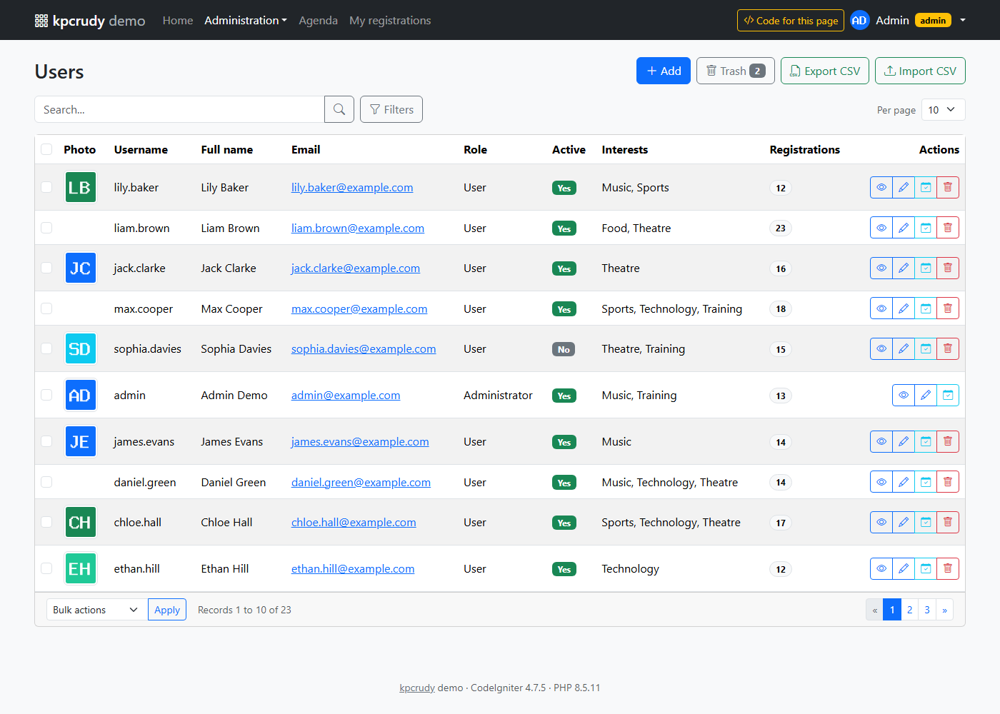
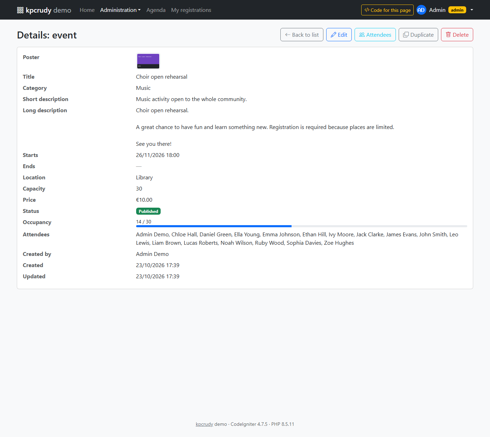
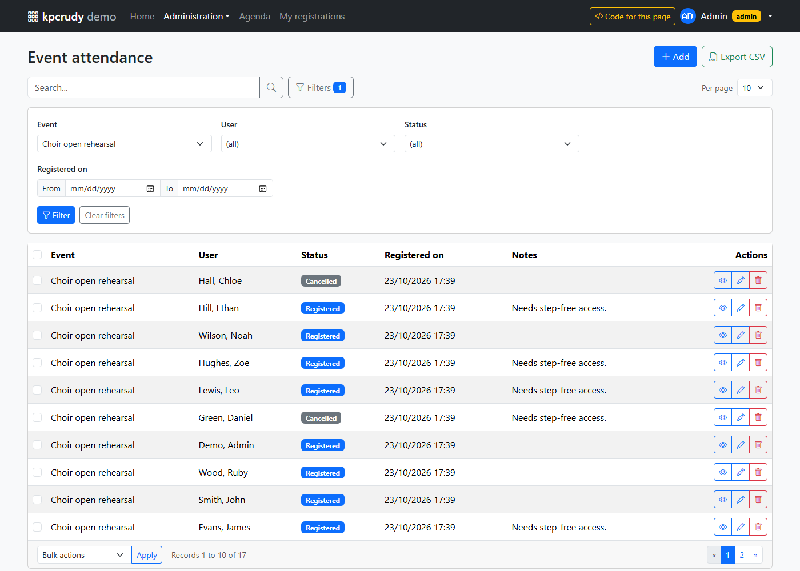
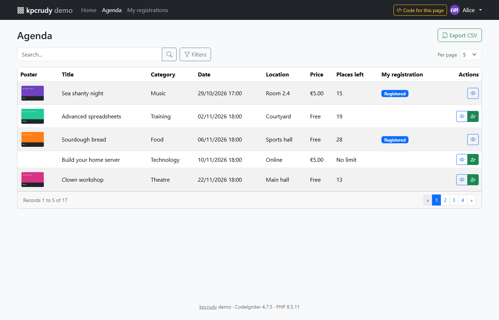
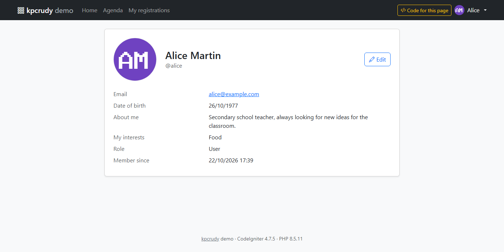

# kpcrudy · demo application

**English** · [Català](README_CA.md)

An event management application built to show every feature of the [kpcrudy](../README_EN.md) library. Each management screen is an automatic CRUD configured in a single controller method.

The demo is in English (data, texts and command messages), so it can be integrated into any project.

Every page has a **Code for this page** button in the top bar. It opens a panel with the code of the controller that generates the page and the list of features it demonstrates.

The demo is a **module of the library** ([src/Demo](../src/Demo)) and is installed with a `spark` command, both in your own project and in the project in this folder.

---

## Installing it in your project

Requirements: a CodeIgniter 4 project with kpcrudy installed, the database configured and, for the sample images, the `gd` extension.

```bash
php spark kpcrudy:demo install
```

Open `http://your-project/kpcrudy-demo`.

The command **does not copy or modify any file of the project**:

| What it creates | Where |
|---|---|
| 5 tables with sample data | `kpdemo_categories`, `kpdemo_users`, `kpdemo_user_interests`, `kpdemo_events`, `kpdemo_attendances` |
| Avatars and posters | `public/uploads/kpcrudy-demo/` |
| Marker file | `writable/kpcrudy-demo.json` |

The routes (`/kpcrudy-demo/...`) are registered by the library itself: CodeIgniter discovers the module's [src/Config/Routes.php](../src/Config/Routes.php) file, which only enables them if the marker file exists and it is not production (see the notes). The `kpdemo_` and `kpcrudy-demo` prefixes avoid any collision with the project's tables, URLs, files and session (for example, with its own `users` table or Shield's).

### Other actions

```bash
php spark kpcrudy:demo status       # what is installed and how many records each table has
php spark kpcrudy:demo reset        # restores the initial data (also from the "Reset data" button on the home page, outside production)
php spark kpcrudy:demo uninstall    # deletes tables, images and marker: the project is left as it was
```

| Option | Description |
|---|---|
| `--yes` | Does not ask for confirmation (`uninstall`, `reset`) |
| `--force` | `install`: if tables from a previous installation are left over, deletes them and starts again |
| `--allow-production` | `install`, `reset`: run even if `ENVIRONMENT` is `production`; with `install`, the demo routes are also registered there |

`uninstall` also works if an installation was left half-finished.

**Notes:**

- The demo uses the `default` database connection.
- The demo migrations are not recorded in the project's migration history: the installer runs them, so that the project's `php spark migrate:rollback` never touches them.
- If the project has route discovery disabled (`Config\Modules::$aliases` without `routes`), the command tells you the line you have to add to `app/Config/Routes.php`. The line registers nothing if the demo is not installed, but remove it when you uninstall it.
- In production (`CI_ENVIRONMENT = production`), `install` and `reset` refuse to run and the demo routes are not registered, unless it was installed with `--allow-production`. The reset from the web never exists in production.
- Do not upload `writable/kpcrudy-demo.json` to the repository or to production: it is what enables the demo routes.
- The demo is shown in English even if the project uses another language, including the library's texts.

---

## Running the project in this folder

This folder is an empty CodeIgniter 4 project set up to run the demo while the library is being developed. It loads kpcrudy directly from `../src`, registering the namespace in [app/Config/Autoload.php](app/Config/Autoload.php):

```php
public $psr4 = [
    APP_NAMESPACE => APPPATH,
    'Kpcrudy'     => ROOTPATH . '../src',
];
```

This way, any change to the library is visible immediately. A Composer `path` repository is not used because Composer cannot link a package inside a subfolder of itself.

```bash
cd demo
composer install

# Database (with XAMPP: user root, no password; configuration in .env)
mysql -u root -e "CREATE DATABASE demo_kpcrudy CHARACTER SET utf8mb4 COLLATE utf8mb4_unicode_ci"

php spark kpcrudy:demo install
php spark serve
```

Open <http://localhost:8080>: the root redirects to `/kpcrudy-demo`. If you use another port or URL, change `app.baseURL` in the [.env](.env) file.

---

## Logging in to the demo

To make testing easier, the login page **does not ask for a password**: it shows the list of users and you just click one to log in with their profile.

- **Administrators** (`admin`, `john.smith`): access to all pages.
- **Users** (for example `alice`): agenda, their own registrations and profile.

Deactivated or trashed users are not shown in the list and cannot log in. There are two of each in the sample data.

The passwords still exist in the database (`admin1234` for the administrator and `user1234` for everyone else) so that the password field of the user and profile CRUDs makes sense, but the login does not use them.

---

## Data model

```
kpdemo_categories ──< kpdemo_events ──< kpdemo_attendances >── kpdemo_users ──< kpdemo_user_interests >── kpdemo_categories
```

| Table | Contents | What it demonstrates |
|---|---|---|
| `kpdemo_users` | Username, password, first name, last name, email, photo, date of birth, bio, role, active | Trash, images, passwords, enum, boolean, unique rules |
| `kpdemo_categories` | Name, color and description | Model mode, color, table without trash |
| `kpdemo_events` | Category, title, short description, long description, start, end, venue, capacity, price, poster, status, creator | 1-N relations, date and time, decimal, image, range filters |
| `kpdemo_attendances` | User, event, status (`registered`, `attended`, `absent`, `cancelled`), registration date and notes | Join table with its own data: it has its own CRUD and also works as an N-N relation |
| `kpdemo_user_interests` | User and category | Pure N-N relation, editable from the form |

The tables are created with the **migrations** in [src/Demo/Database/Migrations](../src/Demo/Database/Migrations), and the sample data with the **seeder** [src/Demo/Database/Seeds/DemoSeeder.php](../src/Demo/Database/Seeds/DemoSeeder.php). The seeder is deterministic (it always generates the same data) and creates the avatars and posters with GD.

---

## Pages and features

All URLs start with `/kpcrudy-demo/`. The controllers are in [src/Demo/Controllers](../src/Demo/Controllers).

### Administration (`admin` role)

#### Users — `admin/users`
[Controllers/Admin/Users.php](../src/Demo/Controllers/Admin/Users.php)

- **Table mode** (`setTable`): the library detects the primary key, timestamps and soft deletes.
- **Trash**: deleting moves the record to the trash, from where it can be restored or permanently deleted.
- **Image** (`fieldType('avatar', 'image')`) with a thumbnail in the list.
- **Password**: stored with `password_hash()`; when editing, it does not change if left blank.
- **Editable N-N relation** (`setRelationNN`): the user's interests.
- **Virtual columns** (`callbackColumn`): full name and number of registrations.
- **Rules with `{id}`**: `is_unique[kpdemo_users.email,id,{id}]` ignores the record being edited.
- **Read-only field** when editing (`readonlyFields`): the username.
- **Per-record permission** (`setPermission('delete', fn)`): you cannot delete yourself.
- **Hook** `beforeUpdate`: you cannot remove your own administrator role.
- **Custom bulk actions**: activate and deactivate.
- **Per-row link** to the user's registrations, using URL filters.
- **CSV import** (`enableImport(['key' => 'username'])`): adds new users and updates existing ones by username. Passwords are stored hashed and interests are given by name (`Music, Sports`).



#### Categories — `admin/categories`
[Controllers/Admin/Categories.php](../src/Demo/Controllers/Admin/Categories.php) · [Models/CategoryModel.php](../src/Demo/Models/CategoryModel.php)

- **Model mode** (`setModel`): uses the model's validation, messages and timestamps.
- Table **without `deleted_at`**: there is no trash and deleting is permanent.
- **Color** field type.
- **Hook** `beforeDelete`: a category that has events cannot be deleted.
- No bulk actions or export (`unsetBulk`, `unsetExport`).

#### Events — `admin/events`
[Controllers/Admin/Events.php](../src/Demo/Controllers/Admin/Events.php)

- **1-N relations** with a template (`'{first_name} {last_name}'`): category and creator.
- Read-only **N-N relation**: attendees on the detail page and in the export.
- **Image, date and time, decimal, number, textarea and select** types.
- **Files in subfolders** (`subdir` option): each poster is stored in `posters/{year}/{month}/` according to the event date, and the field stores the relative path (`2026/11/abc123.png`). User avatars, on the other hand, all go into the same folder, so both cases can be compared.
- **Filters** by list (category, status) and by **range** (date, price).
- Calculated **occupancy column** with a progress bar.
- `callbackColumn` for the status and the price, and `callbackExport` for the price in the CSV.
- **Hooks**: `beforeInsert` assigns the creator and checks that the end is after the start.
- **Custom POST action** with confirmation: *Duplicate* (outside the CRUD, in `Events::duplicate`).
- Custom **bulk actions**: publish and cancel.
- **Header button** linking to the public agenda.
- **Export columns** different from the list columns (`exportColumns`).
- **CSV import** by id: you can use *Export CSV*, edit the file in a spreadsheet and import it with *Update the record if its "Id" already exists*. Categories and statuses are read by their text, and dates in the display format.
- `callbackImport`: the file can use `Free` as the price.



#### Attendance — `admin/attendances`
[Controllers/Admin/Attendances.php](../src/Demo/Controllers/Admin/Attendances.php)

- CRUD on a **join table with its own data**.
- Relations with **filtered and sorted options** (`where`, `order`): only active users and events that are not drafts.
- **Different fields for adding and editing**, with user and event read-only when editing.
- **Default values** (`setDefault`).
- **Hook** `beforeInsert`: prevents duplicates and checks the capacity.
- **Linkable filters**: reached from users and events with `?f[user_id]=…` or `?f[event_id]=…`.
- Custom **bulk actions**: mark as attended or absent.



### User area (any logged-in user)

#### Agenda — `agenda`
[Controllers/Agenda.php](../src/Demo/Controllers/Agenda.php)

- **Read-only** (`readOnly`) on the same table as the administration.
- `where()`: only **published and upcoming** events, also on the detail page and in the export.
- **POST action** *Join*, **visible only** if there are places left and you are not registered.
- **Calculated columns** for the logged-in user (free places, my registration). The data is calculated once before the CRUD, to avoid one query per row.



#### My registrations — `my/attendances`
[Controllers/MyAttendances.php](../src/Demo/Controllers/MyAttendances.php)

- `where('user_id', …)`: users only see and modify their own registrations.
- **Conditional per-row action**: cancel only active registrations for upcoming events.
- **Safe bulk action**: the identifiers it receives are already limited by the CRUD's `where()`.

#### My profile — `profile`
[Controllers/Profile.php](../src/Demo/Controllers/Profile.php) · [Views/kpcrudy/profile/show.php](../src/Demo/Views/kpcrudy/profile/show.php)

- **Single-record CRUD**: `where('id', logged-in user)`. Changing the id in the URL does not give access to any other profile.
- **Custom theme** `profile`: it only replaces `show.php`; the other templates are those of the `bootstrap5` theme.
- `setBackUrl()`: after saving, you go back to the profile detail page.
- **Limited fields**: users cannot change their role or username.
- **Editable N-N**: my interests. The photo and password can also be changed.



---

## How it is built

Everything is in [src/Demo](../src/Demo), with the `Kpcrudy\Demo` namespace:

| Element | File |
|---|---|
| `kpcrudy:demo` command | [src/Commands/Demo.php](../src/Commands/Demo.php) |
| Installation and uninstallation | [Installer.php](../src/Demo/Installer.php) |
| Names, routes, URLs and folders | [Demo.php](../src/Demo/Demo.php) · [src/Config/Routes.php](../src/Config/Routes.php) |
| Configuration of the demo CRUDs (layout, themes, pagination) | [Config/CrudConfig.php](../src/Demo/Config/CrudConfig.php) |
| Layout with menu and code panel | [Views/layouts/main.php](../src/Demo/Views/layouts/main.php) |
| Code panel (outside the controllers, so they only contain the CRUD code) | [Config/Showcase.php](../src/Demo/Config/Showcase.php) · [Controllers/BaseController.php](../src/Demo/Controllers/BaseController.php) |
| Simple session-based authentication | [Libraries/Auth.php](../src/Demo/Libraries/Auth.php) · [Filters/AuthFilter.php](../src/Demo/Filters/AuthFilter.php) |

Each controller creates the CRUD with `new Crud(new CrudConfig())`, so the demo neither depends on nor modifies the project's `app/Config/Kpcrudy.php`.

### Security

- All forms and POST actions (logout included) carry the CSRF token. The demo filters extend `CodeIgniter\Filters\CSRF` ([CsrfFilter](../src/Demo/Filters/CsrfFilter.php)): they verify the token if the project does not have the global `csrf` filter, and do nothing if it does (it is enabled in this project).
- The public pages (login and logout) use `CsrfFilter`, the user pages `AuthFilter` and the administration pages `AdminFilter`, one filter per route: since the class is used, there is no need to register any alias in `app/Config/Filters.php`.
- The user is reloaded on every request (also in worker mode): if an administrator deactivates them or moves them to the trash, they lose access instantly. On logout, the session gets a new id.
- The demo session uses its own key (`kpdemo_user_id`) and does not interfere with the project's login.
- Authentication is deliberately minimal because the focus is the library: you log in without a password by choosing the user. **Never use it outside a test environment.** In a real project, use [CodeIgniter Shield](https://shield.codeigniter.com/).
