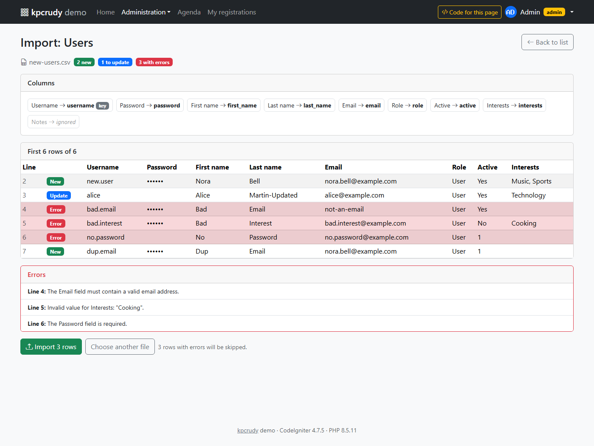

# Referència de funcions

[English](functions_EN.md) · **Català**

Totes les funcions i propietats públiques de **kpcrudy**, amb un exemple de cada una.

Gairebé tots els mètodes de configuració retornen la mateixa instància (`static`), de manera que es poden encadenar:

```php
$crud = new \Kpcrudy\Crud();
$crud->setTable('clients')
     ->setSubject('client', 'Clients')
     ->columns(['name', 'email']);

return $crud->render();
```

Per a receptes completes de casos habituals, vegeu [howto_CA.md](howto_CA.md).

## Índex

- [Creació i execució](#creació-i-execució): `__construct`, `render`, `routes`
- [Origen de dades](#origen-de-dades): `setTable`, `setModel`, `setDatabase`, `setPrimaryKey`, `setSubject`, `softDeletes`, `where`
- [Columnes i camps](#columnes-i-camps): `columns`, `fields`, `addFields`, `editFields`, `showFields`, `searchFields`, `filters`, `exportColumns`, `unsortable`, `displayAs`
- [Tipus de camp i validació](#tipus-de-camp-i-validació): `fieldType`, `setRules`, `requiredFields`, `readonlyFields`, `hideFields`, `setDefault`, `setHelp`
- [Relacions](#relacions): `setRelation`, `setRelationNN`
- [Traduccions](#traduccions): `setTranslations`, `postedTranslations`
- [Callbacks de presentació](#callbacks-de-presentació): `callbackColumn`, `callbackField`, `callbackExport`
- [Hooks](#hooks): `beforeInsert`, `afterInsert`, `beforeUpdate`, `afterUpdate`, `beforeDelete`, `afterDelete`, `afterRestore`, `afterWrite`
- [Accions](#accions): `addAction`, `addHeaderAction`, `addBulkAction`
- [Operacions pròpies](#operacions-pròpies): `addOperation`, `backToList`, `page`
- [Importació CSV](#importació-csv): `enableImport`, `callbackImport`
- [Permisos](#permisos): `setPermission`, `unsetAdd`, `unsetEdit`, `unsetDelete`, `unsetShow`, `unsetExport`, `unsetTrash`, `unsetPurge`, `unsetSearch`, `unsetFilters`, `unsetBulk`, `readOnly`, `setResource`, `getResource`, `setPermissionResolver`, `isAllowed`, `permissionCatalogue`, `impliedPermissions`, `PermissionResolver`, només els registres propis
- [Presentació i navegació](#presentació-i-navegació): `setPerPage`, `defaultOrder`, `setBaseUrl`, `setBackUrl`, `setTheme`, `setLayout`, `setLayoutData`, `showTitle`, `getTitle`
- [Accés des dels callbacks](#accés-des-dels-callbacks): `getModel`, `getTable`, `getPrimaryKey`, `getBaseUrl`, `url`
- [Identificadors emmascarats](#identificadors-emmascarats): `maskIds`, `encodeId`, `decodeId`, `maskId`, `unmaskId`, `idFromUrl`, `idForUrl`, `IdMasker`, `checkRoutes`
- [URL signades](#url-signades): `requireSignature`, `signedUrl`, `signUrl`, `checkSignature`, `hasValidSignature`
- [Constants](#constants): `ID_OPERATIONS`, `OPERATIONS`, `IMPLIED_PERMISSIONS`
- [Comandes de spark](#comandes-de-spark): `kpcrudy:make`, `kpcrudy:demo`, `kpcrudy:maskid`, `kpcrudy:unmaskid`, `kpcrudy:signurl`, `kpcrudy:checkurl`
- [Configuració global](#configuració-global): propietats de `Config\Kpcrudy`, idiomes
- [Plantilles](#plantilles): `Renderer::render`, `Renderer::renderParent`, `Renderer::locate`, `Renderer::hidden`, `Renderer::attrs`, `Renderer::nonce`, Content-Security-Policy, esdeveniment `kpcrudy:confirm`

---

## Creació i execució

### `__construct(?KpcrudyConfig $config = null)`

Crea un CRUD. Sense paràmetres, fa servir la configuració del projecte (`app/Config/Kpcrudy.php`, si existeix) o la de la llibreria. També es pot passar una configuració concreta, que ha d'estendre `Kpcrudy\Config\Kpcrudy`.

```php
use Kpcrudy\Crud;

$crud = new Crud();

// Amb una configuració pròpia per a una zona de l'aplicació
$crud = new Crud(new \Config\KpcrudyPublic());
```

### `render(): ResponseInterface|string`

Executa l'operació que correspon a la URL actual (llistat, formulari, fitxa, esborrat, exportació...) i en retorna el resultat. Pot ser HTML o una resposta (una redirecció o una descàrrega), així que el controlador l'ha de retornar tal qual.

```php
public function clients()
{
    $crud = new Crud();
    $crud->setTable('clients');

    return $crud->render();
}
```

Si vols posar el CRUD dins d'una vista pròpia, comprova primer si és una resposta (vegeu la recepta [CRUD dins d'una vista pròpia](howto_CA.md#crud-dins-duna-vista-pròpia)).

### `Crud::routes(RouteCollection $routes, string $path, string $handler, array $options = []): void` (estàtica)

Registra les dues rutes que necessita un CRUD, `path` i `path/(:any)`, per a GET i POST. `$options` són les opcions de ruta de CodeIgniter (`filter`, `as`...).

```php
// app/Config/Routes.php
use Kpcrudy\Crud;

Crud::routes($routes, 'admin/clients', 'Admin::clients');
Crud::routes($routes, 'admin/invoices', 'Admin\Invoices::index', ['filter' => 'auth:admin']);

// Dins d'un grup, les opcions del grup s'hereten
$routes->group('', ['filter' => 'auth'], static function ($routes) {
    Crud::routes($routes, 'my/orders', 'Orders::mine');
});

// La ruta pot tenir paràmetres: el controlador els rep primer
Crud::routes($routes, 'clients/(:segment)/notes', 'Clients::notes/$1');   // notes(string $code): l'id real amb Crud::idFromUrl($code, 'clients')

// Amb un nom de ruta
Crud::routes($routes, 'admin/clients', 'Admin::clients', ['as' => 'admin-clients']);
```

El nom (`as`) el porta **només la ruta base** (`admin/clients`); la ruta `admin/clients/(:any)` no en té. CodeIgniter no registra una segona ruta amb un nom que ja existeix, de manera que, si el portessin totes dues, les URL de les operacions (`add`, `edit/5`...) quedarien sense ruta. `route_to('admin-clients')` i `url_to('admin-clients')` donen la URL base del CRUD; per a una operació, afegeix-la al final (`url_to('admin-clients') . '/add'`) o fes servir [`url()`](#getbaseurl-string--urlstring-operation-string-id--null-string) del CRUD.

Les rutes que registra porten l'opció `'kpcrudy' => true`, que permet a [`Crud::checkRoutes()`](#crudcheckroutes-void-estàtica) trobar-les. En desenvolupament, `render()` comprova que cap altra ruta no xoqui amb les del CRUD: una ruta amb el mateix prefix definida **després** de `Crud::routes()` no s'executaria mai (`prefix/(:any)` la captura abans), i una de definida **abans** que capturi URL del CRUD (`prefix/add`, `prefix/edit/1`...) les deixaria sense funcionar. Les pàgines pròpies (p. ex. un enllaç públic amb l'[id emmascarat](#identificadors-emmascarats)) han d'anar amb un altre prefix.

Aquestes rutes són **estrictes**: després de la base del CRUD només s'accepta `operació` (`add`, `trash`, `export`...) o `operació/id` (`edit/5`, `show/Xk3f9QaLm2PwE7`); qualsevol altra cosa (`admin/clients/foo`, `admin/clients/edit/5/extra`) és un 404. Així cada pàgina té una sola URL, cosa que també fan servir les [URL signades](#url-signades). Amb rutes definides a mà (sense `Crud::routes()`), l'operació es dedueix dels darrers segments de la URL.

---

## Origen de dades

### `setTable(string $table): static`

El CRUD treballa directament amb la taula. Es crea un model dinàmic que detecta:

- la **clau primària** (camp `PRIMARY KEY`, o `id` si no se'n troba cap);
- els **timestamps** (`created_at` i `updated_at`, si existeixen);
- els **soft deletes** (`deleted_at`, si existeix), que activen la paperera.

```php
$crud->setTable('clients');
```

### `setModel(Model|string $model): static`

El CRUD treballa amb un model de CodeIgniter. Fa servir la seva taula, la clau primària, els `allowedFields`, la validació (regles i missatges), els timestamps, els soft deletes i els callbacks del model.

```php
$crud->setModel(\App\Models\ClientModel::class);

// O una instància ja creada
$crud->setModel(model('ClientModel'));
```

> Si les regles del model fan servir `{id}` (per exemple `is_unique[clients.email,id,{id}]`), a CodeIgniter 4.5+ el camp de la clau primària també ha de tenir una regla: `'id' => 'permit_empty|is_natural_no_zero'`. Kpcrudy hi afegeix l'identificador en editar: sempre l'id real, encara que la URL porti un [codi emmascarat](#identificadors-emmascarats).

### `setDatabase(BaseConnection|string $db): static`

Grup o connexió de base de dades. Només s'aplica en mode taula; en mode model, mana el model.

```php
$crud->setTable('legacy_products')->setDatabase('legacy');
```

### `setPrimaryKey(string $primaryKey): static`

Força la clau primària quan no es pot detectar (per exemple, en una vista o en una taula sense `PRIMARY KEY`).

Un id de la URL o del formulari que no pot ser un valor vàlid de la clau (p. ex. `5abc` en una clau entera) es tracta com un registre inexistent.

```php
$crud->setTable('countries')->setPrimaryKey('iso_code');
```

### `setSubject(string $singular, ?string $plural = null): static`

Noms del tipus de registre per als títols ("Nou: client", "Edita: client") i els missatges. El plural és el títol del llistat. Si no se'n posa, es fa servir el nom de la taula.

```php
$crud->setSubject('client', 'Clients');
```

### `softDeletes(bool $enabled = true, string $field = 'deleted_at'): static`

Activa o desactiva la paperera en mode taula. Per defecte s'activa sola si la taula té el camp `deleted_at`. En mode model, mana `useSoftDeletes` del model.

```php
// La taula fa servir un altre nom de camp
$crud->setTable('posts')->softDeletes(true, 'removed_at');

// Té deleted_at, però vols esborrats definitius
$crud->setTable('logs')->softDeletes(false);
```

### `where(array|string $field, mixed $value = null): static`

Limita els registres que gestiona el CRUD. La condició s'aplica a **tot**: llistat, cerca, exportació, fitxa, edició, esborrat i accions massives. Un usuari no pot accedir a un registre de fora de l'abast encara que en canviï l'id a la URL.

Accepta el format del `where()` del Query Builder, operadors inclosos. Es pot cridar més d'una vegada.

```php
$crud->where('company_id', session('company_id'));
$crud->where('price >', 0);
$crud->where(['status' => 'published', 'deleted_by' => null]);
```

Les condicions d'**igualtat simples** (`camp => valor` amb un valor escalar o `null`, sense operador, amb el nom de la taula al davant o sense) també s'apliquen en **desar**:

- el camp no surt als formularis d'alta i d'edició;
- es desa sempre amb el valor de la condició, tant des del formulari com des de la importació CSV (encara que el camp no sigui a `fields()` i encara que un hook `before*` hi posi un altre valor);
- després de desar, el registre ha de continuar dins l'abast del CRUD; si no hi és (p. ex. per una condició amb operador), es desfà el canvi i es mostra l'error "No tens permís per fer aquesta operació".

Als exemples anteriors, `company_id`, `status` i `deleted_by` es desen sempre amb el valor indicat; `price >` no assigna res, però un preu que no la compleixi no es pot desar.

> Per a les condicions amb operador, el valor dels registres nous l'has d'assignar tu, amb `fieldType('camp', 'hidden', ['value' => ...])`, `setDefault()` o un hook (vegeu la recepta [Limitar el CRUD a l'usuari connectat](howto_CA.md#limitar-el-crud-a-lusuari-connectat)).

---

## Columnes i camps

Si no es configuren, aquests són els valors per defecte:

| Llista | Per defecte |
|---|---|
| Columnes del llistat | Tots els camps menys `deleted_at` i els camps secrets |
| Camps dels formularis | Tots menys la clau primària, els timestamps i els camps secrets (les contrasenyes sí), més les relacions N-N |
| Camps de la fitxa | Tots menys `deleted_at` i els camps secrets, més les relacions N-N |
| Cerca | Columnes de text, número, enum i relació 1-N, menys les que tenen `callbackColumn` |
| Filtres | Columnes de tipus relació, enum, select i booleà |
| Exportació | Les columnes del llistat |

Els **camps secrets** són els que tenen un nom de [`$sensitiveFields`](#configuració-global) (`password`, `token`, `secret`, `salt`, `hash`, `apikey`, `otp`...): el nom sencer, el nom sense `_` (`api_key`) o qualsevol part separada per `_` (`reset_token`, `password_hash`). Per defecte no surten al llistat, la fitxa, la cerca, l'ordenació, els filtres, l'exportació ni els formularis; els camps de tipus `password` sí que surten als formularis (es desen amb hash). Si en necessites algun, indica'l explícitament a `columns()`, `showFields()`, `fields()`, `searchFields()`, `exportColumns()`... A la previsualització de la importació, els seus valors surten emmascarats.

### `columns(array $columns): static`

Columnes del llistat, en ordre. Hi pots posar camps de la taula, relacions i **columnes virtuals** (noms que no existeixen a la taula i que es pinten amb `callbackColumn()`).

```php
$crud->columns(['photo', 'name', 'email', 'city_id', 'total_orders']);
```

### `fields(array $fields): static`

Camps dels formularis d'alta **i** d'edició.

```php
$crud->fields(['name', 'email', 'city_id', 'notes']);
```

### `addFields(array $fields): static` · `editFields(array $fields): static`

Camps diferents per a l'alta i per a l'edició.

```php
$crud->addFields(['username', 'password', 'email'])
     ->editFields(['email', 'password', 'active']);
```

### `showFields(array $fields): static`

Camps de la fitxa de detall.

```php
$crud->showFields(['name', 'email', 'city_id', 'tags', 'notes', 'created_at']);
```

### `searchFields(array $fields): static`

Camps on busca el cercador general. Si hi poses una relació 1-N, es busca pel text que es mostra (p. ex. el nom de la ciutat, no l'id). Els caràcters `%` i `_` del text cercat es busquen literalment, no com a comodins.

Per defecte no es busca a les columnes amb `callbackColumn()`, perquè el callback pot amagar el valor real (p. ex. mostrar `****`) i la cerca el revelaria. Si vols que s'hi busqui, posa-les aquí explícitament.

```php
$crud->searchFields(['name', 'email', 'city_id']);
```

### `filters(array $fields): static`

Camps amb filtre al panell de filtres. El tipus de filtre depèn del tipus de camp:

- **desplegable**: relacions 1-N i N-N, enum, select i booleà;
- **rang** (des de / fins a): data, data i hora, número i decimal;
- **text** (conté): la resta.

Amb un array buit no hi ha filtres. Els valors de filtre no vàlids (un rang que no és numèric, un valor de desplegable que no és cap de les opcions) s'ignoren.

```php
$crud->filters(['city_id', 'status', 'active', 'tags', 'created_at', 'price']);
```

### `exportColumns(array $columns): static`

Columnes del CSV, si han de ser diferents de les del llistat.

L'exportació necessita els permisos `export` i `list`, llegeix els registres per blocs i té un límit de files ([`$exportMaxRows`](#configuració-global)): si el llistat filtrat en té més, es torna al llistat amb un avís perquè l'usuari el filtri. Els valors que comencen per `=`, `+`, `-` o `@` (també amb espais o salts de línia al davant, i les variants d'amplada completa) es neutralitzen amb un apòstrof per evitar la injecció de fórmules.

```php
$crud->exportColumns(['id', 'name', 'email', 'phone', 'city_id', 'created_at']);
```

### `unsortable(array $columns): static`

Columnes que no es poden ordenar fent clic a la capçalera. Les columnes virtuals i les relacions N-N ja no són ordenables. Les columnes amb `callbackColumn()` sí que ho són: si l'ordre podria revelar el valor que el callback amaga, posa-les aquí.

```php
$crud->unsortable(['notes', 'photo']);
```

### `displayAs(array|string $field, ?string $label = null): static`

Etiqueta d'un camp o d'una columna. Sense etiqueta, es fa servir el nom del camp amb la primera lletra en majúscula, i a les relacions es treu el sufix `_id` (`city_id` → "City").

```php
$crud->displayAs('city_id', 'Ciutat');

$crud->displayAs([
    'name'    => 'Nom',
    'email'   => 'Correu',
    'city_id' => 'Ciutat',
]);
```

---

## Tipus de camp i validació

### `fieldType(string $field, string $type, array $options = []): static`

Força el tipus d'un camp. Si no es força, es dedueix de la base de dades (enter, decimal, data, `TINYINT(1)`, `ENUM`, `TEXT`...) i del nom (`email`, `password`, `url`).

| Tipus | Formulari | Llistat |
|---|---|---|
| `text` | input de text | text retallat |
| `textarea` | àrea de text | text retallat (complet a la fitxa) |
| `number` | número enter | número |
| `decimal` | número amb decimals | número |
| `email` | input email | enllaç `mailto:` |
| `url` | input url | enllaç (només si és `http`/`https`; si no, text) |
| `password` | contrasenya (amb hash) | no es mostra |
| `date` | selector de data | `dateFormat` |
| `datetime` | data i hora | `datetimeFormat` |
| `time` | hora | hora |
| `color` | selector de color | mostra de color (només colors `#rrggbb`) |
| `boolean` | interruptor | Sí / No |
| `enum` | desplegable | etiqueta |
| `select` | desplegable | etiqueta |
| `multiselect` | diverses caselles | etiquetes separades per comes |
| `hidden` | camp ocult | valor |
| `readonly` | només lectura | valor |
| `upload` | fitxer | enllaç |
| `image` | imatge | miniatura |

Opcions:

| Opció | Tipus | Descripció |
|---|---|---|
| `options` | `enum`, `select`, `multiselect` | `[valor => etiqueta]`. Als `ENUM` de MySQL, si no s'indica, s'agafen els valors de la columna |
| `storage` | `multiselect` | Com es desen els valors a la columna: `'json'` (per defecte, `["kids","adults"]`) o `'csv'` (`kids,adults`) |
| `value` | `hidden` | Valor que es desa sempre, a l'alta i a l'edició. El camp no surt al formulari, però ha de ser a la llista de camps (`fields()` o la per defecte) |
| `hash` | `password` | `true` (per defecte): es desa amb `password_hash()`. `false`: es desa tal qual |
| `path` | `upload`, `image` | Directori on es desen els fitxers. Per defecte, `uploadPath/{taula}` |
| `url` | `upload`, `image` | URL pública d'aquest directori |
| `subdir` | `upload`, `image` | Subcarpeta per a cada fitxer nou: text amb `{camp}` o `fn (array $data, ?array $record): string` |
| `allowed` | `upload`, `image` | Extensions permeses (array o text separat per comes) |
| `maxSize` | `upload`, `image` | Mida màxima en KB |
| `deleteFiles` | `upload`, `image` | `true` (per defecte): esborra el fitxer en esborrar definitivament el registre. Només s'esborren fitxers que siguin dins del directori del camp (`path`) |
| `attrs` | tots | Atributs HTML de l'input: `['placeholder' => ..., 'min' => 0]` |

```php
$crud->fieldType('notes', 'textarea', ['attrs' => ['rows' => 8]])
     ->fieldType('status', 'select', ['options' => ['draft' => 'Esborrany', 'published' => 'Publicat']])
     ->fieldType('company_id', 'hidden', ['value' => session('company_id')])
     ->fieldType('photo', 'image', ['maxSize' => 1024])
     ->fieldType('contract', 'upload', ['allowed' => ['pdf'], 'subdir' => '{client_id}'])
     ->fieldType('price', 'decimal', ['attrs' => ['min' => 0, 'step' => '0.01']])
     ->fieldType('code', 'readonly');
```

**`multiselect`**: diversos valors d'una llista fixa en **una sola columna** (una columna `VARCHAR`, `TEXT` o `JSON`), sense taula intermèdia. Si els valors són registres d'una altra taula, fes servir [`setRelationNN()`](#relacions).

- Només es desen els valors que són a `options`: els altres (un formulari manipulat, una opció que ja no existeix) es descarten. Sense cap valor triat, la columna es desa com a `NULL` (o `''` si no admet `NULL`).
- Al llistat i a la fitxa es mostren les etiquetes separades per comes.
- Com a [filtre](#filtersarray-fields-static), mostra les opcions i troba els registres que **contenen** el valor triat. Per defecte no entra a la cerca.
- A la [importació CSV](#importació-csv), la columna porta valors o etiquetes separats per `,` o `|` (`Infants, Adults`); un valor desconegut és un error d'aquella fila.

```php
$crud->fieldType('audience', 'multiselect', [
    'options' => ['kids' => 'Infants', 'adults' => 'Adults', 'seniors' => 'Gent gran'],
])->filters(['audience']);

// Es desa com a "mon,wed,fri" en lloc de JSON
$crud->fieldType('days', 'multiselect', ['options' => ['mon' => 'Dilluns', 'wed' => 'Dimecres', 'fri' => 'Divendres'], 'storage' => 'csv']);
```

### `setRules(array|string $field, array|string|null $rules = null): static`

Regles de validació de CodeIgniter. `{id}` se substitueix per l'identificador real del registre que s'edita (buit a l'alta), també si la URL porta un codi emmascarat. Les regles es poden passar com a text separat per `|` o com a array; fes servir l'array si una regla conté `|`, com ara `regex_match`.

Si un camp té regles pròpies, no se n'hi dedueixen d'automàtiques (vegeu `$inferRules`).

```php
$crud->setRules('email', 'required|valid_email|is_unique[clients.email,id,{id}]');

$crud->setRules([
    'name'  => 'required|min_length[3]',
    'phone' => ['permit_empty', 'regex_match[/^[0-9 +]{9,15}$/]'],
]);
```

> En edició, la regla `required` d'un camp `password` s'ignora: deixar-lo en blanc vol dir no canviar la contrasenya. A l'alta, si la columna és `NOT NULL` sense valor per defecte, la contrasenya és obligatòria (regla deduïda).

### `requiredFields(array $fields): static`

Afegeix la regla `required` als camps indicats, a més de les que ja tinguin.

```php
$crud->requiredFields(['city_id', 'phone']);
```

### `readonlyFields(array $fields): static`

Camps que es mostren al formulari d'**edició** però no es poden modificar. A l'alta són editables. Per a un camp que no s'ha de poder editar mai, fes servir `fieldType($camp, 'readonly')`.

```php
$crud->readonlyFields(['username', 'created_by']);
```

### `hideFields(array $fields): static`

Amaga camps **de tot arreu** amb una sola crida: llistat, fitxa, formularis d'alta i edició, cerca, filtres, ordenació, exportació CSV i importació CSV. Si un camp ocult arriba en un POST o en un fitxer CSV, no es desa. Té prioritat sobre `columns()`, `fields()`, `showFields()`, `exportColumns()`, `searchFields()`, `filters()` i `enableImport(['fields' => ...])`, de manera que es pot cridar al final, segons un permís, sense haver de treure el camp de cada llista (i sense oblidar-se, per exemple, de l'exportació).

```php
$crud->setTable('staff')
     ->columns(['name', 'department', 'salary'])
     ->exportColumns(['name', 'department', 'salary', 'bank_account']);

if (! auth()->user()->can('staff.salary')) {
    $crud->hideFields(['salary', 'bank_account']);   // llistat, fitxa, formularis, cerca, CSV...
}
```

Funciona amb camps de la taula, columnes virtuals, relacions N-N i camps traduïts. La llibreria aquí no decideix res sobre permisos: és el teu codi qui decideix quan amagar. Els registres continuen tenint el valor (per exemple, un resolutor de permisos o una closure `visible` el poden fer servir), però mai no es mostra ni s'escriu.

### `setDefault(string $field, mixed $value): static`

Valor inicial d'un camp al formulari d'**alta**. L'usuari el pot canviar. Si no se'n posa cap, es fa servir el valor per defecte de la columna a la base de dades.

```php
$crud->setDefault('status', 'draft')
     ->setDefault('date', date('Y-m-d'))
     ->setDefault('tags', [1, 3]);   // relació N-N: ids seleccionats
```

### `setHelp(string $field, string $text): static`

Text d'ajuda sota el camp al formulari.

```php
$crud->setHelp('capacity', 'Deixa-ho en blanc si no hi ha límit de places.');
```

---

## Relacions

### `setRelation(string $field, string $table, string $display, array $options = []): static`

Relació **1-N**: el camp `$field` és una clau forana cap a `$table`. Al formulari surt un desplegable, i al llistat, a la fitxa, a la cerca, a l'ordenació i al CSV es mostra el text de la taula relacionada.

`$display` pot ser un camp (`'name'`) o una plantilla amb diversos camps (`'{last_name}, {first_name}'`).

| Opció | Per defecte | Descripció |
|---|---|---|
| `pk` | `'id'` | Clau primària de la taula relacionada |
| `where` | `[]` | Condicions per a les opcions del desplegable |
| `order` | primer camp de `$display` | Ordre de les opcions |

Els valors que arriben del formulari es validen contra les opcions permeses (incloent-hi el `where`).

```php
$crud->setRelation('city_id', 'cities', 'name');

$crud->setRelation('manager_id', 'users', '{last_name}, {first_name}', [
    'where' => ['role' => 'manager', 'deleted_at' => null],
    'order' => 'last_name',
]);
```

### `setRelationNN(string $name, string $junction, string $otherTable, string $thisKey, string $otherKey, string $display, array $options = []): static`

Relació **N-N** a través d'una taula intermèdia. `$name` és un camp virtual que pots posar a `columns()`, `fields()`, `showFields()`, `filters()` i `exportColumns()`. Al formulari surt un desplegable múltiple; en desar, es reescriuen les files de la taula intermèdia que corresponen a opcions que l'usuari podia triar (respectant el `where` de la relació). Els enllaços amb registres de fora d'aquestes opcions es mantenen.

| Paràmetre | Exemple | Descripció |
|---|---|---|
| `$name` | `'tags'` | Nom del camp virtual |
| `$junction` | `'client_tag'` | Taula intermèdia |
| `$otherTable` | `'tags'` | Taula relacionada |
| `$thisKey` | `'client_id'` | Camp de la intermèdia que apunta a aquesta taula |
| `$otherKey` | `'tag_id'` | Camp de la intermèdia que apunta a la relacionada |
| `$display` | `'name'` | Camp o plantilla a mostrar |
| `$options` | | `pk`, `where`, `order` (com a `setRelation`) |

```php
$crud->setRelationNN('tags', 'client_tag', 'tags', 'client_id', 'tag_id', 'name');
$crud->columns(['name', 'tags'])->filters(['tags']);
```

> En esborrar definitivament un registre, se n'esborren les files de la taula intermèdia. Si la intermèdia té més dades que les dues claus (estat, data...), no la posis als `fields()`: en desar el formulari es perdrien. Fes-ne un CRUD propi (vegeu la recepta [Taula intermèdia amb dades pròpies](howto_CA.md#taula-intermèdia-amb-dades-pròpies)).

---

## Traduccions

### `setTranslations(string $table, string $foreignKey, string $localeField, array $fields, array $locales, array $options = []): static`

Camps traduïbles desats en una taula filla, **una fila per idioma**. Per exemple, `news` (`id`, `published_at`...) i `news_translations` (`news_id`, `locale`, `title`, `body`).

- `$table`: la taula de traduccions.
- `$foreignKey`: el camp de la taula de traduccions que apunta a aquesta (`news_id`).
- `$localeField`: el camp amb el codi d'idioma (`locale`).
- `$fields`: els camps traduïbles (columnes de la taula de traduccions).
- `$locales`: els idiomes, `['ca', 'en']` o amb nom, `['ca' => 'Català', 'en' => 'English']`.

| Opció | Per defecte | Descripció |
|---|---|---|
| `required` | el primer idioma | Idiomes que s'han d'omplir (llista). Els altres són opcionals |
| `rules` | deduïdes de la taula de traduccions | `[camp => regles]`, com a `setRules()` |
| `types` | deduïts (`TEXT` => `textarea`; si no, `text`) | `[camp => 'text' \| 'textarea']` |
| `listLocale` | l'idioma de la petició si és un dels de `$locales`; si no, el primer | Idioma del llistat, la cerca, l'ordenació, els filtres i l'exportació |

Els camps traduïts es fan servir com qualsevol altre camp a `columns()`, `fields()`, `showFields()`, `searchFields()`, `filters()`, `displayAs()`...:

- **Llistat, cerca, ordenació, filtres i exportació**: treballen amb la traducció de `listLocale` (un `LEFT JOIN` amb la taula de traduccions). Un registre sense traducció en aquest idioma mostra el camp buit.
- **Formulari**: tots els camps traduïts van junts en un bloc amb **una pestanya per idioma** (plantilla `partials/translations`). Els idiomes obligatoris es marquen.
- **Fitxa**: cada camp mostra totes les traduccions omplertes, precedides d'una etiqueta amb el codi d'idioma.
- **Validació**: les regles s'apliquen per idioma; les claus dels errors són `kp_tr.{locale}.{camp}` (p. ex. `kp_tr.en.title`). La regla `required` només s'aplica als **idiomes obligatoris**: un idioma opcional que es deixa del tot buit no es valida, i si s'ha omplert només es valida el que s'hi ha escrit.
- **Desar**: s'escriu (o s'actualitza) una fila per cada idioma omplert, a la mateixa transacció que el registre. Un idioma opcional que es deixa buit **s'esborra** de la taula de traduccions. Un esborrat definitiu (o una taula sense paperera) també n'esborra les traduccions; enviar-lo a la paperera les conserva.
- Funcionen amb `setTable()` i amb `setModel()`: els camps traduïts no són columnes de la taula principal, així que **no** van als `allowedFields` del model.
- No entren a la [importació CSV](#importació-csv).

```php
$crud->setTable('news')
     ->setTranslations('news_translations', 'news_id', 'locale', ['title', 'body'],
         ['ca' => 'Català', 'en' => 'English', 'es' => 'Español'],
         ['required' => ['ca', 'en'], 'rules' => ['title' => 'required|max_length[200]']])
     ->columns(['title', 'published_at'])
     ->fields(['published_at', 'title', 'body'])
     ->searchFields(['title']);
```

### `postedTranslations(): array`

Les traduccions enviades amb el formulari que s'està desant, com a `[locale => [camp => valor]]` (valors sense espais als extrems; també hi són els idiomes buits). Serveix en un hook `beforeInsert` o `beforeUpdate`, que només reben les dades de la taula principal.

```php
$crud->beforeInsert(function (array $data) use ($crud) {
    $data['slug'] = url_title($crud->postedTranslations()['ca']['title'] ?? '', '-', true);

    return $data;
});
```

---

## Callbacks de presentació

### `callbackColumn(string $column, Closure $callback): static`

Personalitza com es mostra un valor al **llistat** i a la **fitxa**: `fn (mixed $value, array $row): string`. Retorna **HTML**, així que has d'escapar les dades amb `esc()`. També serveix per crear columnes virtuals.

Una columna amb `callbackColumn` no es fa servir per cercar si no la poses a `searchFields()` (el callback pot amagar el valor real). Continua sent ordenable; si l'ordre podria revelar el valor, afegeix-la a `unsortable()`.

```php
// Format de moneda
$crud->callbackColumn('price', fn ($value) => esc(number_format((float) $value, 2, ',', '.')) . ' €');

// Insígnia de color segons l'estat
$crud->callbackColumn('status', fn ($value) => match ($value) {
    'paid'    => '<span class="badge text-bg-success">Pagada</span>',
    'pending' => '<span class="badge text-bg-warning">Pendent</span>',
    default   => esc($value),
});

// Columna virtual que combina camps
$crud->columns(['full_name', 'email'])
     ->callbackColumn('full_name', fn ($value, array $row) => esc($row['first_name'] . ' ' . $row['last_name']));
```

### `callbackField(string $field, Closure $callback): static`

Substitueix l'input d'un camp al formulari: `fn (mixed $value, ?array $row, array $field): string`. `$row` és el registre en edició (`null` a l'alta) i `$field` conté les dades que faria servir la plantilla (`label`, `required`, `error`, `options`...). L'input ha de fer servir `name="{camp}"`.

```php
$crud->callbackField('rating', fn ($value) =>
    '<input type="range" class="form-range" min="1" max="5" name="rating" value="' . esc((string) ($value ?? 3), 'attr') . '">'
);
```

### `callbackExport(string $column, Closure $callback): static`

Valor d'una columna al CSV: `fn (mixed $value, array $row): string`. Si no n'hi ha, es fa servir `callbackColumn` sense l'HTML, o el text que es veu al llistat.

```php
// Al llistat "1.234,50 €", al CSV un número que el full de càlcul entengui
$crud->callbackExport('price', fn ($value) => number_format((float) $value, 2, ',', ''));
```

---

## Hooks

Els hooks s'executen en desar o esborrar. Els `before*` poden aturar l'operació:

| Retorn | Efecte |
|---|---|
| `null` | Continua sense canvis |
| `array` | Continua amb aquestes dades (només `beforeInsert` i `beforeUpdate`) |
| `string` | S'atura i es mostra el text com a error |
| `false` | S'atura amb el missatge genèric "S'ha cancel·lat l'operació" |

Les dades que reben són les que s'escriuran a la base de dades: la contrasenya ja amb hash, les dates en format `Y-m-d H:i:s`, i sense els camps de només lectura ni les relacions N-N.

### `beforeInsert(Closure $callback): static`

`fn (array $data): array|string|false|null`

```php
$crud->beforeInsert(function (array $data) {
    $data['created_by'] = session('user_id');
    $data['slug']       = url_title($data['title'], '-', true);

    return $data;
});
```

### `afterInsert(Closure $callback): static`

`fn (string $id, array $data): void`. S'executa després de desar, amb l'id del registre nou.

```php
$crud->afterInsert(fn (string $id, array $data) => log_message('info', "Client {$id} creat: {$data['name']}"));
```

### `beforeUpdate(Closure $callback): static`

`fn (array $data, string $id, array $old): array|string|false|null`. `$old` és el registre tal com era abans de desar.

```php
$crud->beforeUpdate(function (array $data, string $id, array $old) {
    if ($old['status'] === 'closed') {
        return 'Una factura tancada no es pot modificar.';
    }

    return null;
});
```

### `afterUpdate(Closure $callback): static`

`fn (string $id, array $data, array $old): void`

```php
$crud->afterUpdate(function (string $id, array $data, array $old) {
    if (($data['status'] ?? null) === 'shipped' && $old['status'] !== 'shipped') {
        service('email')->setTo($old['email'])->setSubject('Comanda enviada')->send();
    }
});
```

### `beforeDelete(Closure $callback): static`

`fn (string $id, array $row, bool $purge): string|false|null`. `$purge` és `true` si l'esborrat és definitiu (o la taula no té paperera) i `false` si el registre va a la paperera.

```php
$crud->beforeDelete(function (string $id, array $row, bool $purge) {
    $orders = db_connect()->table('orders')->where('client_id', $id)->countAllResults();

    return $orders > 0 ? "No es pot esborrar: té {$orders} comandes." : null;
});
```

### `afterDelete(Closure $callback): static`

`fn (string $id, array $row, bool $purge): void`

```php
$crud->afterDelete(function (string $id, array $row, bool $purge) {
    if ($purge) {
        cache()->delete("client_{$id}");
    }
});
```

### `afterRestore(Closure $callback): static`

`fn (string $id, array $row): void`. S'executa en restaurar un registre de la paperera.

```php
$crud->afterRestore(fn (string $id) => log_message('info', "Client {$id} restaurat"));
```

### `afterWrite(Closure $callback): static`

`fn (string $operation, string $id, array $data, ?array $old): void`. S'executa després de **qualsevol** escriptura que fa el CRUD, per tenir en un sol lloc un registre d'auditoria, buidar una memòria cau, etc.

- `$operation`: `'insert'`, `'update'`, `'delete'` (a la paperera o definitiu) o `'restore'`.
- `$data`: els valors desats (buit a `delete` i `restore`).
- `$old`: el registre abans del canvi (`null` a `insert`).

S'executa **després** del hook `after*` específic de l'operació (`afterInsert`, `afterUpdate`...), i també en les escriptures que fan les accions massives (esborrar, restaurar, esborrar definitivament, buidar la paperera) i la [importació CSV](#importació-csv).

```php
$crud->afterWrite(function (string $operation, string $id, array $data, ?array $old) {
    db_connect()->table('audit_log')->insert([
        'user_id'    => session('user_id'),
        'table_name' => 'clients',
        'record_id'  => $id,
        'operation'  => $operation,
        'changes'    => json_encode($data),
        'created_at' => date('Y-m-d H:i:s'),
    ]);

    cache()->delete('clients_count');
});
```

---

## Accions

### `addAction(string $label, Closure|string $url, array $options = []): static`

Afegeix un botó a **cada fila** del llistat i a la **fitxa**. Se'n poden afegir tants com calgui.

La URL pot ser:

- un **text** amb `{id}` (clau primària), `{kp_id}` (l'id tal com surt a les URL del CRUD: [emmascarat](#identificadors-emmascarats) si s'ha activat `maskIds()`, i si no, l'id real) i `{camp}` (qualsevol camp del registre), que es codifiquen per a la URL. Si és relativa, passa per `site_url()`;
- una **closure** `fn (array $row): string` que retorna la URL completa. Només es fa servir si és relativa o comença per `http:`, `https:`, `mailto:` o `tel:`; si no (p. ex. `javascript:`), el botó porta a `#`.

> **`{id}` i `{kp_id}` sempre són la clau primària**, es digui com es digui el camp (`id`, `codi`, `nif`...): la que la llibreria detecta a la taula o la indicada amb `setPrimaryKey()` (o al model). Si la clau es diu `codi`:
>
> | Marcador | Valor |
> |---|---|
> | `{id}` | el valor real de `codi` |
> | `{codi}` | el mateix: és un camp del registre |
> | `{kp_id}` | el valor de `codi` tal com surt a les URL del CRUD (emmascarat si hi ha `maskIds()`) |
> | `{kp_codi}` | **no existeix**: es canvia per un text buit i l'enllaç queda trencat |
>
> El prefix `kp_` només existeix per a la clau (`{kp_id}`). I si la taula té un camp anomenat `id` que no és la clau, `{id}` continua donant la clau: per al camp, fes servir una closure (`fn ($row) => '...' . $row['id']`).

| Opció | Per defecte | Descripció |
|---|---|---|
| `icon` | cap | Classe de la icona, p. ex. `'bi bi-receipt'` ([Bootstrap Icons](https://icons.getbootstrap.com/)). Amb icona, el botó del llistat només mostra la icona |
| `class` | `'btn-outline-secondary'` | Classe del botó |
| `target` | cap | `'_blank'` per obrir en una pestanya nova. L'enllaç porta `rel="noopener noreferrer"` |
| `confirm` | cap | Missatge de confirmació abans d'executar l'acció |
| `visible` | sempre | `fn (array $row): bool` per mostrar-la només en alguns registres |
| `method` | `'get'` | `'post'` per a accions que modifiquen dades. S'envia un formulari amb el token CSRF |
| `permission` | cap | Operació o permís que l'usuari ha de tenir sobre el registre (p. ex. `'edit'` o `'invoice'`) perquè surti el botó. Es comprova com les operacions del CRUD: amb [`setPermission()`](#setpermissionstring-operation-boolclosure-allowed-static) i el [resolutor de permisos](#permisos-centralitzats) |

El botó només és un enllaç: si la URL porta a una ruta pròpia, aquella ruta ha de comprovar els permisos pel seu compte. Amb [`addOperation()`](#operacions-pròpies), la comprovació la fa el CRUD.

```php
// {kp_id}: l'id tal com surt a les URL del CRUD (un codi si està emmascarat).
// La ruta de destí, amb (:segment), n'obté l'id real amb Crud::idFromUrl()
$crud->addAction('Factures', 'invoices/client/{kp_id}', ['icon' => 'bi bi-receipt']);

$crud->addAction('Mapa', 'https://www.openstreetmap.org/search?query={address}', [
    'icon' => 'bi bi-geo-alt', 'target' => '_blank',
]);

$crud->addAction('Envia recordatori', 'clients/remind/{kp_id}', [
    'method'     => 'post',
    'confirm'    => 'Vols enviar el recordatori?',
    'visible'    => fn (array $row) => $row['balance'] > 0,
    'permission' => 'edit',   // només als registres que l'usuari pot editar
]);
```

### `addHeaderAction(string $label, string $url, array $options = []): static`

Afegeix un botó a la **capçalera** del llistat, al costat d'"Afegeix". Accepta les mateixes opcions que `addAction()`. `visible` rep `null`.

```php
$crud->addHeaderAction('Importa CSV', 'clients/import', ['icon' => 'bi bi-upload']);
$crud->addHeaderAction('Recalcula saldos', 'clients/recalculate', ['method' => 'post', 'confirm' => 'Pot trigar uns minuts. Continuar?']);
```

### `addBulkAction(string $key, string $label, Closure $callback, array $options = []): static`

Acció sobre els registres **seleccionats** amb les caselles: `fn (array $ids, Crud $crud): string|ResponseInterface|null`.

`$ids` només conté identificadors que existeixen i que són dins de l'abast del CRUD (`where()`), encara que algú manipuli el formulari. Si el callback retorna un text, es mostra com a missatge; si retorna una resposta (una descàrrega, una redirecció...), es retorna tal qual.

| Opció | Per defecte | Descripció |
|---|---|---|
| `confirm` | cap | Missatge de confirmació |
| `trash` | `false` | `true` per oferir l'acció a la paperera en lloc del llistat |
| `permission` | cap | Operació o permís necessari (p. ex. `'edit'`). L'acció només s'ofereix si l'usuari el té en general (`$row = null`), i el callback **només rep els ids dels registres sobre els quals el té**: es comprova registre a registre. Si no en queda cap, l'acció no s'executa |

```php
$crud->addBulkAction('activate', 'Activa', function (array $ids) {
    db_connect()->table('clients')->whereIn('id', $ids)->update(['active' => 1]);

    return count($ids) . ' clients activats.';
});

// Retornar una descàrrega
$crud->addBulkAction('labels', 'Etiquetes en PDF', function (array $ids) {
    $pdf = (new \App\Libraries\Labels())->render($ids);

    return service('response')->download('etiquetes.pdf', $pdf);
});
```

Sense `permission`, una acció massiva pròpia està disponible per a qualsevol usuari que pugui fer accions massives (`bulk`), i no comprova els permisos registre a registre: si cal, fes-ho dins el callback.

```php
// Al callback només hi arriben els registres que l'usuari pot editar
$crud->addBulkAction('archive', 'Arxiva', fn (array $ids, Crud $crud) => ..., ['permission' => 'edit']);
```

---

## Operacions pròpies

### `addOperation(string $key, Closure $callback, array $options = []): static`

Una operació pròpia **servida per la mateixa ruta del CRUD**: `base/{clau}/{id}` (sobre un registre) o `base/{clau}` (general). Per exemple, `admin/invoices/duplicate/5` o `admin/invoices/recalculate`. A diferència d'un `addAction()` que porta a una ruta pròpia, el CRUD hi aplica el mateix que a les seves operacions:

- el token CSRF (amb `method` `post`);
- els [identificadors emmascarats](#identificadors-emmascarats): l'`{id}` de la URL és el codi, i el callback rep l'id real;
- l'abast del CRUD (`where()`): un registre de fora "no existeix";
- els permisos (`permission`, `visible`, el [resolutor de permisos](#permisos-centralitzats));
- les [URL signades](#url-signades), si el CRUD les exigeix;
- la tornada al llistat amb el missatge, mantenint la pàgina, la cerca i els filtres.

`$callback`: `fn (?string $id, ?array $row, Crud $crud): ResponseInterface|string|false|null`

- `$id` i `$row`: l'id real i el registre (`null` a les operacions generals).
- Retorna:

| Retorn | Efecte |
|---|---|
| una resposta | Es retorna tal qual: una redirecció, una descàrrega, una pàgina feta amb `$crud->page()` |
| `string` | Torna al llistat amb aquest text com a missatge d'èxit |
| `null` | Torna al llistat amb el missatge genèric "Operació feta" |
| `false` | Torna al llistat amb el missatge "S'ha cancel·lat l'operació" |

Per tornar al llistat amb un error: `return $crud->backToList('danger', 'Missatge');`

| Opció | Per defecte | Descripció |
|---|---|---|
| `row` | `true` | `true`: treballa sobre un registre (`base/{clau}/{id}`) i el botó va a cada fila i a la fitxa. `false`: operació general (`base/{clau}`), amb el botó a la capçalera del llistat |
| `method` | `'post'` | `'post'` (un formulari amb el token CSRF; una petició GET es rebutja) o `'get'` (per a pàgines i descàrregues que no canvien res) |
| `permission` | la clau | Operació o permís que es comprova, amb el registre. Es pot decidir amb `setPermission('clau', ...)` o amb el [resolutor de permisos](#permisos-centralitzats). Si ningú no ho decideix, es permet (llevat de `denyByDefault`) |
| `visible` | sempre | `fn (?array $row): bool`. Si retorna `false`, el botó no surt **i** l'operació es denega |
| `trash` | `false` | `true`: treballa sobre registres de la paperera (només amb `row`); el botó surt a la paperera. També cal el permís `trash` |
| `button` | `true` | `false` per no afegir-hi botó (p. ex. si s'hi arriba des d'un enllaç propi: fes servir `$crud->url('clau', $id)`) |
| `label` | la clau, amb majúscula inicial | Text del botó |
| `icon`, `class`, `confirm`, `target` | | Com a [`addAction()`](#accions) |

La clau ha de començar amb una lletra minúscula i només pot tenir minúscules, números, `-` i `_`. No pot ser `list` ni una operació del CRUD ([`ID_OPERATIONS` i `OPERATIONS`](#crudid_operations--crudoperations)): una clau no vàlida llança una excepció.

```php
// Sobre un registre: admin/invoices/duplicate/5 (POST)
$crud->addOperation('duplicate', function (string $id, array $row, Crud $crud) {
    unset($row['id']);
    $row['number'] = null;
    $row['status'] = 'draft';
    $crud->getModel()->insert($row);

    return redirect()->to($crud->url('edit', (string) $crud->getModel()->getInsertID()));
}, [
    'label'      => 'Duplica',
    'icon'       => 'bi bi-copy',
    'confirm'    => 'Vols duplicar aquesta factura?',
    'permission' => 'add',
]);

// Amb una condició i un missatge d'error
$crud->addOperation('send', function (string $id, array $row, Crud $crud) {
    if (! service('email')->setTo($row['email'])->setSubject('La teva factura')->send()) {
        return $crud->backToList('danger', "No s'ha pogut enviar el correu.");
    }

    return 'Factura enviada.';
}, ['icon' => 'bi bi-envelope', 'visible' => fn (?array $row) => $row === null || $row['status'] === 'issued']);

// General, com a pàgina: admin/invoices/summary (GET)
$crud->addOperation('summary', function (?string $id, ?array $row, Crud $crud) {
    $html = view('invoices/summary', ['totals' => model('InvoiceModel')->totals()]);

    return service('response')->setBody($crud->page($html, 'Resum'));
}, ['row' => false, 'method' => 'get', 'icon' => 'bi bi-bar-chart']);
```

Per decidir qui la pot fer, fes servir la clau com a permís:

```php
$crud->setPermission('send', auth()->user()->inGroup('admin', 'billing'));
```

[`requireSignature()`](#requiresignaturearraystring-operations---int-ttl--null-arraystring-signfrom---static) també accepta les claus de les operacions pròpies. Amb `'*'` (per defecte) s'hi inclouen sempre; en una llista explícita, afegeix l'operació **abans** de cridar `requireSignature()`.

### `backToList(string $type, string $text): ResponseInterface`

Redirecció al llistat (o a `setBackUrl()`) amb un missatge, mantenint la pàgina, la cerca i els filtres. `$type`: `success`, `danger`, `warning` o `info`. Per a les operacions pròpies que acaben amb un error, o per tornar un missatge d'un tipus diferent de `success`.

```php
return $crud->backToList('warning', 'La factura no té línies.');
```

### `page(string $html, string $title): string`

Embolcalla un HTML propi amb el mateix layout que les pàgines del CRUD (el del tema, o el del projecte amb `setLayout()`) i en fixa el títol (`getTitle()`). Per a les operacions pròpies que mostren una pàgina en lloc de redirigir.

```php
return service('response')->setBody($crud->page($html, 'Vista prèvia de la factura'));
```

---

## Importació CSV

### `enableImport(array $options = []): static`

Activa la importació des d'un fitxer CSV. Al llistat apareix el botó **Importa CSV**, que porta a `base/import`. El procés té tres passos:

1. **Pujar el fitxer** i triar:
   - què cal fer amb cada fila: *afegir sempre un registre nou* o *actualitzar el registre si la clau ja existeix, i si no, afegir-lo*;
   - què cal fer si hi ha files amb errors: *no importar res* (tot en una transacció) o *importar les correctes i saltar les altres*.
2. **Previsualitzar**: es mostra com s'han associat les columnes, quantes files són noves, quantes s'actualitzaran, quines tenen errors (per línia) i les primeres files.
3. **Confirmar**. Si tot va bé, es torna al llistat amb el resum; si hi ha files que no s'han pogut importar, es mostra un informe.



| Opció | Per defecte | Descripció |
|---|---|---|
| `fields` | camps del formulari d'alta | Camps que es poden importar. No s'hi inclouen mai fitxers, camps virtuals, camps `readonly` ni camps `hidden` amb valor fix |
| `key` | clau primària | Camp que identifica un registre existent per actualitzar-lo (p. ex. `email`, `username`, `code`) |
| `maxRows` | `$importMaxRows` (1000) | Nombre màxim de files |
| `maxSize` | `$importMaxSize` (2048) | Mida màxima del fitxer, en KB |

```php
$crud->enableImport();

$crud->enableImport([
    'key'     => 'email',
    'fields'  => ['name', 'email', 'phone', 'city_id', 'tags', 'active'],
    'maxRows' => 300,
]);
```

**Com es llegeix el fitxer:**

- La primera fila és la capçalera. Cada columna s'associa a un camp pel **nom** (`city_id`) o per l'**etiqueta** (`Ciutat`), sense tenir en compte majúscules. Les columnes que no corresponen a cap camp s'ignoren.
- La codificació (UTF-8, amb BOM o sense, o Windows-1252) i el separador (`;`, `,` o tabulador) es detecten sols.
- La pàgina de pujada té un botó per descarregar una **plantilla** amb les columnes.
- Una fila amb menys columnes de les necessàries és un error.
- La lectura s'atura tan bon punt se supera `maxRows`.
- Si un valor comença per un apòstrof seguit d'un caràcter de fórmula (`'=`, `'+`...), l'apòstrof que hi afegeix l'exportació es treu.

**Com es converteixen els valors:**

| Tipus | Accepta |
|---|---|
| relació 1-N, `enum`, `select` | l'id o el text que es mostra (`3` o `Barcelona`) |
| relació N-N | diversos ids o textos separats per comes (`Música, Esports`) |
| `boolean` | `1`/`0`, `yes`/`no`, `true`/`false`, `sí`/`no` i el text "Sí/No" de l'idioma actual |
| `date`, `datetime` | `AAAA-MM-DD [HH:MM[:SS]]` o el format de pantalla (`$dateFormat`, `$datetimeFormat`) |
| `number`, `decimal` | `1234.5`, `1234,5`, `1.234,50`, `€ 12.00`... Només xifres, separadors, un signe menys al davant, espais i els símbols `€`, `$` i `£`: amb lletres, el valor no és vàlid |
| `password` | el text, que es desa amb hash. En una actualització, si és buit, no es canvia |

Gràcies a això, un fitxer generat amb **Exporta CSV** es pot editar amb un full de càlcul i tornar a importar sense canvis.

Si un text coincideix amb més d'una opció (dues ciutats amb el mateix nom), la fila té un error ("coincideix amb més d'un registre"): fes servir l'id. El mateix passa si, amb *actualitzar si ja existeix*, el valor de la clau coincideix amb més d'un registre.

**Què es comprova a cada fila:**

- Les mateixes **regles de validació** que el formulari (les configurades i les deduïdes de la taula).
- Els **permisos**: `add` per afegir i `edit` (amb el registre) per actualitzar. La closure d'`edit` es torna a avaluar amb el registre tal com quedaria després de la importació.
- L'abast de **`where()`**: només s'actualitzen registres de dins l'abast, els camps amb una condició d'igualtat simple es desen sempre amb el valor de la condició i, després de desar, el registre ha de continuar dins l'abast.
- En una actualització, només es canvien les columnes que hi ha al fitxer i que són al formulari d'edició (`editFields()`), i mai els `readonlyFields`. A l'alta es fan servir els camps d'importació (`fields`).
- A l'alta, els camps que no hi són agafen el valor de `setDefault()` o el de la base de dades.

Mentre es mostra la previsualització, el fitxer es guarda a `writable/uploads/kpcrudy-import/` amb un nom aleatori, permisos privats (`0600`) i lligat a la sessió de l'usuari. S'esborra en importar, en pujar-ne un altre, en tornar a la pàgina de pujada o, si s'abandona, al cap d'una hora. A la previsualització, els valors dels [camps secrets](#columnes-i-camps) surten emmascarats.

En importar, s'executen els **hooks** (`beforeInsert`, `afterInsert`, `beforeUpdate`, `afterUpdate`) com si es desés el formulari, i es reescriuen les relacions N-N que hi hagi al fitxer. Els hooks posteriors (`afterInsert`, `afterUpdate`) s'executen només quan la transacció s'ha confirmat; amb *no importar res* si hi ha errors, només si tota la importació ha anat bé. La previsualització no executa els hooks ni detecta duplicats dins del mateix fitxer (dues files amb el mateix email): aquests errors surten en importar.

### `callbackImport(string $field, Closure $callback): static`

Transforma el valor d'una columna abans de validar-lo: `fn (string $value, array $row): mixed`. `$row` conté els valors de tota la fila (camp => text del CSV). El valor que retorna es valida i es desa tal qual, sense la conversió automàtica. Als camps de relació, `enum`, `select` i N-N, el resultat ha de ser igualment una opció vàlida.

```php
// Telèfons només amb xifres
$crud->callbackImport('phone', fn (string $value) => preg_replace('/\D/', '', $value));

// Acceptar "Free" com a preu 0
$crud->callbackImport('price', fn (string $value) => strcasecmp($value, 'free') === 0 ? '0.00' : $value);

// Dates en format americà (m/d/Y), que la conversió automàtica no reconeix
$crud->callbackImport('birthdate', function (string $value) {
    $date = DateTime::createFromFormat('!m/d/Y', $value);

    return $date ? $date->format('Y-m-d') : $value;   // si no és vàlida, la validació ho dirà
});
```

El callback només s'executa si la columna és al fitxer.

---

## Permisos

### `setPermission(string $operation, bool|Closure $allowed): static`

Permet o denega una operació. Totes les operacions estan permeses per defecte (llevat que s'activi [`denyByDefault`](#permisos-centralitzats)), excepte `trash`, `restore` i `purge`, que només existeixen si la taula té paperera.

`$operation` també pot ser el permís d'una acció (opció `permission` d'[`addAction()`](#accions)) o la clau d'una [operació pròpia](#operacions-pròpies).

Els permisos es comproven al **servidor**, no només a la interfície: si una acció no està permesa, no surt el botó i, si algú hi accedeix per URL, rep un error.

| Operació | Què controla | Rep `$row`? |
|---|---|---|
| `list` | Veure el llistat (si es denega, error 404) | no |
| `add` | Botó "Afegeix" i formulari d'alta | no |
| `edit` | Botó i formulari d'edició | sí |
| `show` | Botó i fitxa de detall | sí |
| `delete` | Botó d'esborrar i acció massiva | sí, i `null` per a l'acció massiva |
| `export` | Botó d'exportar i acció massiva (també cal `list`) | no |
| `import` | Botó i pàgina d'importació (cal `enableImport()`). Cada fila necessita, a més, `add` o `edit` | no (les files, via `add` i `edit`) |
| `trash` | Paperera (també cal per a `restore` i `purge`) | sí, i `null` per a l'enllaç |
| `restore` | Restaurar de la paperera | sí, i `null` per a l'acció massiva |
| `purge` | Esborrar definitivament i buidar la paperera | sí, i `null` per a l'acció massiva i "Buida la paperera" |
| `search` | Cercador | no |
| `filters` | Panell de filtres | no |
| `bulk` | Caselles i accions massives | no |

`$allowed` pot ser:

- un **booleà**: permès o denegat per a tothom;
- una **closure** `fn (?array $row, string $operation): bool`, que decideix registre a registre.

La closure rep el registre (`$row`) quan n'hi ha un de concret, i `null` quan la decisió és general: si es mostra el botó "Afegeix", si s'ofereix l'acció massiva, etc. **Si retorna `false` amb `null`, l'opció desapareix del tot.** Per això la majoria de closures comencen amb `$row === null ||`.

La closure d'**`edit`** s'avalua dues vegades: abans d'editar, amb el registre desat, i en desar (formulari i importació CSV), amb el registre tal com quedaria després del canvi (el desat combinat amb les dades enviades). Si la segona vegada retorna `false`, no es desa. Així, a l'exemple 3, un usuari no pot canviar el `user_id` d'una nota seva per passar-la a un altre usuari.

**Exemple 1. Desactivar una operació per a tothom**

```php
$crud->setPermission('export', false);   // equival a unsetExport()
```

**Exemple 2. Segons el rol de l'usuari** (un booleà calculat abans)

```php
$isAdmin = auth()->user()->inGroup('admin');   // amb CodeIgniter Shield

$crud->setPermission('add', $isAdmin)
     ->setPermission('delete', $isAdmin)
     ->setPermission('trash', $isAdmin);
```

**Exemple 3. Només el propietari pot editar o esborrar el registre**

```php
$userId = session('user_id');
$owner  = fn (?array $row) => $row === null || (int) $row['user_id'] === (int) $userId;

$crud->setPermission('edit', $owner)
     ->setPermission('delete', $owner);
```

Amb `$row === null` retornant `true`, l'acció massiva "Esborra" continua disponible, però en aplicar-la només s'esborren els registres propis: la llibreria torna a comprovar el permís per a cada registre seleccionat.

**Exemple 4. Segons l'estat del registre**

```php
// Les factures tancades no es poden modificar ni esborrar
$crud->setPermission('edit', fn (?array $row) => $row === null || $row['status'] !== 'closed')
     ->setPermission('delete', fn (?array $row) => $row === null || $row['status'] === 'draft');
```

**Exemple 5. Una sola closure per a diverses operacions, fent servir `$operation`**

```php
$rules = function (?array $row, string $operation): bool {
    if (auth()->user()->inGroup('admin')) {
        return true;
    }

    return match ($operation) {
        'show'   => true,
        'edit'   => $row === null || $row['user_id'] == session('user_id'),
        'delete' => false,
        default  => false,
    };
};

foreach (['show', 'edit', 'delete', 'add'] as $operation) {
    $crud->setPermission($operation, $rules);
}
```

**Exemple 6. Amb una condició de temps**

```php
// Els comentaris només es poden editar durant les primeres 24 hores
$crud->setPermission('edit', fn (?array $row) =>
    $row === null || strtotime($row['created_at']) > strtotime('-24 hours')
);
```

**Exemple 7. Amagar l'opció a la interfície però decidir registre a registre**

```php
// No hi ha esborrat massiu (null => false), però cada fila esborrable té el seu botó
$crud->setPermission('delete', fn (?array $row) => $row !== null && $row['locked'] == 0);
```

### Dreceres

Totes equivalen a `setPermission($operació, false)`:

| Mètode | Operació |
|---|---|
| `unsetAdd()` | `add` |
| `unsetEdit()` | `edit` |
| `unsetDelete()` | `delete` |
| `unsetShow()` | `show` |
| `unsetExport()` | `export` |
| `unsetTrash()` | `trash` (i per tant `restore` i `purge`) |
| `unsetPurge()` | `purge` |
| `unsetSearch()` | `search` |
| `unsetFilters()` | `filters` |
| `unsetBulk()` | `bulk` |

```php
$crud->unsetAdd()->unsetBulk()->unsetExport();
```

### `readOnly(): static`

Només consulta: equival a `unsetAdd()->unsetEdit()->unsetDelete()->unsetPurge()` i `setPermission('restore', false)`, de manera que tampoc es pot restaurar, esborrar definitivament ni buidar la paperera. Continuen disponibles el llistat, la fitxa, la cerca, els filtres i l'exportació.

```php
$crud->setTable('logs')->readOnly()->unsetTrash();
```

### Permisos centralitzats

`setPermission()` decideix els permisos d'un CRUD. Per decidir els de **tots els CRUD del projecte des d'un sol lloc** (per exemple, a partir dels rols o els permisos de l'usuari), fes servir un **resolutor de permisos**: una classe que rep el nom del CRUD (el *recurs*), l'operació i el registre, i respon.

**Com es decideix** cada operació (i cada registre):

1. Si la taula no té paperera, `trash`, `restore` i `purge` es deneguen.
2. El **resolutor** respon `true` (permet), `false` (denega) o `null` (no opina). Si denega, l'operació queda denegada: **el resolutor té l'última paraula per denegar**, i `setPermission()` no la pot tornar a permetre.
3. Si el CRUD té una regla de `setPermission()` per a aquella operació, decideix la regla (encara pot restringir el que el resolutor ha permès).
4. Si no, compta la resposta del resolutor; i si no ha opinat (o no n'hi ha), decideix `Config\Kpcrudy::$denyByDefault`: `false` (per defecte) permet, `true` denega.

Amb `denyByDefault = true`, cada operació, també `list`, `search`, `filters`, `bulk` i les operacions pròpies, l'ha de permetre explícitament el resolutor o `setPermission()`.

### Interfície `Kpcrudy\PermissionResolver`

```php
interface PermissionResolver
{
    public function allows(string $resource, string $operation, ?array $row, Crud $crud): ?bool;
}
```

- `$resource`: el nom del CRUD (`setResource()`; per defecte, el nom de la taula).
- `$operation`: `list`, `show`, `add`, `edit`, `delete`, `export`, `import`, `trash`, `restore`, `purge`, `search`, `filters`, `bulk`, o el `permission` d'una acció o operació pròpia.
- `$row`: el registre, o `null` si la comprovació és general (p. ex. si es mostra el botó "Afegeix"). Vegeu la taula de [`setPermission()`](#setpermissionstring-operation-boolclosure-allowed-static).
- Retorna `true`, `false` o `null` (no opina).

Es configura per a tots els CRUD a `app/Config/Kpcrudy.php`:

```php
public ?string $permissionResolver = \App\Libraries\CrudPermissions::class;
public bool $denyByDefault         = true;   // opcional: denega el que ningú no permet
```

La llibreria no depèn de cap sistema d'autenticació. Com a exemple, un resolutor basat en [CodeIgniter Shield](https://shield.codeigniter.com/), amb permisos amb el nom `recurs.operació` (`clients.edit`, `blog-posts.delete`...):

```php
<?php

namespace App\Libraries;

use Kpcrudy\Crud;
use Kpcrudy\PermissionResolver;

class CrudPermissions implements PermissionResolver
{
    public function allows(string $resource, string $operation, ?array $row, Crud $crud): ?bool
    {
        $user = auth()->user();

        if ($user === null) {
            return false;
        }

        // Cercar, filtrar i seleccionar: ho decideix cada CRUD (o denyByDefault)
        if (in_array($operation, ['search', 'filters', 'bulk'], true)) {
            return null;
        }

        return $user->can("{$resource}.{$operation}");
    }
}
```

De la mateixa manera podria llegir els permisos de la sessió, d'una taula pròpia o d'una altra llibreria. Les regles per registre (només el propietari pot editar...) continuen anant a cada CRUD amb `setPermission()`, que pot restringir el que el resolutor permet.

**Noms de permisos amb Shield.** Shield només expandeix el comodí a la primera part del nom (`clients.*`). Amb noms com `<mòdul>-<recurs>.<operació>` (`blog-posts.edit`, `blog-categories.delete`), `blog-posts.*` concedeix tot un CRUD d'una vegada. Fes servir `setResource('blog-posts')` i el resolutor d'abans tal com és.

Les respostes del resolutor **sense registre** (`$row === null`: botons, menús, el llistat) es desen a cada instància del CRUD, perquè una pàgina fa moltes vegades la mateixa pregunta. Les respostes sobre un registre concret es pregunten sempre. `setResource()` i `setPermissionResolver()` buiden la memòria cau.

### Només els registres propis

No hi ha cap permís especial per als registres "propis"; hi ha dos patrons, segons què ha de veure l'usuari:

- **L'usuari només veu i modifica els seus registres**: fes servir `where()`. S'aplica al llistat, la fitxa, l'edició, l'esborrat, les accions massives i l'exportació, i un registre de fora de l'abast és "inexistent" encara que se'n tingui la URL. No hi intervé cap permís.

  ```php
  $crud->setTable('expenses')->where('user_id', auth()->id());
  ```

- **L'usuari veu tots els registres però només modifica els seus**: és una decisió per registre, que `where()` no pot expressar. Fes servir `setPermission()` amb una closure, o el resolutor, que reben el registre:

  ```php
  $crud->setPermission('edit', fn (?array $row) => $row === null || (int) $row['author_id'] === auth()->id());
  ```

  Amb `$row === null` (la pregunta general: si es mostra la columna "Edita"...) retorna `true` si l'usuari pot editar algun registre.

### `permissionCatalogue(): array`

Totes les operacions per les quals aquest CRUD pot preguntar als permisos: les pròpies del CRUD que té actives (sense `trash`, `restore` ni `purge` si la taula no té paperera, sense `import` si no s'ha cridat `enableImport()`, sense les desactivades amb `setPermission(..., false)` o `unset*()`), més les claus de les [operacions pròpies](#operacions-pròpies) i el `permission` de les accions, accions de capçalera i accions massives.

Serveix per generar o comprovar un catàleg de permisos, per exemple en un resolutor que falla en desenvolupament quan un CRUD pregunta per una operació que no s'ha declarat (la demo ho fa a `Libraries/DemoPermissions.php`):

```php
$missing = array_diff($crud->permissionCatalogue(), $declared[$resource]);

if ($missing !== [] && ENVIRONMENT !== 'production') {
    throw new RuntimeException('Permisos no declarats: ' . implode(', ', $missing));
}
```

### `Crud::impliedPermissions(array $operations): array` (estàtic)

Completa una llista d'operacions amb les que pressuposen ([`IMPLIED_PERMISSIONS`](#crudimplied_permissions)), per exemple quan una pantalla de permisos les concedeix: `['edit']` → `['edit', 'list', 'show']`. Les operacions que no coneix (les pròpies) es mantenen tal com són.

```php
Crud::impliedPermissions(['purge', 'export']);   // ['purge', 'export', 'trash', 'list']
```

### `setResource(string $resource): static` · `getResource(): string`

Nom del CRUD per al resolutor de permisos (p. ex. `'events'` o `'blog-posts'`). Per defecte, el nom de la taula. Serveix quan dos CRUD fan servir la mateixa taula amb permisos diferents, o per agrupar-los.

```php
$crud->setTable('posts')->setResource('blog-posts');
```

### `setPermissionResolver(PermissionResolver|Closure|null $resolver): static`

Resolutor només per a aquest CRUD, en lloc del de la configuració. Accepta una instància de `PermissionResolver` o una closure amb la mateixa signatura, `fn (string $resource, string $operation, ?array $row, Crud $crud): ?bool`. `null` treu el configurat per a aquest CRUD.

```php
$crud->setPermissionResolver(function (string $resource, string $operation, ?array $row) {
    return in_array($operation, ['list', 'show', 'search', 'filters', 'export'], true) ? true : null;
});
```

### `isAllowed(string $operation, ?array $row = null): bool`

Si l'usuari pot fer una operació (o té el `permission` d'una acció), en general o sobre un registre concret. Combina el resolutor, `setPermission()` i `denyByDefault` exactament com ho fa el CRUD. Útil als callbacks i a les vistes pròpies.

```php
$crud->callbackColumn('total', function ($value, array $row) use ($crud) {
    return $crud->isAllowed('edit', $row) ? esc($value) : '***';
});
```

---

## Presentació i navegació

### `setPerPage(int $perPage, ?array $options = null): static`

Registres per pàgina i, opcionalment, les opcions del selector "Per pàgina".

```php
$crud->setPerPage(50);
$crud->setPerPage(5, [5, 10, 20]);
```

### `defaultOrder(string $field, string $direction = 'asc'): static`

Ordre inicial del llistat. Pot ser una relació 1-N (s'ordena pel text). Per defecte, per la clau primària ascendent.

```php
$crud->defaultOrder('created_at', 'desc');
$crud->defaultOrder('city_id');
```

### `setBaseUrl(string $url): static`

URL base del CRUD. Normalment es dedueix sola de la URL actual. Només cal indicar-la si la ruta acaba amb una paraula que el CRUD fa servir com a operació (`add`, `trash`, `export`, `import`, `bulk`, `emptytrash`, `edit`, `show`, `delete`, `restore`, `purge`).

```php
// Ruta "admin/trash": "trash" és una operació
Crud::routes($routes, 'admin/trash', 'Admin::trash');

$crud->setBaseUrl(site_url('admin/trash'));
```

### `setBackUrl(string $url): static`

On es torna després de desar, esborrar o cancel·lar, i on porta el botó "Torna al llistat". Per defecte, al llistat amb la pàgina, la cerca i els filtres que l'usuari hi havia deixat.

```php
// Després d'editar el perfil, tornar a la fitxa
$crud->setBackUrl(site_url('profile/show/' . Crud::idForUrl($userId, 'users')));   // el codi si els ids estan emmascarats
```

### `setTheme(string $theme): static`

Tema de plantilles per a aquest CRUD: un dels inclosos (`bootstrap5`, `w3css`, `tailwind`) o un de registrat a `$themes`. Vegeu [new_theme_CA.md](new_theme_CA.md).

```php
$crud->setTheme('w3css');
$crud->setTheme('compact');   // tema propi
```

### `setLayout(string|false $layout, ?string $section = null): static`

Com s'embolcalla l'HTML del CRUD:

| Valor | Resultat |
|---|---|
| `'default'` | Pàgina HTML completa del tema (`layout.php`) amb Bootstrap des de CDN |
| `false` | Només el fragment HTML del CRUD |
| nom d'una vista | Vista de CodeIgniter que rep `$kpcrudy` (HTML del CRUD), `$title` i les variables de `setLayoutData()` |
| nom d'una vista + `$section` | Layout **amb seccions**: el CRUD va a la secció `$section` de la vista, que s'estén com amb `$this->extend()` |

`$section` és per als layouts que fan servir `$this->renderSection('content')`, la manera habitual a CodeIgniter 4. Sense (o amb `null`), la vista rep `$kpcrudy` i l'ha d'escriure. Si no es passa, es manté el `layoutSection` de la configuració.

```php
// La vista escriu <?= $kpcrudy ?>
$crud->setLayout('layouts/admin');

// La vista té <?= $this->renderSection('content') ?>
$crud->setLayout('layouts/admin', 'content');
```

Amb seccions, el layout també rep `$title` i les variables de `setLayoutData()` (p. ex. per a `<title><?= esc($title) ?></title>`).

### `setLayoutData(array $data): static`

Variables que rep el layout del projecte a més de `$kpcrudy` i `$title` (menú, usuari, molles de pa...). Es pot cridar diverses vegades; els valors s'ajunten.

```php
$crud->setLayout('layouts/admin', 'content')
     ->setLayoutData(['menu' => 'clients', 'breadcrumbs' => ['Admin', 'Clients']]);
```

### `showTitle(bool $show = true): static`

Mostra o amaga el títol (`<h1>`) del CRUD, p. ex. si el layout ja mostra el títol de la pàgina. Per defecte, `Config\Kpcrudy::$showTitle`.

```php
$crud->showTitle(false);
```

### `getTitle(): ?string`

Títol de la pàgina generada per `render()` (p. ex. "Nou: client" o "Clients"), per fer-lo servir al layout o a una vista pròpia. `null` abans de `render()`.

```php
$output = $crud->render();

if ($output instanceof ResponseInterface) {
    return $output;
}

return view('admin/page', ['content' => $output, 'title' => $crud->getTitle()]);
```

---

## Accés des dels callbacks

Aquests mètodes són útils dins dels callbacks, dels hooks i de les accions massives.

### `getModel(): Model`

El model que fa servir el CRUD: el teu, o el dinàmic en mode taula.

```php
$crud->addBulkAction('archive', 'Arxiva', function (array $ids, Crud $crud) {
    $crud->getModel()->update($ids, ['archived' => 1]);

    return 'Arxivats.';
});
```

### `getTable(): string` · `getPrimaryKey(): string`

Nom de la taula i de la clau primària.

```php
$crud->addBulkAction('touch', 'Marca com a revisats', function (array $ids, Crud $crud) {
    db_connect()->table($crud->getTable())
        ->whereIn($crud->getPrimaryKey(), $ids)
        ->update(['reviewed_at' => date('Y-m-d H:i:s')]);
});
```

### `getBaseUrl(): string` · `url(string $operation, ?string $id = null): string`

URL base del CRUD i URL d'una operació. Dins dels callbacks ja estan resoltes.

```php
$crud->addBulkAction('duplicate', 'Duplica', function (array $ids, Crud $crud) {
    $newId = (new \App\Libraries\Duplicator())->copy($ids[0]);

    return redirect()->to($crud->url('edit', (string) $newId));
});
```

`url()` rep l'id real: si els [identificadors estan emmascarats](#identificadors-emmascarats), ja l'emmascara.

---

## Identificadors emmascarats

Per defecte, les URL del CRUD porten la clau primària: `admin/invoices/edit/5`. Amb `maskIds()` porten un codi en lloc de l'id: `admin/invoices/edit/Xk3f9QaLm2PwE7`.

**Quan cal fer-ho servir.** Quan les URL surten de l'aplicació (un enllaç públic, un correu, un [enllaç signat](#url-signades)) o quan no vols que es vegi quants registres hi ha ni que es puguin provar ids consecutius (`edit/6`, `edit/7`...). No substitueix els permisos ni `where()`: és una capa més. En un CRUD intern ben protegit no és imprescindible.

### Inici ràpid

1. **Activa-ho al CRUD** (o a tots, amb `public bool $maskIds = true;` a la [configuració global](#configuració-global)). No cal cap ruta més:

   ```php
   $crud->setTable('invoices')->maskIds();
   ```

2. **Les pàgines pròpies que reben el codi** (p. ex. una fitxa pública) van amb **un altre prefix** que el CRUD i el desfan amb `Crud::unmaskId()`, amb el mateix context (per defecte, el nom de la taula):

   ```php
   // Routes.php
   Crud::routes($routes, 'admin/invoices', 'Admin\Invoices::index', ['filter' => 'auth:admin']);
   $routes->get('invoice/(:segment)', 'PublicInvoice::show/$1');   // invoice/..., no admin/invoices/...

   // PublicInvoice::show(string $code)
   $id = Crud::unmaskId($code, 'invoices') ?? throw PageNotFoundException::forPageNotFound();
   ```

   Si la ruta rep l'id d'una acció del CRUD (`{kp_id}`) i ha de funcionar tant si els ids estan emmascarats com si no, fes servir [`Crud::idFromUrl()`](#crudidfromurlstring-value-string-context-bool-masked--null-kpcrudyconfig-config--null-string-estàtica) en lloc d'`unmaskId()`, i [`Crud::idForUrl()`](#crudidforurlintstring-id-string-context-bool-masked--null-kpcrudyconfig-config--null-string-estàtica) per fer-ne els enllaços. La ruta sempre amb `(:segment)`, mai `(:num)`: el codi té lletres, `-` i `_`.

3. **A les accions**, `{kp_id}` posa el codi a la URL (`{id}` continua sent l'id real). Fora del CRUD (un correu, una vista), `Crud::maskId($id, 'invoices')` dona el mateix codi:

   ```php
   $crud->addAction('Enllaç públic', 'invoice/{kp_id}', ['target' => '_blank']);
   ```

### Què canvia i què no

| Element | Amb `maskIds()` |
|---|---|
| URL d'editar, fitxa, esborrar, restaurar i esborrar definitivament | Porten el codi: `edit/Xk3f9QaLm2PwE7` |
| Caselles del llistat (accions massives, exportar la selecció) i redireccions després de desar | Fan servir el codi |
| Un id real o un codi fals a la URL | Es tracta com un registre inexistent ("No s'ha trobat el registre.") |
| Columna de la clau primària | No surt per defecte al llistat, la fitxa ni l'exportació (es veuria al costat del codi). Si la vols, posa-la a `columns()`, `showFields()` o `exportColumns()` |
| Hooks, permisos, callbacks, accions massives, closures d'`addAction()` i `{id}` | **No canvien**: reben l'id real |
| Filtres a la URL (`admin/attendances?f[event_id]=5`) | **No canvien**: fan servir els valors reals |
| Rutes | **No canvien**: les mateixes dues de `Crud::routes()` |

### Context i clau

- **Context**: per defecte, el nom de la taula, de manera que el mateix id dona codis diferents a cada taula (el codi d'una factura no obre cap client). Fora del CRUD cal fer servir el mateix context. Si el canvies (`maskIds(context: 'invoice')`), canvien els codis.
- **Clau**: `Config\Kpcrudy::$maskKey` (com a mínim 32 caràcters, p. ex. `bin2hex(random_bytes(32))`; si és més curta, es llança una excepció); si és buida, la clau d'encriptació de CodeIgniter (`php spark key:generate`); i si tampoc n'hi ha, una clau aleatòria que es crea la primera vegada a `writable/kpcrudy/mask.key`. És la mateixa clau que signa les [URL signades](#url-signades) (se'n deriva una de diferent per a cada ús).
- **Si la clau canvia, canvien tots els codis** i deixen de funcionar els enllaços antics, també els signats. Fes servir la mateixa clau a tots els servidors i no esborris `mask.key` en desplegar.
- Si un CRUD fa servir una configuració pròpia (`new Crud(new \Config\KpcrudyPublic())`), passa-la també a `Crud::maskId()` i `Crud::unmaskId()` (`$config`), perquè pot tenir una altra clau o un altre emmascarador.

### `maskIds(bool $enabled = true, ?string $context = null, IdMasker|string|null $masker = null): static`

Emmascara els identificadors de totes les URL del CRUD (vegeu [Què canvia i què no](#què-canvia-i-què-no)). Funciona amb les mateixes dues rutes de [`Crud::routes()`](#crudroutesroutecollection-routes-string-path-string-handler-array-options---void-estàtica).

- `$context`: per defecte, el nom de la taula (vegeu [Context i clau](#context-i-clau)).
- `$masker`: una instància o el nom d'una classe que implementi [`IdMasker`](#interfície-kpcrudyidmasker). Per defecte, la de `Config\Kpcrudy::$idMasker`.

```php
$crud->setTable('invoices')->maskIds();

// Amb un context propi (p. ex. dos CRUD que comparteixen codis)
$crud->maskIds(context: 'invoice');

// Desactivar-ho en un CRUD concret si està activat a la configuració global
$crud->maskIds(false);
```

El codi per defecte ([`DefaultIdMasker`](../src/DefaultIdMasker.php)):

- és **sempre el mateix** per al mateix id i context (les URL no canvien i es poden desar com a adreces d'interès);
- es xifra amb AES-256-CTR i fa servir com a vector inicial un HMAC de l'id, que és alhora la signatura: **no es pot fabricar ni modificar** sense la clau (es tracta com a no vàlid);
- és **curt** (uns 16 caràcters més la llargada de l'id) i només té caràcters segurs per a la URL (`A-Z a-z 0-9 - _`);
- necessita l'extensió `openssl` de PHP.

### `encodeId(int|string $id): string` · `decodeId(string $value): ?string`

L'id tal com surt a les URL d'aquest CRUD, i l'id real a partir del que surt a la URL (`null` si el codi no és vàlid). Si `maskIds()` no està actiu, retornen el valor sense canvis.

```php
$crud->callbackColumn('number', fn ($value, array $row) =>
    '<a href="' . site_url('admin/invoices/show/' . $crud->encodeId($row['id'])) . '">' . esc($value) . '</a>');
```

### `Crud::maskId(int|string $id, string $context, ?KpcrudyConfig $config = null): string` (estàtica)

Emmascara un id fora d'un CRUD: una pàgina pública, un correu, una ruta pròpia. El context ha de ser el del CRUD (per defecte, el nom de la taula). Sense `$config`, fa servir la configuració del projecte (la clau i l'emmascarador).

```php
use Kpcrudy\Crud;

$link = site_url('invoice/' . Crud::maskId($invoice['id'], 'invoices'));
```

### `Crud::unmaskId(string $code, string $context, ?KpcrudyConfig $config = null): ?string` (estàtica)

Id real d'un codi fet per un CRUD o per `Crud::maskId()`, o `null` si no és vàlid per a aquest context (fals, modificat, d'una altra taula o d'una clau anterior).

```php
// Routes.php: un altre prefix que el del CRUD (admin/invoices)
$routes->get('invoice/(:segment)', 'PublicInvoice::show/$1');

// Controlador
public function show(string $code)
{
    $id = Crud::unmaskId($code, 'invoices') ?? throw \CodeIgniter\Exceptions\PageNotFoundException::forPageNotFound();
    // ...
}
```

### `Crud::idFromUrl(string $value, string $context, ?bool $masked = null, ?KpcrudyConfig $config = null): ?string` (estàtica)

Id real a partir del valor que arriba a una ruta pròpia (p. ex. el `{kp_id}` d'una acció), **tant si els ids estan emmascarats com si no**:

- amb emmascarament, desfà el codi com `unmaskId()` (`null` si no és vàlid);
- sense, retorna el valor tal qual (`null` si és buit). No comprova que sigui un número: la consulta del registre ja ho farà.

`$masked`: `null` (per defecte) segueix `Config\Kpcrudy::$maskIds`; passa `true` si el CRUD l'activa només amb `maskIds()` (o `false` si el desactiva amb `maskIds(false)`). `$config`: la configuració del CRUD, si en fa servir una de pròpia.

```php
// Controlador del CRUD de clients
$crud->addAction('Envia recordatori', 'clients/remind/{kp_id}', ['method' => 'post']);

// Routes.php: (:segment), no (:num)
$routes->post('clients/remind/(:segment)', 'Clients::remind/$1');

// Destí
public function remind(string $code)
{
    $id = Crud::idFromUrl($code, 'clients') ?? throw \CodeIgniter\Exceptions\PageNotFoundException::forPageNotFound();
    // Si el CRUD l'activa només amb maskIds(): Crud::idFromUrl($code, 'clients', true)
    // ...
}
```

### `Crud::idForUrl(int|string $id, string $context, ?bool $masked = null, ?KpcrudyConfig $config = null): string` (estàtica)

El valor que va a la URL per a un id real: el codi (com `maskId()`) si els ids estan emmascarats, i l'id tal qual si no. És el mateix que posa `{kp_id}` a les accions. `$masked` i `$config` funcionen com a `idFromUrl()`.

Serveix per fer enllaços i redireccions a les pàgines d'un CRUD des de fora del CRUD sense suposar que l'id surt tal qual a la URL. Si tens la instància del CRUD, `$crud->url('edit', $id)` o `$crud->encodeId($id)` ja saben si està activat.

```php
return redirect()->to(site_url('admin/clients/show/' . Crud::idForUrl($id, 'clients')));
```

A les accions, `{kp_id}` posa l'id tal com surt a les URL del CRUD (el codi, si està emmascarat). La ruta de destí ha de fer servir `(:segment)` (no `(:num)`) i obtenir l'id real amb `Crud::idFromUrl()` (o `Crud::unmaskId()` si els ids sempre estan emmascarats, com a la demo). Per exemple, l'acció *Duplicate* de la demo ([Events::duplicate](../src/Demo/Controllers/Admin/Events.php)), adaptada perquè funcioni en els dos casos:

```php
// Controlador del CRUD
$crud->addAction('Duplicate', 'admin/events-duplicate/{kp_id}', ['method' => 'post']);

// Routes.php
$routes->post('admin/events-duplicate/(:segment)', 'Admin\Events::duplicate/$1');

// Destí
public function duplicate(string $code)
{
    $id = Crud::idFromUrl($code, 'events') ?? throw \CodeIgniter\Exceptions\PageNotFoundException::forPageNotFound();
    // ...
    return redirect()->to(site_url('admin/events/edit/' . Crud::idForUrl($newId, 'events')));
}
```

`{id}` continua sent l'id real: és el que cal, per exemple, per obrir un altre CRUD filtrat (`admin/attendances?f[event_id]={id}`), perquè els filtres fan servir els valors reals.

### Interfície `Kpcrudy\IdMasker`

Per fer servir un altre format de codi, implementa la interfície i indica la classe a `Config\Kpcrudy::$idMasker` (per a tot el projecte) o passa-la a `maskIds(masker: ...)`. El constructor rep la configuració (`Kpcrudy\Config\Kpcrudy`).

```php
interface IdMasker
{
    public function encode(string $id, string $context): string;   // codi per a la URL
    public function decode(string $code, string $context): ?string; // id real, o null si no és vàlid
}
```

Per exemple, codis més curts amb [Sqids](https://sqids.org/php) (`composer require sqids/sqids`). No és xifratge: amaga l'ordre i la quantitat de registres, però qui conegui l'alfabet pot desfer el codi.

```php
// app/Libraries/SqidsMasker.php
namespace App\Libraries;

use Kpcrudy\IdMasker;
use Sqids\Sqids;

class SqidsMasker implements IdMasker
{
    public function encode(string $id, string $context): string
    {
        return $this->sqids($context)->encode([(int) $id]);
    }

    public function decode(string $code, string $context): ?string
    {
        $ids = $this->sqids($context)->decode($code);

        // Només és vàlid si torna a donar el mateix codi
        return count($ids) === 1 && $this->encode((string) $ids[0], $context) === $code ? (string) $ids[0] : null;
    }

    protected function sqids(string $context): Sqids
    {
        // Alfabet propi, barrejat de manera diferent (però fixa) per a cada context
        $alphabet = str_split('k3G7QAe51FCsPW92uEOyq4Bg6Sp8YzVTmnU0liwDdHXLajZrfxNhobJIRcMvKt');
        usort($alphabet, fn ($a, $b) => strcmp(md5($context . $a), md5($context . $b)));

        return new Sqids(implode('', $alphabet), 8);
    }
}
```

```php
// app/Config/Kpcrudy.php
public bool $maskIds   = true;
public string $idMasker = \App\Libraries\SqidsMasker::class;
```

### `Crud::checkRoutes(): void` (estàtica)

Comprova que cap ruta no xoqui amb les dels CRUD registrats amb [`Crud::routes()`](#crudroutesroutecollection-routes-string-path-string-handler-array-options---void-estàtica) i, si en troba una, llança una `RuntimeException` que explica el problema. `render()` la crida sola quan `ENVIRONMENT` és `development` (una vegada per petició), de manera que l'error surt mentre programes i no en producció. Per desactivar-ho, posa `public bool $checkRoutes = false;` a la [configuració global](#configuració-global) (només si tens una ruta que substitueix una operació del CRUD a propòsit).

Hi ha quatre casos d'error:

- una ruta amb el mateix prefix definida **després** de `Crud::routes()`: no s'hi arriba mai, perquè `prefix/(:any)` la captura abans;
- una ruta definida **abans** que captura una URL del CRUD (`prefix/add`, `prefix/edit/1`, `prefix/trash`...): el CRUD deixa de funcionar per a aquesta URL;
- una ruta idèntica a `prefix/(:any)` definida abans: CodeIgniter ignora la del CRUD;
- un CRUD amb un prefix que en conté un altre definit **després** (`admin` i després `admin/users`): el segon no s'executa mai. Defineix primer el CRUD amb el prefix més llarg.

Les rutes més concretes definides abans que no capturen cap URL del CRUD (p. ex. `admin/invoices/pdf/(:segment)`) són correctes. Amb els identificadors emmascarats és fàcil caure en el primer cas (`admin/invoices/(:segment)` per a la pàgina pública): fes servir un altre prefix (`invoice/(:segment)`).

```php
// Incorrecte: no s'executa mai, Crud::routes() ja captura admin/invoices/...
Crud::routes($routes, 'admin/invoices', 'Admin\Invoices::index');
$routes->get('admin/invoices/(:segment)', 'PublicInvoice::show/$1');

// Correcte
$routes->get('invoice/(:segment)', 'PublicInvoice::show/$1');
```

### Problemes freqüents amb els codis

| Símptoma | Causa | Solució |
|---|---|---|
| "No s'ha trobat el registre." en obrir `edit/5` o un enllaç fet a mà | Amb `maskIds()`, un id real a la URL no és vàlid | Fes els enllaços amb `{kp_id}`, `$crud->url('edit', $id)`, `encodeId()`, `Crud::idForUrl()` o `Crud::maskId()` |
| La pàgina pròpia dona un 404 amb un codi bo (`Crud::unmaskId()` o `Crud::idFromUrl()` retorna `null`) | Un altre context (la taula o el de `maskIds(context: ...)`) o una altra configuració | El mateix context; passa `$config` si el CRUD en fa servir una de pròpia |
| La ruta pròpia que rep `{kp_id}` dona un 404 abans d'arribar al controlador | La ruta fa servir `(:num)` i el codi té lletres, `-` i `_` | `(:segment)` i `Crud::idFromUrl()` al controlador |
| `Crud::idFromUrl()` retorna el codi sense desfer | Els ids s'emmascaren només amb `maskIds()` al CRUD, no a la configuració | Passa `true` a `$masked` |
| Després d'un desplegament, cap enllaç antic funciona i els codis són uns altres | Ha canviat la clau: un altre `$maskKey`, una nova `encryption.key` o s'ha esborrat `writable/kpcrudy/mask.key` | Restaura la clau anterior; fixa `$maskKey` a tots els entorns |
| La ruta pròpia no s'executa mai (s'obre el CRUD o un 404) | Té el mateix prefix que el CRUD i `prefix/(:any)` la captura | Un altre prefix (`invoice/...`); en desenvolupament, [`checkRoutes()`](#crudcheckroutes-void-estàtica) ho avisa |
| Excepció "... no s'executarà mai" o "... captura ..." en desenvolupament | `checkRoutes()` ha trobat un xoc de rutes | Canvia el prefix de la ruta pròpia, o defineix primer el CRUD amb el prefix més llarg |
| La columna de l'id ha desaparegut del llistat | `maskIds()` amaga la clau primària per defecte | Posa-la a `columns()` (o `showFields()`, `exportColumns()`) |
| Un llistat filtrat amb `{kp_id}` no troba res | Els filtres fan servir els valors reals | `?f[event_id]={id}` |
| Saber a quin registre correspon un codi | | `php spark kpcrudy:unmaskid <taula> <codi>` (vegeu [la recepta](howto_CA.md#saber-a-quin-registre-correspon-un-codi)) |

---

## URL signades

Una URL signada porta una signatura (`kp_sig`, 32 caràcters) i, si caduca, el moment de caducitat (`kp_exp`, en segons Unix): `shared/agenda?kp_exp=1767225600&kp_sig=Qm9...`. Qui té l'enllaç pot obrir la pàgina **sense iniciar sessió**; si en canvia res que estigui signat, deixa de funcionar.

**Quan cal fer-ho servir.** Per compartir una consulta de només lectura amb qui no té compte (una agenda, una llista de preus, la fitxa d'una comanda), per enviar per correu un enllaç que caduca o per protegir una descàrrega o una pàgina pròpia. No serveix per donar permís d'edició a visitants anònims.

**Com funciona:**

1. Al CRUD que es comparteix, [`requireSignature()`](#requiresignaturearraystring-operations---int-ttl--null-arraystring-signfrom---static) indica quines operacions només s'obren amb una URL signada.
2. Des d'un altre lloc (l'administració, un correu, una comanda) es crea l'enllaç d'entrada amb [`Crud::signUrl()`](#crudsignurlstring-url-int-ttl--3600-bool-lockquery--true-kpcrudyconfig-config--null-string-estàtica) o [`signedUrl()`](#signedurlstring-operation--list-intstringnull-id--null-int-ttl--86400-array-query---string), amb una durada.
3. El visitant l'obre: el CRUD comprova la signatura i, si no és vàlida o ha caducat, respon amb un 404.
4. Mentre navega per un llistat signat, els enllaços que genera el CRUD (pàgines, ordenació, cerca, fitxes, exportació) se signen sols, amb **la mateixa caducitat** que l'enllaç d'entrada.
5. Quan l'enllaç d'entrada caduca, caduca tota la navegació: navegar no allarga mai la validesa.

```text
Administració (amb login)                     Visitant (sense login), CRUD amb requireSignature()
Crud::signUrl('shared/agenda', 7 dies) ───►  shared/agenda?kp_exp=…&kp_sig=…           llistat
                                               ├─ ?page=2 · ?sort=… · ?q=…              signats sols, mateixa caducitat
                                               ├─ show/Xk3f9QaLm2PwE7?kp_exp=…&kp_sig=…  fitxa (sense botó de tornar)
                                               └─ export?kp_exp=…&kp_sig=…              CSV (si no s'ha tret)
                                             shared/agenda/edit/Xk3f9…  (sense signatura)  ─► 404 "Aquest enllaç no és vàlid."
                                             qualsevol enllaç passat kp_exp              ─► 404 "Aquest enllaç ha caducat."
```

**Què cobreix la signatura** a les pàgines del CRUD: el camí (la base del CRUD, l'operació i l'id emmascarat) i la caducitat. **No** cobreix els paràmetres (`?q=`, `?page=`, `?sort=`, `?f[...]=`), que el visitant pot canviar per cercar, filtrar i paginar. Per tant, **el que pot veure el visitant ho limita `where()`** (i els paràmetres del camí, p. ex. el `5` de `clients/5/notes`), mai un filtre posat a l'enllaç.

### `requireSignature(array|string $operations = '*', ?int $ttl = null, array|string $signFrom = []): static`

Les operacions indicades només s'obren amb una URL signada vàlida. Sense signatura, amb una signatura que no correspon o amb una de caducada, el CRUD respon amb un 404 i el missatge "Aquest enllaç no és vàlid." o "Aquest enllaç ha caducat." (claus d'idioma `linkInvalid` i `linkExpired`).

- `$operations`: `'*'` (per defecte, i el més segur): totes les operacions. O bé una llista (`['list', 'show']`): les que no hi són queden **obertes a qualsevol** que arribi a la ruta; protegeix-les amb un filtre d'autenticació o treu-les amb `unset*()`. Un nom que no existeix (`'lsit'`) llança una excepció, perquè deixaria l'operació oberta sense avisar. Les operacions són `list`, les de [`ID_OPERATIONS` i `OPERATIONS`](#crudid_operations--crudoperations) i les claus de les [operacions pròpies](#operacions-pròpies) afegides abans (amb `'*'`, també les afegides després).
- `$signFrom`: operacions que s'obren **sense** signatura i que reparteixen enllaços signats. P. ex. `['list']` per a un llistat intern, protegit amb login, que dona enllaços signats a les fitxes. Una operació no pot ser alhora a `$operations` i a `$signFrom`.
- `$ttl`: durada, en segons, dels enllaços que reparteixen les operacions de `$signFrom` (`null` = no caduquen). Els enllaços que se signen navegant amb una URL signada no el fan servir: hereten la caducitat de l'enllaç d'entrada.

```php
// Tot el CRUD només amb un enllaç signat (el cas habitual)
$crud->readOnly()->requireSignature();

// Només el llistat i les fitxes: la resta queda oberta i cal treure-la
$crud->readOnly()->unsetExport()->unsetTrash()->unsetBulk()->requireSignature(['list', 'show']);

// Llistat intern (amb login) que dona enllaços de 7 dies a les fitxes
$crud->requireSignature(['show'], 7 * 86400, ['list']);
```

Quins enllaços signa el CRUD sol:

- Només quan s'hi ha entrat amb una URL signada d'un **llistat** (o de la paperera), o per una operació de `$signFrom`. Una petició sense signatura vàlida no aconsegueix mai enllaços signats (si no, qualsevol en podria obtenir).
- A una **fitxa** oberta amb un enllaç signat (`show/X`), el CRUD no signa cap altre enllaç: l'enllaç d'una fitxa no dona accés al llistat. No hi ha botó de tornar al llistat (des d'un llistat signat, el visitant torna amb el botó del navegador), i els errors (p. ex. un registre que ja no existeix) es mostren com una pàgina 404 amb el missatge, en lloc de redirigir a un llistat que no podria obrir.
- Exportar la paperera demana una signatura feta des de la paperera.

### `signedUrl(string $operation = 'list', int|string|null $id = null, ?int $ttl = 86400, array $query = []): string`

URL signada d'una operació d'aquest CRUD, per compartir-la. L'id és el real (s'emmascara sol si cal). `$ttl` en segons (per defecte, 1 dia; `null` = no caduca). `$query`: paràmetres inicials (una cerca, un ordre); no queden signats, el visitant els pot canviar. Només signa el camí, com els enllaços que fa el CRUD navegant.

L'enllaç apunta a la URL d'aquest CRUD. Si el crees des d'un altre controlador (p. ex. l'administració), construeix el CRUD públic en un sol lloc i indica-li la URL base amb [`setBaseUrl()`](#setbaseurlstring-url-static):

```php
class SharedEvents extends BaseController
{
    public static function crud(): Crud
    {
        return (new Crud())->setTable('events')
            ->setBaseUrl(site_url('shared/events'))
            ->maskIds()
            ->readOnly()
            ->requireSignature();
    }

    public function index()
    {
        return static::crud()->render();
    }
}

// A l'administració
$week  = SharedEvents::crud()->signedUrl('list', null, 7 * 86400, ['sort' => 'starts_at']);
$event = SharedEvents::crud()->signedUrl('show', $row['id'], 3 * 86400);   // id real
```

### `Crud::signUrl(string $url, ?int $ttl = 3600, bool $lockQuery = true, ?KpcrudyConfig $config = null): string` (estàtica)

Signa qualsevol URL del projecte, absoluta (`site_url(...)`) o relativa (`'shared/agenda'`, que passa per `site_url()`). `$ttl` en segons (per defecte, 1 hora; `null` = no caduca). El camí ha de ser exactament el de la pàgina, amb l'id emmascarat si el CRUD fa servir `maskIds()`.

- `$lockQuery = true` (per defecte): la signatura cobreix també tots els paràmetres; no se'n pot canviar, treure ni afegir cap. Per a rutes pròpies i descàrregues, que es comproven amb [`Crud::checkSignature()`](#crudchecksignatureincomingrequest-request--null-bool-allowfreequery--false-kpcrudyconfig-config--null-string-estàtica).
- `$lockQuery = false`: només el camí. És el que cal per crear, des d'un altre lloc, l'**enllaç d'entrada a un CRUD** amb `requireSignature()`, perquè el visitant pugui cercar i canviar de pàgina (com fa `Shared::link()` de la [demo](../src/Demo/Controllers/Shared.php)).
- `$config`: la configuració d'on surt la clau, si el CRUD en fa servir una de pròpia.

```php
use Kpcrudy\Crud;

// Entrada a un CRUD signat (només el camí), 7 dies
$agenda = Crud::signUrl('shared/agenda', 7 * 86400, false);
$event  = Crud::signUrl('shared/agenda/show/' . Crud::maskId($id, 'events'), 7 * 86400, false);

// Ruta pròpia (camí i paràmetres), 10 minuts
$pdf = Crud::signUrl(site_url('reports/' . Crud::maskId($id, 'reports') . '/pdf') . '?copy=1', 600);
```

### `Crud::checkSignature(?IncomingRequest $request = null, bool $allowFreeQuery = false, ?KpcrudyConfig $config = null): string` (estàtica)

Estat de la signatura de la petició (per defecte, l'actual), per a controladors propis: `'valid'`, `'missing'` (sense `kp_sig`), `'invalid'` o `'expired'`, que són les constants `UrlSigner::VALID`, `MISSING`, `INVALID` i `EXPIRED`.

- `$allowFreeQuery`: accepta també els enllaços fets amb `$lockQuery = false` o amb `signedUrl()`, en què els paràmetres es poden canviar. Per defecte, no.
- Només accepta enllaços fets amb `Crud::signUrl()` o `signedUrl()` per a aquest mateix camí: els que signa un CRUD mentre es navega no serveixen per a una pàgina pròpia.
- `'expired'` només surt si la signatura és correcta, de manera que es pot dir "demana un enllaç nou" sense donar pistes a qui la falsifica.

```php
use CodeIgniter\Exceptions\PageNotFoundException;
use Kpcrudy\Crud;
use Kpcrudy\UrlSigner;

$status = Crud::checkSignature();

if ($status !== UrlSigner::VALID) {
    throw PageNotFoundException::forPageNotFound(lang($status === UrlSigner::EXPIRED ? 'Kpcrudy.linkExpired' : 'Kpcrudy.linkInvalid'));
}
```

### `Crud::hasValidSignature(?IncomingRequest $request = null, bool $allowFreeQuery = false, ?KpcrudyConfig $config = null): bool` (estàtica)

El mateix que `Crud::checkSignature() === UrlSigner::VALID`, quan no cal distingir per què l'enllaç no és bo.

```php
if (! Crud::hasValidSignature()) {
    throw \CodeIgniter\Exceptions\PageNotFoundException::forPageNotFound();
}
```

### Seguretat

Què garanteix:

- No es pot canviar res del camí, ni la caducitat: ni l'operació (`show` → `edit`), ni l'id, ni la base del CRUD, ni `kp_exp`. Qualsevol canvi, també amb trucs de codificació (`%2F`, `..`), dona "Aquest enllaç no és vàlid.".
- Navegar no allarga la validesa, i l'enllaç d'una fitxa no dona accés al llistat ni a cap altra fitxa.
- Una petició sense signatura vàlida no obté mai enllaços signats (excepte a les operacions de `$signFrom`, que han d'estar protegides amb login).
- Els enllaços que signa un CRUD navegant no serveixen per a les pàgines pròpies, i un codi emmascarat no serveix com a signatura ni a l'inrevés (cada ús té la seva clau derivada).
- La signatura és un HMAC-SHA256 amb una clau derivada de la [clau de la llibreria](#context-i-clau), i es compara en temps constant. Si la clau canvia, deixen de funcionar tots els enllaços.
- El camí es compara tal com el veu CodeIgniter, sense el domini, el port, el directori base ni `index.php`: un enllaç continua sent vàlid si canvia el domini o el port.
- Les rutes de `Crud::routes()` són estrictes: després de la base només s'accepta `operació` o `operació/id`, i qualsevol segment de més és un 404.

Límits:

- Qui té l'enllaç hi entra fins que caduca: no es pot anul·lar un enllaç concret. Si cal poder retirar l'accés, limita el CRUD amb una columna (`where('shared', 1)`) i desmarca-la; per anul·lar-los tots, canvia la clau (també canvien els codis emmascarats).
- A les pàgines del CRUD els paràmetres no estan signats: el visitant pot cercar, filtrar i ordenar tot el que permet `where()`.
- Està pensat per a consultes: combina'l amb `readOnly()` i treu (`unset*()`) el que el visitant no hagi de fer.
- L'enllaç pot quedar a l'historial del navegador, als registres del servidor o ser reenviat: fes servir HTTPS i durades curtes per a dades sensibles. Amb `$ttl = null`, no caduca mai.

### Problemes freqüents amb les URL signades

| Símptoma | Causa | Solució |
|---|---|---|
| "Aquest enllaç no és vàlid." amb un enllaç acabat de crear | El camí no és el de la pàgina (falta l'id emmascarat, un altre prefix) o s'ha signat amb una altra configuració (clau) que la del CRUD | Crea'l amb `signedUrl()` o `Crud::maskId()`, i passa `$config` si el CRUD en té una de pròpia. Comprova'l amb `kpcrudy:checkurl` |
| "Aquest enllaç no és vàlid." després d'editar-lo, o només des d'alguns correus | S'ha modificat o tallat: l'id, `kp_exp`, `kp_sig`, `&amp;` en lloc de `&` | Copia l'enllaç sencer; no es pot allargar a mà, crea'n un de nou |
| "Aquest enllaç ha caducat." | `kp_exp` ja ha passat (la navegació hereta la caducitat de l'enllaç d'entrada) | Crea un enllaç nou, amb un `$ttl` més llarg si cal |
| Cap enllaç funciona després d'un desplegament, o funcionen en un servidor i no en un altre | La clau és una altra (vegeu [Context i clau](#context-i-clau)) | La mateixa clau a tots els entorns (`$maskKey`) |
| El llistat signat ho mostra tot | Falta `where()`: un filtre o una cerca a l'enllaç no limiten res | Limita amb `where()` el que el visitant pot veure |
| El llistat signat no mostra res | `where()` massa estricte (p. ex. dates futures) o l'enllaç porta una cerca (`?q=`) | Revisa el `where()`; crea l'enllaç sense paràmetres |
| La fitxa no té botó de tornar, o un error surt com a 404 en lloc de tornar al llistat | És el comportament esperat: l'enllaç d'una fitxa no dona accés al llistat | Si el visitant ha de veure el llistat, comparteix l'enllaç del llistat |
| Altres operacions s'obren sense signatura | `requireSignature()` amb una llista: la resta queda oberta | `requireSignature()` sense paràmetres, `unset*()` o un filtre d'autenticació |
| La pàgina pròpia diu `'invalid'` amb un enllaç fet amb `$lockQuery = false` | `checkSignature()` exigeix per defecte que els paràmetres estiguin signats | `Crud::checkSignature(allowFreeQuery: true)` |
| `kpcrudy:checkurl` diu `signed by a CRUD while browsing` | L'enllaç s'ha copiat d'una pàgina del llistat signat (la pàgina 2, una fitxa): és correcte, però només l'accepta aquell CRUD | Normal; caduca alhora que l'enllaç d'entrada |
| Excepció "l'operació '...' no existeix" | Un nom mal escrit a `requireSignature()` | Fes servir els noms d'[`ID_OPERATIONS` i `OPERATIONS`](#crudid_operations--crudoperations), o `list` |

Vegeu també les receptes d'[Enllaços signats](howto_CA.md#compartir-un-llistat-de-només-lectura-sense-login) i les comandes `kpcrudy:signurl` i `kpcrudy:checkurl` a [commands_CA.md](commands_CA.md).

---

## Comandes de spark

### `php spark kpcrudy:make [taula] [opcions]`

Genera el mètode de controlador d'un CRUD i la seva ruta a partir de l'estructura d'una taula. Sense la taula, pregunta tots els valors. Detecta les relacions 1-N (claus foranes), les N-N (taules intermèdies), els camps únics i els tipus que s'endevinen pel nom.

| Opció | Per defecte | Descripció |
|---|---|---|
| `--namespace` | `App` | Namespace base de l'aplicació o d'un mòdul/paquet. Els controladors van a `<ns>\Controllers` i els models a `<ns>\Models` |
| `--path` | el directori del namespace a l'autoloader (`app/` per a `App`) | Directori del namespace base, si l'autoloader no el coneix |
| `--routes` | `<path>/Config/Routes.php` | Fitxer de rutes on s'afegeix la ruta. Es crea si no existeix |
| `--extends` | `<ns>\Controllers\BaseController`, `App\Controllers\BaseController` o `CodeIgniter\Controller` (el primer que existeixi) | Classe pare d'un controlador nou |
| `--controller` | la taula en *StudlyCase* | Classe relativa a `<ns>\Controllers` (`Admin/Clients`). Es crea si no existeix; si existeix, s'hi afegeix el mètode |
| `--method` | `index` | Nom del mètode |
| `--route` | a partir del controlador | Ruta que es registra amb `Crud::routes()` |
| `--filter` | cap | Filtre de la ruta |
| `--as` | cap | Nom de la ruta, per a `route_to()` i `url_to()` (vegeu [`Crud::routes()`](#creació-i-execució)) |
| `--model` | no | Genera també un model a `<ns>\Models` i fa servir `setModel()` |
| `--dry-run` | no | Mostra el codi sense escriure res |
| `--force` | no | Reemplaça el mètode i el model si ja existeixen |

```bash
php spark kpcrudy:make products --controller Admin/Shop --method products --route admin/products --filter auth:admin

# Dins d'un mòdul: Modules\Blog\Controllers\Posts, modules/Blog/Config/Routes.php
php spark kpcrudy:make posts --namespace "Modules\Blog" --route admin/posts --as blog-posts --model
```

**Mòduls i paquets.** Amb `--namespace` (diferent d'`App`), el codi es genera dins el mòdul: el namespace ha d'estar registrat a `Config\Autoload::$psr4` (o cal indicar-ne el directori amb `--path`). La ruta fa servir el **nom complet de la classe** del controlador (`'\Modules\Blog\Controllers\Posts::index'`), perquè el namespace per defecte de les rutes és `App\Controllers`. Si el fitxer de rutes del mòdul no existeix, es crea; CodeIgniter només el carrega si el descobriment de rutes està activat (`Config\Modules`: `$enabled`, `$discoverInComposer` i `'routes'` a `$aliases`) o si `app/Config/Routes.php` l'inclou. La comanda t'ho recorda.

Abans d'escriure cap fitxer ho comprova tot, i s'atura sense tocar res si alguna cosa no quadra: taules o columnes amb noms que no siguin només lletres, números i `_` (no es poden posar sense risc al codi generat), un mètode que comenci amb `_` o que ja tingui el controlador base (`initController`...), una ruta que ja apunti a un altre controlador o un model amb el mateix nom que sigui d'una altra taula. Amb `--dry-run` també fa aquestes comprovacions.

Vegeu la recepta [Generar el CRUD d'una taula amb una comanda](howto_CA.md#generar-el-crud-duna-taula-amb-una-comanda).

### `php spark kpcrudy:demo <install|status|reset|uninstall>`

Instal·la i desinstal·la l'aplicació de demostració. Vegeu [Instal·lar la demo al projecte](../README_CA.md#installar-la-demo-al-projecte).

### `php spark kpcrudy:maskid <context> <id> [<id>...] [--config Classe]`

Mostra el codi [emmascarat](#identificadors-emmascarats) d'un o més ids, tal com surt a les URL d'un CRUD amb `maskIds()`. El context és el nom de la taula, o el que s'hagi passat a `maskIds(context: ...)`.

### `php spark kpcrudy:unmaskid <context> <codi> [<codi>...] [--config Classe]`

Mostra l'id real d'un o més codis emmascarats: serveix per saber a quin registre es refereix una URL o una línia del log. Els codis que no són vàlids per a aquest context surten marcats a la taula, i la comanda acaba amb codi de sortida 1.

| Opció | Per defecte | Descripció |
|---|---|---|
| `--config` | `app/Config/Kpcrudy.php` | Classe de configuració que es passa al CRUD, si n'és una altra (p. ex. `"Kpcrudy\Demo\Config\CrudConfig"` per a la demo, que té la seva pròpia clau) |

```bash
php spark kpcrudy:maskid invoices 5 6 7
php spark kpcrudy:unmaskid invoices Xk3f9QaLm2PwE7

# Demo
php spark kpcrudy:unmaskid kpdemo_events <codi> --config "Kpcrudy\Demo\Config\CrudConfig"
```

```text
Context: invoices
+----------------+----+
| Masked code    | Id |
+----------------+----+
| Xk3f9QaLm2PwE7 | 5  |
+----------------+----+
```

Vegeu la recepta [Saber a quin registre correspon un codi](howto_CA.md#saber-a-quin-registre-correspon-un-codi).

### `php spark kpcrudy:signurl <url>` · `php spark kpcrudy:checkurl <url>`

Creen i comproven [URL signades](#url-signades) des de la línia de comandes: per enviar un enllaç a mà o per saber per què un enllaç no funciona (vàlid, caducat, modificat, i quan caduca). Totes les opcions, a [commands_CA.md](commands_CA.md).

### `php spark kpcrudy:publish <config|theme|lang> [nom]`

Copia al projecte la configuració (`app/Config/Kpcrudy.php`, amb totes les opcions), un tema (`theme w3css --as intranet`, opcionalment només algunes plantilles amb `--only`) o els textos d'un idioma (`lang ca`), per adaptar-los sense tocar la llibreria. No sobreescriu res sense `--force`, i amb `--dry-run` només mostra què faria. Vegeu [kpcrudy:publish](commands_CA.md#kpcrudypublish).

---

## Constants

### `Crud::ID_OPERATIONS` · `Crud::OPERATIONS`

Paraules de la URL que el CRUD interpreta com a operació: `ID_OPERATIONS` porten un id al darrere (`edit`, `show`, `delete`, `restore`, `purge`); `OPERATIONS`, no (`add`, `trash`, `export`, `import`, `bulk`, `emptytrash`).

```php
// Saber si estem al llistat principal
$segments = explode('/', uri_string());
$isList   = ! array_intersect($segments, [...Crud::ID_OPERATIONS, ...Crud::OPERATIONS]);
```

### `Crud::IMPLIED_PERMISSIONS`

Operacions que en pressuposen d'altres perquè tinguin sentit a la interfície: `add` → `list`; `edit` → `list`, `show`; `delete`, `export`, `trash`, `search`, `filters`, `bulk` → `list`; `import` → `list`, `add`; `restore` i `purge` → `trash`. El CRUD no les aplica (cada operació es comprova per separat); són per al projecte, amb [`impliedPermissions()`](#crudimpliedpermissionsarray-operations-array-estàtic).

---

## Configuració global

Per canviar la configuració de tots els CRUD del projecte, crea `app/Config/Kpcrudy.php`:

```php
<?php

namespace Config;

class Kpcrudy extends \Kpcrudy\Config\Kpcrudy
{
    public string|false $layout = 'layouts/admin';
    public int $perPage         = 10;
}
```

`php spark kpcrudy:publish config` el crea amb totes les opcions, el valor per defecte i el comentari, com a referència: canvia-hi només el que necessitis. Les opcions que no hi siguin agafen el valor de la llibreria (vegeu [kpcrudy:publish](commands_CA.md#kpcrudypublish)).

| Propietat | Per defecte | Descripció |
|---|---|---|
| `string $theme` | `'bootstrap5'` | Tema per defecte |
| `array $themes` | `[]` | Temes addicionals: `['nom' => directori]` o `['nom' => ['path' => directori, 'parent' => 'w3css']]` per ampliar un altre tema |
| `string\|false $layout` | `'default'` | Layout per defecte (vegeu [`setLayout`](#setlayoutstringfalse-layout-string-section--null-static)) |
| `?string $layoutSection` | `null` | Amb un layout del projecte que fa servir seccions, la secció on va el CRUD (p. ex. `'content'`). Aleshores `$layout` és la vista que s'estén. `null` = el layout rep `$kpcrudy` |
| `bool $showTitle` | `true` | Si el CRUD mostra el seu títol (`<h1>`). Posa-ho a `false` si el layout ja mostra el títol de la pàgina (el rep a `$title`, o amb `getTitle()`) |
| `array $flashKeys` | `[]` | Missatges del CRUD (desat, esborrat, error...) a les claus de sessió del projecte en lloc del bloc d'avisos propi: `[tipus => clau de flashdata]`. Tipus: `success`, `danger`, `warning`, `info`. P. ex. `['success' => 'message', 'danger' => 'error']`. Els tipus que no hi siguin es continuen mostrant dins el CRUD |
| `int $perPage` | `25` | Registres per pàgina |
| `array $perPageOptions` | `[10, 25, 50, 100]` | Opcions del selector "Per pàgina" |
| `string $dateFormat` | `'d/m/Y'` | Format de les dates al llistat, la fitxa i el CSV |
| `string $datetimeFormat` | `'d/m/Y H:i'` | Format de les dates amb hora |
| `int $listTruncate` | `60` | Caràcters màxims dels textos al llistat (`0` = sense límit) |
| `bool $inferRules` | `true` | Deduir regles de validació de l'estructura de la taula |
| `string $csvDelimiter` | `';'` | Separador del CSV (`;` el llegeix bé l'Excel en català i castellà) |
| `bool $csvBom` | `true` | Afegir el BOM UTF-8 perquè l'Excel detecti els accents |
| `int $exportMaxRows` | `100000` | Files màximes d'una exportació CSV (`0` = sense límit). Si el llistat filtrat en té més, es demana a l'usuari que el filtri |
| `bool $checkRoutes` | `true` | En desenvolupament, comprovar que cap ruta del projecte xoqui amb les de `Crud::routes()` (vegeu [`Crud::checkRoutes()`](#crudcheckroutes-void-estàtica)). Desactiva-ho només si tens una ruta que substitueix una operació del CRUD a propòsit |
| `bool $csrfProtection` | `true` | Verificar el token CSRF de les peticions POST del CRUD quan el filtre `csrf` de CodeIgniter (o una subclasse de `CodeIgniter\Filters\CSRF`) no està actiu per a la petició. Desactiva-ho només si el projecte protegeix les peticions d'una altra manera |
| `?string $permissionResolver` | `null` | Classe que decideix els permisos de tots els CRUD; ha d'implementar [`Kpcrudy\PermissionResolver`](#permisos-centralitzats). `null` = cap resolutor: només compten les regles de `setPermission()` de cada CRUD |
| `bool $denyByDefault` | `false` | Què passa amb una operació sobre la qual ni el resolutor ni `setPermission()` diuen res: `false` la permet; `true` la denega (tot s'ha de permetre explícitament) |
| `bool $maskIds` | `false` | [Emmascarar els identificadors](#identificadors-emmascarats) de les URL de tots els CRUD (`edit/Xk3f9...` en lloc d'`edit/5`). Cada CRUD ho pot canviar amb `maskIds()` |
| `string $maskKey` | `''` | Clau de la llibreria: emmascara els identificadors i signa les [URL signades](#url-signades). Ha de tenir com a mínim 32 caràcters (p. ex. `bin2hex(random_bytes(32))`); si és més curta, es llança una excepció. Si és buida, la d'encriptació de CodeIgniter (`encryption.key`) i, si tampoc n'hi ha, una clau aleatòria desada a `writable/kpcrudy/mask.key`. Si canvia, canvien tots els codis i deixen de funcionar els enllaços antics, també els signats |
| `string $idMasker` | `Kpcrudy\DefaultIdMasker` | Classe que emmascara els identificadors; ha d'implementar [`Kpcrudy\IdMasker`](#interfície-kpcrudyidmasker) |
| `array $sensitiveFields` | `password`, `passwd`, `pass`, `pwd`, `contrasenya`, `contrasena`, `secret`, `token`, `salt`, `hash`, `apikey`, `otp`, `totp`, `2fa` | Noms de [camps secrets](#columnes-i-camps), que per defecte no es mostren enlloc |
| `int $importMaxRows` | `1000` | Files màximes d'un fitxer d'importació (es pot canviar a cada CRUD amb `enableImport()`) |
| `int $importMaxSize` | `2048` | Mida màxima d'un fitxer d'importació, en KB |
| `string $uploadPath` | `FCPATH . 'uploads'` | Directori base dels fitxers pujats |
| `string $uploadUrl` | `'uploads'` | URL base dels fitxers, relativa a `base_url()` |
| `int $uploadMaxSize` | `2048` | Mida màxima per defecte, en KB |
| `array $uploadAllowed` | imatges, PDF, ofimàtica, `txt`, `csv`, `zip` | Extensions permeses per defecte als camps `upload` |
| `array $imageAllowed` | `jpg`, `jpeg`, `png`, `gif`, `webp` | Extensions permeses per defecte als camps `image` |
| `string $bootstrapCss` | Bootstrap 5.3.3 (jsDelivr) | CSS que carrega el layout `default` |
| `string $bootstrapJs` | Bootstrap 5.3.3 (jsDelivr) | JS que carrega el layout `default` |
| `string $iconsCss` | Bootstrap Icons 1.11.3 (jsDelivr) | Icones que carrega el layout `default` |

Amb `$inferRules` activat, es dedueixen aquestes regles (només als camps sense regles pròpies):

| Estructura | Regla |
|---|---|
| `NOT NULL` sense valor per defecte | `required` (també a les contrasenyes en l'alta; en edició, no) |
| `VARCHAR(n)` (text, email, url) | `max_length[n]` |
| enter | `integer` |
| decimal | `decimal` |
| data | `valid_date[Y-m-d]` |
| data i hora | `valid_date[Y-m-d H:i:s]` |
| hora | `regex_match` de `HH:MM` o `HH:MM:SS` |
| color | `regex_match` de `#rrggbb` |
| nom amb `email` | `valid_email` |
| nom `url`, `web`, `website` | `valid_url_strict[http,https]` |

Amb `$flashKeys`, el layout mostra els missatges com els de la resta de l'aplicació:

```php
// app/Config/Kpcrudy.php
public array $flashKeys = ['success' => 'message', 'danger' => 'error', 'warning' => 'warning'];
```

```php
<!-- app/Views/layouts/admin.php -->
<?php if (session('message')): ?><div class="alert alert-success"><?= esc(session('message')) ?></div><?php endif ?>
<?php if (session('error')): ?><div class="alert alert-danger"><?= esc(session('error')) ?></div><?php endif ?>
```

### Idiomes

Els textos de la interfície i els missatges són a `Language/{locale}/Kpcrudy.php`, en sis idiomes: català (`ca`), anglès (`en`), castellà (`es`), francès (`fr`), alemany (`de`) i portuguès (`pt`). L'idioma és el de la petició (`$request->getLocale()`). Els **missatges de les excepcions** (errors de configuració: una operació desconeguda, una `maskKey` massa curta, un resolutor no vàlid...) també estan traduïts, a les claus `Kpcrudy.exceptions.*`.

Per a un idioma sense traducció de kpcrudy (o una clau que falti en una traducció pròpia), CodeIgniter recorre a l'idioma sense regió (`pt-BR` → `pt`) i, després, a l'**anglès**. Per traduir o adaptar els textos, `php spark kpcrudy:publish lang <locale>` copia un idioma a `app/Language` (vegeu [kpcrudy:publish](commands_CA.md#kpcrudypublish)).

---

## Plantilles

Les plantilles d'un tema són fitxers PHP. Dins d'una plantilla, `$this` és un `Kpcrudy\Renderer`. Les variables que rep cada plantilla estan documentades a la seva capçalera, a [src/Views/bootstrap5](../src/Views/bootstrap5). La guia [new_theme_CA.md](new_theme_CA.md) explica com crear un tema.

### `Renderer::render(string $view, array $data = []): string`

Renderitza una altra plantilla del tema (o del tema pare, o de `bootstrap5`, si el tema actual no la té).

```php
<?= $this->render('partials/flash', ['flash' => $flash]) ?>
<?= $this->render('partials/button', ['action' => $action, 'compact' => true]) ?>
```

### `Renderer::renderParent(string $view, array $data = []): string`

Renderitza **la mateixa plantilla del tema pare**: la versió que hi hauria si el tema actual no la tingués. Serveix per ampliar una plantilla sense copiar-la. Funciona amb diversos nivells (un tema → el seu pare → `bootstrap5`).

```php
<!-- partials/assets.php d'un tema: hi afegeix CSS i manté el JavaScript del pare -->
<style>
    .kpcrudy .kp-yes { background: #009688; color: #fff; }
</style>
<?= $this->renderParent('partials/assets') ?>
```

### `Renderer::locate(string $view): string`

Ruta del fitxer que es faria servir per a una plantilla.

```php
<!-- <?= esc($this->locate('list')) ?> -->
```

### `Renderer::hidden(array $values, string $prefix = ''): string`

Converteix un array, fins i tot niat, en camps ocults de formulari. Serveix per conservar l'estat del llistat en un formulari GET.

```php
<form method="get" action="<?= esc($listUrl, 'attr') ?>">
    <?= $this->hidden(['sort' => 'name', 'f' => ['status' => 'paid']]) ?>
    <!-- sort=name i f[status]=paid -->
</form>
```

### `Renderer::attrs(array $attributes): string`

Genera atributs HTML escapats. `true` posa l'atribut sense valor, i `false` o `null` el treuen.

```php
<input<?= $this->attrs(['type' => 'text', 'name' => 'q', 'required' => true, 'disabled' => false]) ?>>
<!-- <input type="text" name="q" required> -->
```

### `Renderer::nonce(string $type = 'script'): string`

Atribut `nonce` de la Content-Security-Policy de CodeIgniter per a un bloc `<script>` (`'script'`) o `<style>` (`'style'`), amb un espai al davant. Buit si la CSP no està activa.

```php
<script<?= $this->nonce() ?>>
    // ...
</script>
<style<?= $this->nonce('style') ?>>
    .kpcrudy .my-class { color: #c00; }
</style>
```

### Content-Security-Policy

Els temes inclosos funcionen amb una **CSP estricta** (`Config\App::$CSPEnabled = true`, sense `'unsafe-inline'`): els blocs `<script>` i `<style>` porten el nonce, i les plantilles **no** fan servir gestors en línia (`onclick=""`, `onchange=""`...) ni atributs `style=""`. El comportament va en atributs `data-kp-*`, que gestiona el JavaScript de `partials/assets`. Un tema propi hauria de seguir les mateixes regles:

| Atribut | Comportament |
|---|---|
| `data-kp-confirm="missatge"` | Demana confirmació abans de seguir l'enllaç o d'enviar el formulari del botó |
| `data-kp-autosubmit` | Un `<select>` (o un altre camp) que envia el formulari en canviar (p. ex. "Per pàgina") |
| `data-kp-alert` · `data-kp-dismiss` | Un avís que es pot tancar (`data-kp-alert`) i el seu botó de tancar (`data-kp-dismiss`), sense el JavaScript del framework |
| `data-kp-color="#rrggbb"` | Color de fons d'una mostra de color, posat amb JavaScript en lloc de `style=""` |
| `data-kp-check-all` | Casella que marca o desmarca tots els `ids[]` del formulari |
| `data-kp-bulk="missatge"` | Formulari de les accions massives; el missatge surt si no hi ha cap registre seleccionat |

### Esdeveniment `kpcrudy:confirm`

Abans de demanar una confirmació amb `window.confirm()` (`data-kp-confirm`, o el `confirm` d'una acció massiva), el CRUD envia l'esdeveniment **cancel·lable** `kpcrudy:confirm` a `document`. El seu `detail` porta:

- `message`: el text de la confirmació;
- `element`: l'enllaç, el botó o el formulari que la demana;
- `proceed()`: una funció que continua l'acció.

Si un listener el cancel·la (`preventDefault()`), el CRUD no mostra `window.confirm()`: el listener mostra el seu propi diàleg i crida `detail.proceed()` si l'usuari accepta. Per exemple, amb [SweetAlert2](https://sweetalert2.github.io/), al layout del projecte:

```html
<script<?= csp_script_nonce() ?>>
document.addEventListener('kpcrudy:confirm', function (e) {
    e.preventDefault();
    Swal.fire({ text: e.detail.message, icon: 'warning', showCancelButton: true })
        .then(function (result) { if (result.isConfirmed) { e.detail.proceed(); } });
});
</script>
```
