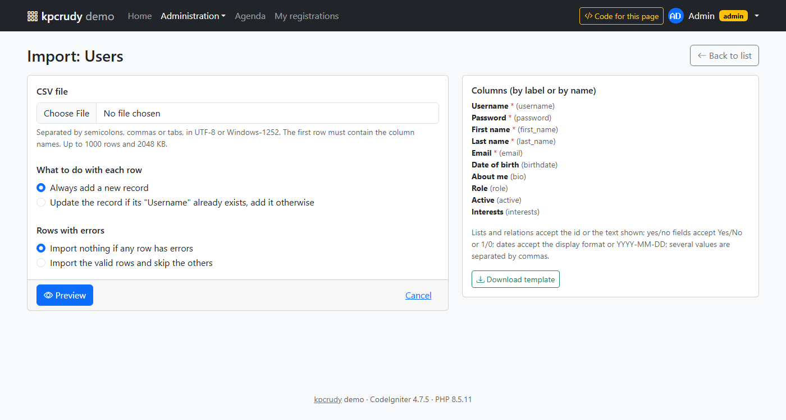

# Receptes

[English](howto_EN.md) · **Català**

Solucions curtes per a casos habituals amb **kpcrudy**. Cada recepta és independent. La descripció de cada funció i de totes les seves opcions és a [functions_CA.md](functions_CA.md).

Als exemples, `$crud` és una instància de `Kpcrudy\Crud` dins d'un mètode de controlador que acaba amb `return $crud->render();`.

## Índex

**Primers passos**
- [CRUD mínim](#crud-mínim)
- [Generar el CRUD d'una taula amb una comanda](#generar-el-crud-duna-taula-amb-una-comanda)
- [Fer servir un model existent](#fer-servir-un-model-existent)
- [Ruta que acaba en una paraula reservada](#ruta-que-acaba-en-una-paraula-reservada)
- [Rutes amb nom](#rutes-amb-nom)
- [CRUD dins d'un mòdul](#crud-dins-dun-mòdul)

**Contrasenyes**
- [Gestionar un camp de contrasenya](#gestionar-un-camp-de-contrasenya)
- [Demanar la contrasenya dues vegades](#demanar-la-contrasenya-dues-vegades)
- [Fer servir un altre algorisme de hash](#fer-servir-un-altre-algorisme-de-hash)
- [Contrasenya gestionada pel model](#contrasenya-gestionada-pel-model)
- [Botó per restablir la contrasenya](#botó-per-restablir-la-contrasenya)

**Enllaços i accions**
- [Enllaçar a una pàgina del projecte amb l'id](#enllaçar-a-una-pàgina-del-projecte-amb-lid)
- [Enllaçar a una pàgina externa amb l'id](#enllaçar-a-una-pàgina-externa-amb-lid)
- [Enllaçar amb l'id emmascarat](#enllaçar-amb-lid-emmascarat)
- [Saber a quin registre correspon un codi](#saber-a-quin-registre-correspon-un-codi)
- [Accions que modifiquen dades](#accions-que-modifiquen-dades)
- [Operacions pròpies a la ruta del CRUD](#operacions-pròpies-a-la-ruta-del-crud)
- [Mostrar una acció només en alguns registres](#mostrar-una-acció-només-en-alguns-registres)
- [Obrir el llistat ja filtrat o ordenat](#obrir-el-llistat-ja-filtrat-o-ordenat)
- [Accions massives pròpies](#accions-massives-pròpies)

**Enllaços signats**
- [Compartir un llistat de només lectura sense login](#compartir-un-llistat-de-només-lectura-sense-login)
- [Compartir un sol registre durant uns dies](#compartir-un-sol-registre-durant-uns-dies)
- [Llistat intern que reparteix enllaços signats](#llistat-intern-que-reparteix-enllaços-signats)
- [Descàrrega o pàgina pròpia amb enllaç signat](#descàrrega-o-pàgina-pròpia-amb-enllaç-signat)
- [Enllaços signats amb ids emmascarats](#enllaços-signats-amb-ids-emmascarats)
- [Esbrinar per què no funciona un enllaç signat](#esbrinar-per-què-no-funciona-un-enllaç-signat)

**Importació CSV**
- [Importar dades des d'un CSV](#importar-dades-des-dun-csv)
- [Exportar, editar i tornar a importar](#exportar-editar-i-tornar-a-importar)
- [Actualitzar registres per un camp únic](#actualitzar-registres-per-un-camp-únic)
- [Importar usuaris amb contrasenya](#importar-usuaris-amb-contrasenya)
- [Importar només per a alguns usuaris](#importar-només-per-a-alguns-usuaris)
- [Valors en formats especials](#valors-en-formats-especials)

**Dades i seguretat**
- [Limitar el CRUD a l'usuari connectat](#limitar-el-crud-a-lusuari-connectat)
- [Desar qui ha creat el registre](#desar-qui-ha-creat-el-registre)
- [Permisos per rol i per registre](#permisos-per-rol-i-per-registre)
- [Permisos centralitzats per a tots els CRUD](#permisos-centralitzats-per-a-tots-els-crud)
- [Només els registres propis](#només-els-registres-propis)
- [Amagar un camp segons un permís](#amagar-un-camp-segons-un-permís)
- [Un catàleg de permisos complet](#un-catàleg-de-permisos-complet)
- [Validacions entre camps](#validacions-entre-camps)
- [Impedir esborrar si té registres relacionats](#impedir-esborrar-si-té-registres-relacionats)
- [Executar codi després de cada canvi](#executar-codi-després-de-cada-canvi)
- [Diversos CRUD sobre la mateixa taula](#diversos-crud-sobre-la-mateixa-taula)
- [Un perfil d'usuari: CRUD d'un sol registre](#un-perfil-dusuari-crud-dun-sol-registre)

**Relacions**
- [Relació 1-N amb opcions filtrades](#relació-1-n-amb-opcions-filtrades)
- [Relació N-N](#relació-n-n)
- [Taula intermèdia amb dades pròpies](#taula-intermèdia-amb-dades-pròpies)
- [CRUD dels fills d'un registre](#crud-dels-fills-dun-registre)
- [Camps traduïts](#camps-traduïts)

**Presentació**
- [Desplegables amb etiquetes](#desplegables-amb-etiquetes)
- [Diversos valors en una columna](#diversos-valors-en-una-columna)
- [Formats: moneda, insígnies i textos](#formats-moneda-insígnies-i-textos)
- [Columnes calculades sense una consulta per fila](#columnes-calculades-sense-una-consulta-per-fila)
- [Pujar fitxers i imatges](#pujar-fitxers-i-imatges)

**Integració**
- [Integrar el CRUD al layout del projecte](#integrar-el-crud-al-layout-del-projecte)
- [Content-Security-Policy](#content-security-policy)
- [Diàlegs de confirmació propis](#diàlegs-de-confirmació-propis)
- [CRUD dins d'una vista pròpia](#crud-dins-duna-vista-pròpia)
- [Canviar una plantilla](#canviar-una-plantilla)
- [Configuració diferent per a un CRUD](#configuració-diferent-per-a-un-crud)
- [Canviar un text o afegir un idioma](#canviar-un-text-o-afegir-un-idioma)

---

## Primers passos

### CRUD mínim

```php
// app/Config/Routes.php
\Kpcrudy\Crud::routes($routes, 'admin/clients', 'Admin::clients');
```

```php
// app/Controllers/Admin.php
namespace App\Controllers;

use Kpcrudy\Crud;

class Admin extends BaseController
{
    public function clients()
    {
        $crud = new Crud();
        $crud->setTable('clients')
             ->setSubject('client', 'Clients');

        return $crud->render();
    }
}
```

Amb això ja tens llistat, cerca, ordenació, paginació, exportació, alta, edició, fitxa i esborrat, i paperera si la taula té `deleted_at`.

### Generar el CRUD d'una taula amb una comanda

En lloc d'escriure el mètode a mà, `kpcrudy:make` el genera a partir de l'estructura de la taula i afegeix la ruta a `app/Config/Routes.php`.

**Mode interactiu.** Sense arguments, la comanda mostra les taules de la base de dades i pregunta cada valor, amb una proposta per defecte (n'hi ha prou de prémer Retorn):

```
$ php spark kpcrudy:make
Tables:
  [1] cities
  [2] client_tag
  [3] clients
  [4] tags
Table (number or name) : 3
Controller (relative to App\Controllers)  [Clients]: Admin/Clients
Method  [index]:
Route  [admin/clients]:
Route filter (empty for none) : auth
Route name (empty for none) :
Generate a model too? [n, y]: n
```

**Amb arguments.** Per fer-ho d'una tirada (o des d'un script), passa la taula i les opcions; el que no s'indiqui pren el valor per defecte:

```bash
php spark kpcrudy:make clients --controller Admin/Clients --route admin/clients --filter auth
```

**Veure el codi abans d'escriure'l**, amb `--dry-run`:

```bash
php spark kpcrudy:make clients --dry-run
```

**Diversos CRUD al mateix controlador.** Si el controlador ja existeix, s'hi afegeix el mètode nou (i l'`use Kpcrudy\Crud;` si no hi era):

```bash
php spark kpcrudy:make cities --controller Admin/Catalog --method cities --route admin/cities
php spark kpcrudy:make tags   --controller Admin/Catalog --method tags   --route admin/tags
```

Si el mètode ja existeix, la comanda s'atura; amb `--force` el reemplaça (útil després de canviar la taula, però es perden els canvis que hi haguessis fet). Si alguna comprovació falla (per exemple, una columna amb un nom que no és només lletres, números i `_`), no s'escriu cap fitxer.

**Amb un model.** `--model` crea `app/Models/{Taula}Model.php` amb els `allowedFields`, els timestamps, els soft deletes i les regles de validació (`required`, `max_length`, `valid_email` i `is_unique` amb `{id}`), i el CRUD el fa servir amb `setModel()`. Si el model ja existeix, es reaprofita només si és de la mateixa taula (amb `--force` es reemplaça).

**En un mòdul o amb un nom de ruta**, vegeu [CRUD dins d'un mòdul](#crud-dins-dun-mòdul) i [Rutes amb nom](#rutes-amb-nom).

El codi generat és un punt de partida. Revisa sobretot les etiquetes (es generen a partir dels noms dels camps), les columnes del llistat i el camp que es mostra a cada relació.

### Fer servir un model existent

Si ja tens un model amb validació, es reaprofita tal qual:

```php
$crud->setModel(\App\Models\ClientModel::class)
     ->setSubject('client', 'Clients');
```

Si les regles del model fan servir `{id}`, la clau primària ha de tenir una regla pròpia (CodeIgniter 4.5+). El CRUD hi posa sempre l'id real, encara que la URL porti un [codi emmascarat](#enllaçar-amb-lid-emmascarat):

```php
protected $validationRules = [
    'id'    => 'permit_empty|is_natural_no_zero',
    'email' => 'required|valid_email|is_unique[clients.email,id,{id}]',
];
```

### Ruta que acaba en una paraula reservada

El CRUD fa servir els últims segments de la URL per saber l'operació (`add`, `edit/5`, `trash`...). Si la teva ruta acaba amb una d'aquestes paraules, indica'n la base:

```php
\Kpcrudy\Crud::routes($routes, 'warehouse/trash', 'Warehouse::trash');

// Controlador
$crud->setTable('waste_items')->setBaseUrl(site_url('warehouse/trash'));
```

### Rutes amb nom

`Crud::routes()` accepta les mateixes opcions que una ruta de CodeIgniter, també `as`:

```php
// app/Config/Routes.php
use Kpcrudy\Crud;

Crud::routes($routes, 'admin/clients', 'Admin\Clients::index', ['filter' => 'auth', 'as' => 'admin-clients']);
```

```php
// En una vista o un controlador
<a href="<?= url_to('admin-clients') ?>">Clients</a>
<a href="<?= url_to('admin-clients') . '/add' ?>">Nou client</a>
<a href="<?= url_to('admin-clients') . '/edit/' . Crud::idForUrl($id, 'clients') ?>">Edita</a>
```

Només la ruta base porta el nom: CodeIgniter no registra una segona ruta amb un nom que ja existeix, i per això les URL de les operacions (`add`, `edit/5`...) es fan afegint-les a la base. Amb [ids emmascarats](#enllaçar-amb-lid-emmascarat), `Crud::idForUrl()` dona el codi que va a la URL. `kpcrudy:make --as admin-clients` escriu la ruta amb el nom.

### CRUD dins d'un mòdul

kpcrudy funciona igual dins d'un mòdul (un namespace propi, com `Blog` a `modules/Blog`). Registra el namespace i fes que `kpcrudy:make` hi generi el codi:

```php
// app/Config/Autoload.php
public $psr4 = [
    APP_NAMESPACE => APPPATH,
    'Blog'        => ROOTPATH . 'modules/Blog',
];
```

```bash
php spark kpcrudy:make posts --namespace Blog --route admin/posts --as blog-posts --model
```

Això crea `Blog\Controllers\Posts` (a `modules/Blog/Controllers/Posts.php`), `Blog\Models\PostModel` i la ruta a `modules/Blog/Config/Routes.php`, amb el nom complet de la classe perquè el namespace per defecte de les rutes és `App\Controllers`:

```php
// modules/Blog/Config/Routes.php
\Kpcrudy\Crud::routes($routes, 'admin/posts', '\Blog\Controllers\Posts::index', ['as' => 'blog-posts']);
```

Si el fitxer no existia, la comanda el crea. CodeIgniter el llegeix amb el descobriment de rutes, que està activat per defecte (`Config\Modules`: `$enabled = true` i `'routes'` a `$aliases`) i busca a tots els namespaces de `Config\Autoload`. Si el projecte el té desactivat, inclou el fitxer des d'`app/Config/Routes.php`:

```php
// app/Config/Routes.php
require ROOTPATH . 'modules/Blog/Config/Routes.php';
```

La resta d'opcions (`--path` per a un namespace no registrat, `--routes`, `--extends`) són a [kpcrudy:make](commands_CA.md#kpcrudymake).

---

## Contrasenyes

### Gestionar un camp de contrasenya

Un camp que es diu `password` (o `contrasenya`) ja és de tipus contrasenya. Si es diu d'una altra manera, indica-ho amb `fieldType()`.

```php
$crud->fieldType('pass_hash', 'password')
     ->setRules('pass_hash', 'required|min_length[8]')
     ->displayAs('pass_hash', 'Contrasenya');
```

Comportament:

- Es desa amb `password_hash()`.
- A l'**alta**, la regla `required` s'aplica (també sense `setRules()`, si la columna és `NOT NULL` sense valor per defecte). A l'**edició** s'ignora: si es deixa en blanc, la contrasenya no canvia, i sota el camp surt "Deixa-ho en blanc per mantenir la contrasenya actual".
- No surt al llistat, a la fitxa, a la cerca, als filtres ni a l'exportació. Si la poses explícitament a `columns()`, es mostra `••••••`.
- Els altres camps secrets de la taula (`reset_token`, `api_key`, `salt`... segons `$sensitiveFields`) tampoc surten per defecte, ni tan sols als formularis.
- El formulari mai mostra el valor desat.

Per verificar-la en fer login:

```php
if (password_verify($request->getPost('password'), $user['pass_hash'])) {
    // correcta
}
```

### Demanar la contrasenya dues vegades

Amb `callbackField()` es pinten els dos inputs, i amb un hook es comprova que coincideixin:

```php
$crud->callbackField('password', fn ($value, ?array $row) =>
    '<input type="password" name="password" class="form-control mb-2" autocomplete="new-password" placeholder="Contrasenya"' . ($row === null ? ' required' : '') . '>'
    . '<input type="password" name="password_confirm" class="form-control" autocomplete="new-password" placeholder="Repeteix la contrasenya">'
);

$sameTwice = function () {
    $request = service('request');

    return $request->getPost('password') === $request->getPost('password_confirm')
        ? null
        : 'Les dues contrasenyes no coincideixen.';
};

$crud->beforeInsert($sameTwice)
     ->beforeUpdate($sameTwice);
```

El hook compara els valors que arriben del formulari, perquè a `$data` la contrasenya ja hi és amb hash.

### Fer servir un altre algorisme de hash

Amb `'hash' => false` la llibreria no aplica cap hash, i el pots fer tu en un hook. En edició, si el camp es deixa en blanc, no arriba a `$data`:

```php
$hash = function (array $data) {
    if (isset($data['password'])) {
        $data['password'] = password_hash($data['password'], PASSWORD_ARGON2ID);
    }

    return $data;
};

$crud->fieldType('password', 'password', ['hash' => false])
     ->beforeInsert($hash)
     ->beforeUpdate($hash);
```

### Contrasenya gestionada pel model

Si el model ja aplica el hash en els seus callbacks (`beforeInsert`, `beforeUpdate`), desactiva el de la llibreria perquè no es faci dues vegades:

```php
$crud->setModel(\App\Models\UserModel::class)
     ->fieldType('password', 'password', ['hash' => false]);
```

### Botó per restablir la contrasenya

L'administrador no ha de veure ni escriure contrasenyes: un botó genera una contrasenya temporal i l'envia per correu.

```php
// Controlador del CRUD
$crud->addAction('Restableix la contrasenya', 'admin/users-reset-password/{kp_id}', [
    'icon'    => 'bi bi-key',
    'method'  => 'post',
    'confirm' => 'Es generarà una contrasenya nova i s\'enviarà per correu. Continuar?',
]);
```

```php
// Routes.php: (:segment), perquè amb els ids emmascarats l'id és un codi
$routes->post('admin/users-reset-password/(:segment)', 'Admin\Users::resetPassword/$1');

// Controlador
public function resetPassword(string $code)
{
    // L'id real, tant si els ids estan emmascarats com si no
    $id       = \Kpcrudy\Crud::idFromUrl($code, 'users') ?? throw \CodeIgniter\Exceptions\PageNotFoundException::forPageNotFound();
    $user     = db_connect()->table('users')->where('id', $id)->get()->getRowArray() ?? throw \CodeIgniter\Exceptions\PageNotFoundException::forPageNotFound();
    $password = bin2hex(random_bytes(6));

    db_connect()->table('users')->where('id', $id)->update(['password' => password_hash($password, PASSWORD_DEFAULT)]);

    service('email')->setTo($user['email'])
        ->setSubject('La teva contrasenya nova')
        ->setMessage("Contrasenya temporal: {$password}")
        ->send();

    return redirect()->back()->with('message', 'S\'ha enviat una contrasenya nova a ' . $user['email']);
}
```

Les accions amb `'method' => 'post'` envien el token CSRF; la ruta ha de ser `post`.

---

## Enllaços i accions

### Enllaçar a una pàgina del projecte amb l'id

`{kp_id}` és l'id tal com surt a les URL del CRUD (un codi si els ids estan [emmascarats](#enllaçar-amb-lid-emmascarat), i si no, l'id real), `{id}` és sempre la clau primària real, i `{camp}` qualsevol camp del registre. Les URL relatives passen per `site_url()`:

```php
$crud->addAction('Factures', 'invoices/client/{kp_id}', ['icon' => 'bi bi-receipt']);
$crud->addAction('Comandes', 'orders?client={kp_id}&year={year}', ['icon' => 'bi bi-cart']);
```

Per a les pàgines pròpies, fes servir `{kp_id}`: la ruta, amb `(:segment)` (no `(:num)`), n'obté l'id real amb [`Crud::idFromUrl()`](functions_CA.md#crudidfromurlstring-value-string-context-bool-masked--null-kpcrudyconfig-config--null-string-estàtica), i funciona tant si els ids estan emmascarats com si no (vegeu [Accions que modifiquen dades](#accions-que-modifiquen-dades)). Per obrir un altre CRUD filtrat, en canvi, cal `{id}`, perquè els filtres fan servir els valors reals (vegeu [Obrir el llistat ja filtrat o ordenat](#obrir-el-llistat-ja-filtrat-o-ordenat)).

> `{id}` i `{kp_id}` apunten sempre a la **clau primària** de la taula, encara que el camp no es digui `id`. Si la clau és `codi`, `{id}` dona el valor de `codi` i `{kp_id}`, aquest valor tal com surt a les URL del CRUD. `{kp_codi}` no existeix: el prefix `kp_` només és per a la clau (vegeu [`addAction()`](functions_CA.md#addactionstring-label-closurestring-url-array-options---static)).

Si cal construir la URL amb lògica, fes servir una closure:

```php
$crud->addAction('Fitxa pública', fn (array $row) => site_url('catalog/' . $row['category_slug'] . '/' . $row['slug']));
```

### Enllaçar a una pàgina externa amb l'id

Les URL que comencen per `http://`, `https://`, `//` o `/` es deixen tal qual. Els valors de `{...}` es codifiquen per a la URL:

```php
// Sistema extern que rep l'id
$crud->addAction('Veure al CRM', 'https://crm.example.com/contacts/{external_id}', [
    'icon'   => 'bi bi-box-arrow-up-right',
    'target' => '_blank',
]);

// Un camp com a paràmetre de cerca
$crud->addAction('Mapa', 'https://www.openstreetmap.org/search?query={address}', [
    'icon'   => 'bi bi-geo-alt',
    'target' => '_blank',
]);
```

Per combinar diversos camps en un sol paràmetre, fes servir una closure:

```php
$crud->addAction('Mapa', fn (array $row) =>
    'https://www.openstreetmap.org/search?query=' . rawurlencode($row['address'] . ', ' . $row['city']),
    ['target' => '_blank']
);
```

### Enllaçar amb l'id emmascarat

Potser no vols que l'id es vegi o es pugui endevinar: ni a les URL del CRUD (`edit/5`) ni als enllaços que en surten (una pàgina pública, un correu, un sistema extern). Hi ha tres opcions, i la C es combina amb la A:

| Opció | URL | Per a què |
|---|---|---|
| A. `maskIds()` (recomanada) | curta i fixa: `/invoice/Xk3f9QaLm2PwE7` | Que l'id no es vegi ni es pugui canviar, al CRUD i fora |
| B. Emmascarador propi (Sqids) | més curta: `/invoice/Uk9pQ2xa` | Que no es vegi un número consecutiu |
| C. A + signatura (`Crud::signUrl()`) | `/invoice/Xk3f9QaLm2PwE7?kp_exp=…&kp_sig=…` | A més, que l'enllaç caduqui i que només l'obri qui l'ha rebut |

Cap de les tres substitueix la comprovació de permisos a la pàgina de destí.

**A. Identificadors emmascarats del CRUD.** Amb [`maskIds()`](functions_CA.md#identificadors-emmascarats), totes les URL del CRUD porten un codi en lloc de l'id (`admin/invoices/edit/Xk3f9QaLm2PwE7`), i els enllaços que en surten fan servir el mateix codi. No cal cap ruta més: el CRUD fa servir les de `Crud::routes()`. Els hooks, els permisos i els callbacks continuen rebent l'id real.

```php
// Controlador del CRUD
$crud->setTable('invoices')
     ->maskIds()
     ->addAction('Enllaç per al client', 'invoice/{kp_id}', [   // {kp_id}: l'id emmascarat; {id}: el real
         'icon'   => 'bi bi-link-45deg',
         'target' => '_blank',
     ]);
```

La pàgina pública desfà el codi amb `Crud::unmaskId()`, amb el mateix context que el CRUD (per defecte, el nom de la taula). Un codi fals o modificat retorna `null`:

```php
// Routes.php
Crud::routes($routes, 'admin/invoices', 'Admin\Invoices::index', ['filter' => 'auth:admin']);
$routes->get('invoice/(:segment)', 'PublicInvoice::show/$1');   // un altre prefix!

// Controlador de destí
use Kpcrudy\Crud;

public function show(string $code)
{
    $id = Crud::unmaskId($code, 'invoices') ?? throw \CodeIgniter\Exceptions\PageNotFoundException::forPageNotFound();

    $invoice = model('InvoiceModel')->find($id);
    // ...
}
```

Per fer l'enllaç fora del CRUD (p. ex. en un correu), `Crud::maskId()` dona el mateix codi:

```php
$link = site_url('invoice/' . Crud::maskId($invoice['id'], 'invoices'));
```

**Si la ruta pròpia ha de funcionar amb els ids emmascarats o sense** (p. ex. rep el `{kp_id}` d'una acció i l'emmascarament es pot activar o desactivar a la configuració), fes servir [`Crud::idFromUrl()`](functions_CA.md#crudidfromurlstring-value-string-context-bool-masked--null-kpcrudyconfig-config--null-string-estàtica) en lloc d'`unmaskId()`, i `Crud::idForUrl()` en lloc de `maskId()`: desfan i fan el codi només si els ids estan emmascarats. Si el CRUD l'activa només amb `maskIds()` (no a la configuració), passa `true` com a tercer paràmetre:

```php
$id   = Crud::idFromUrl($code, 'invoices', true) ?? throw \CodeIgniter\Exceptions\PageNotFoundException::forPageNotFound();
$link = site_url('invoice/' . Crud::idForUrl($invoice['id'], 'invoices', true));
```

**La ruta pública ha d'anar amb un altre prefix** (`invoice/...`, no `admin/invoices/...`). `Crud::routes()` registra `admin/invoices/(:any)`, que captura tot el que comenci per `admin/invoices/`: una ruta `admin/invoices/(:segment)` definida després no s'executaria mai, i definida abans s'emportaria `admin/invoices/add`, `admin/invoices/trash`... En desenvolupament, el CRUD ho detecta i llança una excepció que explica el problema (vegeu [`Crud::checkRoutes()`](functions_CA.md#crudcheckroutes-void-estàtica)). Les rutes més concretes que no capturen cap URL del CRUD (p. ex. `admin/invoices/pdf/(:segment)` definida abans de `Crud::routes()`) sí que són correctes.

Per activar-ho a tots els CRUD, posa `public bool $maskIds = true;` a `app/Config/Kpcrudy.php`. La clau és `$maskKey` (com a mínim 32 caràcters) o la d'encriptació del projecte (`php spark key:generate`); si canvia, els enllaços antics deixen de funcionar (vegeu [Context i clau](functions_CA.md#context-i-clau)).

**B. Codis més curts amb Sqids.** Si prefereixes un altre format de codi, implementa `Kpcrudy\IdMasker` i indica-la a `Config\Kpcrudy::$idMasker`: la resta (rutes, `{kp_id}`, `Crud::maskId()`...) funciona igual. A [Interfície `Kpcrudy\IdMasker`](functions_CA.md#interfície-kpcrudyidmasker) hi ha un exemple complet amb [Sqids](https://sqids.org/php). No és xifratge: amb l'alfabet es pot desfer, però no es veu l'ordre ni la quantitat de registres.

**C. Enllaç signat i amb caducitat.** Si a més l'enllaç ha de caducar, i la pàgina no s'ha de poder obrir només sabent el codi, signa'l amb `Crud::signUrl()` i comprova'l a la pàgina pública amb `Crud::hasValidSignature()` (o `Crud::checkSignature()`, per distingir un enllaç caducat d'un de fals). Si algú canvia el codi o la caducitat, la signatura deixa de ser vàlida:

```php
// Controlador del CRUD: enllaç de 24 h amb l'id emmascarat
$crud->addAction('Enllaç de 24 h', fn (array $row) => Crud::signUrl('invoice/' . Crud::maskId($row['id'], 'invoices'), 86400));

// PublicInvoice::show(string $code), abans de desfer el codi
if (! Crud::hasValidSignature()) {
    throw \CodeIgniter\Exceptions\PageNotFoundException::forPageNotFound(lang('Kpcrudy.linkInvalid'));
}
```

Per compartir un CRUD sencer (un llistat o una fitxa) en lloc d'una pàgina pròpia, vegeu el grup [Enllaços signats](#compartir-un-llistat-de-només-lectura-sense-login).

### Saber a quin registre correspon un codi

Amb els identificadors emmascarats, una URL d'un error o d'una queixa (`admin/invoices/edit/Xk3f9QaLm2PwE7`) no diu de quin registre es tracta. La comanda `kpcrudy:unmaskid` ho desfà; el primer paràmetre és el context (el nom de la taula, o el que s'hagi passat a `maskIds(context: ...)`):

```bash
php spark kpcrudy:unmaskid invoices Xk3f9QaLm2PwE7 Pq81LmZt0aXcW9
```

I a l'inrevés, per saber quina URL té un registre:

```bash
php spark kpcrudy:maskid invoices 5 6 7
```

Els codis que no són vàlids per a aquest context surten marcats (potser són d'una altra taula o d'una clau anterior). Si els CRUD fan servir una configuració pròpia (`new Crud(new \Config\KpcrudyPublic())`), indica-la amb `--config "Config\KpcrudyPublic"`, perquè pot tenir una altra clau. Vegeu [les comandes](functions_CA.md#comandes-de-spark). Si el codi ve d'un enllaç signat que no funciona, vegeu [Esbrinar per què no funciona un enllaç signat](#esbrinar-per-què-no-funciona-un-enllaç-signat).

### Accions que modifiquen dades

Una acció que canvia dades no ha de ser un enllaç GET: un cercador o una previsualització podria executar-la. Amb `'method' => 'post'` el botó envia un formulari amb el token CSRF:

```php
$crud->addAction('Duplica', 'admin/events-duplicate/{kp_id}', [   // {kp_id}: l'id com a les URL del CRUD
    'icon'    => 'bi bi-copy',
    'method'  => 'post',
    'confirm' => 'Vols crear una còpia d\'aquest esdeveniment?',
]);
```

```php
// Routes.php: una ruta POST que no comenci com les del CRUD
// (:segment), no (:num): amb els ids emmascarats arriba un codi (DxbBosxVUi2fWpPq3w)
$routes->post('admin/events-duplicate/(:segment)', 'Admin\Events::duplicate/$1');

// Controlador
use Kpcrudy\Crud;

public function duplicate(string $code)
{
    $id = Crud::idFromUrl($code, 'events') ?? throw \CodeIgniter\Exceptions\PageNotFoundException::forPageNotFound();
    // ... crea la còpia ...
    return redirect()->to(site_url('admin/events/edit/' . Crud::idForUrl($newId, 'events')))->with('message', 'Còpia creada.');
}
```

`Crud::idFromUrl()` i `Crud::idForUrl()` desfan i fan el codi només si els ids estan emmascarats, de manera que l'exemple funciona en els dos casos (si el CRUD l'activa només amb `maskIds()`, passa'ls `true` com a tercer paràmetre).

La ruta no pot ser `admin/events/duplicate/<id>`, perquè `admin/events/(:any)` ja és del CRUD. Fes servir un altre prefix, com `admin/events-duplicate/<id>`. O, més senzill, fes que la serveixi el CRUD amb `addOperation()` (recepta següent): sense ruta, sense descodificar l'id i sense comprovar els permisos a mà.

### Operacions pròpies a la ruta del CRUD

`addOperation()` afegeix una operació pròpia que serveix la ruta del CRUD (`admin/events/duplicate/<id>`). Abans de cridar-la, el CRUD fa el mateix que a les seves operacions: token CSRF, id emmascarat, àmbit de `where()`, permisos i signatura; després, torna al llistat amb el missatge. No cal afegir cap ruta.

```php
$crud->addOperation('duplicate', function (string $id, array $event, Crud $crud) {
    unset($event['id']);
    $event['title']  .= ' (còpia)';
    $event['status']  = 'draft';

    $db = db_connect();
    $db->table('events')->insert($event);

    // $crud->url() emmascara (i signa) l'id si cal
    return redirect()->to($crud->url('edit', (string) $db->insertID()))->with('message', 'Còpia creada.');
}, [
    'icon'    => 'bi bi-copy',
    'confirm' => 'Vols crear una còpia d\'aquest esdeveniment?',
]);
```

El callback rep l'id real i el registre, i retorna:

| Retorn | Resultat |
|---|---|
| un string | torna al llistat amb aquest missatge d'èxit |
| `null` | torna al llistat amb un missatge genèric |
| `false` | torna al llistat amb "cancel·lat" |
| `$crud->backToList('danger', 'Missatge')` | torna al llistat amb un error (també `warning`, `info`) |
| una resposta | aquesta resposta (redirecció, descàrrega, pàgina...) |

```php
$crud->addOperation('join', function (string $id, array $event, Crud $crud) use ($userId) {
    if ($event['places'] <= 0) {
        return $crud->backToList('danger', 'No queden places.');
    }

    db_connect()->table('attendances')->insert(['event_id' => $id, 'user_id' => $userId]);

    return 'T\'has inscrit.';
}, ['icon' => 'bi bi-person-plus', 'visible' => fn (array $row) => $row['places'] > 0]);
```

**Una operació general** (no sobre un registre) amb `'row' => false` té un botó a la capçalera del llistat. Amb `'method' => 'get'` pot mostrar una pàgina; `$crud->page()` posa el teu HTML dins el mateix layout que el CRUD:

```php
$crud->addOperation('report', function (?string $id, ?array $row, Crud $crud) {
    $totals = db_connect()->table('events')->select('status, COUNT(*) AS total')->groupBy('status')->get()->getResultArray();

    return service('response')->setBody($crud->page(view('events/report', ['totals' => $totals]), 'Informe d\'esdeveniments'));
}, ['row' => false, 'method' => 'get', 'icon' => 'bi bi-bar-chart', 'label' => 'Informe']);
```

Altres opcions: `'permission'` (per defecte la clau: es decideix amb `setPermission('duplicate', ...)` o amb el [resolutor de permisos](#permisos-centralitzats-per-a-tots-els-crud)), `'trash' => true` (sobre registres de la paperera), `'button' => false` (sense botó, si hi enllaces tu). La clau no pot ser cap de les operacions del CRUD (`add`, `edit`, `trash`...).

### Mostrar una acció només en alguns registres

```php
$crud->addAction('Paga', 'invoices/pay/{kp_id}', [
    'icon'    => 'bi bi-credit-card',
    'class'   => 'btn-success',
    'method'  => 'post',
    'visible' => fn (array $row) => $row['status'] === 'pending',
]);
```

Si la condició depèn d'altres taules, calcula-ho abans del CRUD (vegeu [Columnes calculades sense una consulta per fila](#columnes-calculades-sense-una-consulta-per-fila)):

```php
$registered = array_column(db_connect()->table('attendances')->select('event_id')->where('user_id', $userId)->get()->getResultArray(), 'event_id');

$crud->addAction('Apunta-m\'hi', 'events-join/{kp_id}', [
    'method'  => 'post',
    'visible' => fn (array $row) => ! in_array($row['id'], $registered),
]);
```

`visible` només amaga el botó. La ruta de destí (amb `(:segment)` i `Crud::idFromUrl()`, com a [Accions que modifiquen dades](#accions-que-modifiquen-dades)) ha de tornar a comprovar que l'acció és permesa.

### Obrir el llistat ja filtrat o ordenat

L'estat del llistat va a la URL, de manera que es pot enllaçar directament:

| Paràmetre | Exemple | Efecte |
|---|---|---|
| `q` | `?q=garcia` | Cerca |
| `f[camp]` | `?f[status]=paid` | Filtre de llista o de text |
| `f[camp][from]`, `f[camp][to]` | `?f[created_at][from]=2026-01-01` | Filtre de rang |
| `sort`, `dir` | `?sort=name&dir=desc` | Ordre |
| `page`, `per_page` | `?page=2&per_page=50` | Paginació |

El camp ha de ser a `filters()` (o als filtres per defecte) i a les columnes ordenables.

```php
// Al CRUD de clients, un botó per veure'n les comandes ja filtrades.
// {id}, no {kp_id}: els filtres fan servir l'id real, també amb els ids emmascarats
$crud->addAction('Comandes', 'admin/orders?f[client_id]={id}&sort=date&dir=desc', ['icon' => 'bi bi-cart']);
```

```php
// A una vista qualsevol
<a href="<?= site_url('admin/orders?f[status]=pending') ?>">Comandes pendents</a>
```

### Accions massives pròpies

```php
$crud->addBulkAction('publish', 'Publica', function (array $ids) {
    db_connect()->table('posts')->whereIn('id', $ids)->update(['status' => 'published']);

    return count($ids) . ' articles publicats.';
});

// Amb confirmació, i disponible a la paperera
$crud->addBulkAction('anonymize', 'Anonimitza', function (array $ids) {
    db_connect()->table('users')->whereIn('id', $ids)->update(['email' => null, 'phone' => null]);

    return 'Dades personals eliminades.';
}, ['confirm' => 'No es pot desfer. Continuar?', 'trash' => true]);
```

`$ids` ja està filtrat per l'abast del CRUD (`where()`): no cal comprovar que els registres siguin "teus".

---

## Enllaços signats

Un enllaç signat obre una pàgina sense iniciar sessió, només a qui l'ha rebut i fins que caduca. Com funciona, què cobreix la signatura i totes les opcions: [URL signades](functions_CA.md#url-signades).

### Compartir un llistat de només lectura sense login

Una agenda d'esdeveniments que qualsevol pot consultar durant 7 dies amb l'enllaç, sense compte. És el que fa el controlador [Shared](../src/Demo/Controllers/Shared.php) de la demo.

```php
// app/Config/Routes.php
use Kpcrudy\Crud;

Crud::routes($routes, 'admin/events', 'Admin\Events::index', ['filter' => 'auth:admin']);
// Sense filtre de login (el permís és la signatura) i amb un altre prefix que l'administració
Crud::routes($routes, 'shared/agenda', 'Shared::agenda');
```

```php
// app/Controllers/Shared.php
namespace App\Controllers;

use Kpcrudy\Crud;

class Shared extends BaseController
{
    public const TTL = 7 * 86400;   // 7 dies

    public function agenda()
    {
        $crud = new Crud();
        $crud->setTable('events')
             ->setSubject('esdeveniment', 'Agenda')
             // El que pot veure el visitant: la signatura no cobreix ?q=, ?page=, ?f[...]=...
             ->where('status', 'published')
             ->where('starts_at >=', date('Y-m-d H:i:s'))
             ->readOnly()
             ->unsetTrash()
             ->unsetBulk()
             ->unsetExport()
             ->maskIds()                 // recomanat als enllaços compartits
             ->requireSignature()        // '*': totes les pàgines necessiten signatura
             ->setLayout('default')      // sense el menú de l'aplicació: el visitant no ha iniciat sessió
             ->columns(['title', 'starts_at', 'location']);

        return $crud->render();
    }

    /**
     * Enllaç d'entrada a l'agenda. Només se signa el camí ($lockQuery = false):
     * el visitant pot cercar i canviar de pàgina, però no allargar l'enllaç.
     */
    public static function link(): string
    {
        return Crud::signUrl('shared/agenda', self::TTL, false);
    }
}
```

```php
// app/Controllers/Admin/Events.php: on es crea l'enllaç (un botó de l'administració)
$crud->addHeaderAction('Comparteix l\'agenda', \App\Controllers\Shared::link(), [
    'icon'   => 'bi bi-share',
    'target' => '_blank',
]);
```

Cada vegada que es mostra l'administració es crea un enllaç nou, vàlid 7 dies des d'aquell moment. Mentre el visitant navega (pàgines, ordenació, cerca, fitxes), el CRUD signa els enllaços sol, amb la mateixa caducitat.

**El visitant pot** veure, cercar, ordenar i obrir la fitxa dels esdeveniments publicats i futurs durant 7 dies; **no pot** editar res, veure altres esdeveniments (tampoc canviant la cerca a la URL), allargar l'enllaç ni obrir cap altra pàgina de l'aplicació.

### Compartir un sol registre durant uns dies

Un enllaç a la fitxa d'una factura, vàlid 3 dies, per enviar-lo al client. Qui el rep veu aquella factura i res més.

```php
// app/Config/Routes.php
Crud::routes($routes, 'admin/invoices', 'Admin\Invoices::index', ['filter' => 'auth:admin']);
Crud::routes($routes, 'shared/invoices', 'SharedInvoices::index');   // sense login
```

```php
// app/Controllers/SharedInvoices.php
public function index()
{
    $crud = new Crud();
    $crud->setTable('invoices')
         ->where('status', 'sent')        // només es poden compartir factures enviades
         ->maskIds()
         ->readOnly()
         ->unsetExport()
         ->requireSignature()             // també el llistat: només el donaria un enllaç signat del llistat
         ->setLayout('default')
         ->showFields(['number', 'date', 'client_id', 'total']);

    return $crud->render();
}
```

```php
// app/Controllers/Admin/Invoices.php: una acció a cada fila de l'administració
$crud->addAction('Enllaç per al client (3 dies)', fn (array $row) =>
    Crud::signUrl('shared/invoices/show/' . Crud::maskId($row['id'], 'invoices'), 3 * 86400, false),
    ['icon' => 'bi bi-share', 'target' => '_blank']
);
```

L'enllaç ha de portar el codi emmascarat amb el mateix context que el CRUD públic (el nom de la taula). No facis servir `$crud->signedUrl()` del CRUD d'administració: signaria una URL de l'administració. Com que l'enllaç és d'una fitxa, el CRUD no signa cap altre enllaç: no hi ha botó de tornar al llistat, i si la factura s'esborra o deixa de complir el `where()`, el visitant veu un 404 amb "No s'ha trobat el registre.".

**El visitant pot** veure aquella factura durant 3 dies; **no pot** arribar al llistat (`shared/invoices` sense signatura dona un 404), obrir cap altra factura ni allargar l'enllaç.

### Llistat intern que reparteix enllaços signats

El personal veu el llistat de comandes amb login, i cada fitxa del llistat té un enllaç signat de 7 dies que pot copiar i enviar a qui no té compte.

```php
// app/Config/Routes.php: sense filtre a la ruta. Un filtre de login també bloquejaria
// les fitxes compartides, perquè tenen el mateix prefix: ho decideix el controlador.
Crud::routes($routes, 'orders', 'Orders::index');
```

```php
// app/Controllers/Orders.php
public function index()
{
    $loggedIn = session('user_id') !== null;

    // Sense login ni signatura: a iniciar sessió
    if (! $loggedIn && $this->request->getGet('kp_sig') === null) {
        return redirect()->to('login');
    }

    $crud = new Crud();
    $crud->setTable('orders')
         ->maskIds()
         ->readOnly();

    if ($loggedIn) {
        // El llistat s'obre sense signatura i dona enllaços de 7 dies a les fitxes
        $crud->requireSignature(['show'], 7 * 86400, ['list']);
    } else {
        // Sense login, tot necessita signatura: només s'obren les fitxes que ha repartit el llistat
        $crud->requireSignature();
    }

    return $crud->render();
}
```

**Per què cal protegir la resta.** Amb `requireSignature(['show'], ...)`, només la fitxa necessita signatura: el llistat i qualsevol altra operació que no hagis tret quedarien oberts a tothom que arribi a la ruta. Per això, sense login, el controlador redirigeix al login o exigeix signatura a tot (`requireSignature()`). Si els destinataris també tenen compte, n'hi ha prou amb un filtre de login a la ruta i `requireSignature(['show'], 7 * 86400, ['list'])`.

**Qui rep l'enllaç pot** veure aquella comanda durant 7 dies sense login; **no pot** veure el llistat (el porta al login), ni cap altra comanda, ni allargar l'enllaç.

### Descàrrega o pàgina pròpia amb enllaç signat

Un enllaç de descàrrega d'un informe, vàlid 1 hora, a una ruta pròpia (no és un CRUD). Aquí la signatura cobreix el camí **i** els paràmetres (`$lockQuery = true`, el valor per defecte).

```php
// app/Config/Routes.php: sense login, i amb un prefix diferent de qualsevol CRUD
$routes->get('reports/(:segment)/pdf', 'Reports::pdf/$1');
```

```php
// app/Controllers/Admin/Reports.php: on es crea l'enllaç (acció del CRUD d'administració)
$crud->maskIds()
     ->addAction('Enllaç de descàrrega (1 h)', fn (array $row) =>
         Crud::signUrl('reports/' . Crud::maskId($row['id'], 'reports') . '/pdf'),   // 3600 s per defecte
         ['icon' => 'bi bi-file-earmark-pdf']
     );
```

```php
// app/Controllers/Reports.php
use CodeIgniter\Exceptions\PageNotFoundException;
use Kpcrudy\Crud;
use Kpcrudy\UrlSigner;

public function pdf(string $code)
{
    $status = Crud::checkSignature();

    if ($status === UrlSigner::EXPIRED) {
        // La signatura és bona però ha passat l'hora: es pot dir clarament
        return $this->response->setStatusCode(410)->setBody(lang('Kpcrudy.linkExpired') . ' Demana un enllaç nou.');
    }

    if ($status !== UrlSigner::VALID) {   // 'missing' o 'invalid': no es dona cap pista
        throw PageNotFoundException::forPageNotFound(lang('Kpcrudy.linkInvalid'));
    }

    $id     = Crud::unmaskId($code, 'reports') ?? throw PageNotFoundException::forPageNotFound();
    $report = model('ReportModel')->find($id) ?? throw PageNotFoundException::forPageNotFound();

    return $this->response->download(WRITEPATH . 'reports/' . $report['file'], null);
}
```

Si l'enllaç s'ha fet amb `$lockQuery = false`, comprova'l amb `Crud::checkSignature(allowFreeQuery: true)`. `checkSignature()` només accepta enllaços fets amb `Crud::signUrl()` o `signedUrl()`: els que signa un CRUD mentre es navega no obren pàgines pròpies.

**Qui rep l'enllaç pot** descarregar aquell informe durant 1 hora; **no pot** canviar el codi, afegir-hi o treure'n paràmetres, ni fer-lo servir per a un altre informe.

### Enllaços signats amb ids emmascarats

Es poden fer servir per separat, però per als enllaços compartits és recomanable combinar-los:

| | Només signatura | Signatura + `maskIds()` |
|---|---|---|
| URL | `shared/invoices/show/123?kp_exp=…&kp_sig=…` | `shared/invoices/show/Xk3f9QaLm2PwE7?kp_exp=…&kp_sig=…` |
| Es pot obrir un altre registre canviant la URL? | No | No |
| Es veu l'id real (quantes factures hi ha, l'ordre)? | Sí | No |

```php
// CRUD públic
$crud->setTable('invoices')->maskIds()->readOnly()->requireSignature();

// Amb signedUrl(), l'id real s'emmascara sol
$link = $crud->signedUrl('show', 123, 3 * 86400);

// Amb Crud::signUrl(), emmascara'l tu, amb el mateix context que el CRUD (el nom de la taula)
$link = Crud::signUrl('shared/invoices/show/' . Crud::maskId(123, 'invoices'), 3 * 86400, false);
```

Totes dues coses fan servir la mateixa [clau](functions_CA.md#context-i-clau): si canvia, deixen de funcionar alhora els codis i les signatures.

### Esbrinar per què no funciona un enllaç signat

Quan algú diu "l'enllaç no em funciona", demana-li l'enllaç sencer i comprova'l amb `kpcrudy:checkurl` (entre cometes, perquè porta `&`):

```bash
php spark kpcrudy:checkurl "https://example.com/shared/invoices/show/Xk3f9QaLm2PwE7?kp_exp=1767225600&kp_sig=Qm9..."
```

```text
Valid signature (path only: the parameters can change)
Expires: 2026-01-01 00:00:00
```

| Resultat | Què vol dir | Què fer |
|---|---|---|
| `Valid signature` | L'enllaç és bo | El problema és a les dades: el registre s'ha esborrat o ja no compleix el `where()`, o l'operació s'ha tret |
| `Expired` | La signatura és bona, però ha passat `kp_exp` | Crea'n un de nou |
| `Invalid signature` | S'ha modificat o tallat, o s'ha signat amb una altra clau (un altre entorn o una altra configuració) | Torna'l a copiar sencer; passa `--config` si el CRUD fa servir una configuració pròpia |
| `Not signed` | No porta `kp_sig` (s'ha tallat l'enllaç) | Torna'l a copiar sencer |

La comanda també diu qui ha signat l'enllaç: `signed with signUrl() or signedUrl()` (un enllaç d'entrada) o `signed by a CRUD while browsing` (copiat d'una pàgina del llistat signat, com la pàgina 2 o una fitxa). Aquests darrers només els accepta aquell CRUD i caduquen alhora que l'enllaç d'entrada.

Per saber de quin registre es tracta, desfés el codi de la URL; i per enviar un enllaç nou sense passar per l'aplicació, crea'l amb `kpcrudy:signurl` (`--ttl` en segons; `--free-query` per a pàgines d'un CRUD):

```bash
php spark kpcrudy:unmaskid invoices Xk3f9QaLm2PwE7
php spark kpcrudy:signurl "shared/invoices/show/Xk3f9QaLm2PwE7" --ttl 259200 --free-query
```

Totes les opcions de les comandes són a [commands_CA.md](commands_CA.md).

---

## Importació CSV

### Importar dades des d'un CSV

La importació no està activada per defecte, perquè modifica moltes dades de cop. S'activa a cada CRUD:

```php
$crud->setTable('products')
     ->enableImport();
```

Al llistat apareix el botó **Importa CSV**. L'usuari:

1. puja el fitxer i tria què cal fer amb cada fila (*afegir sempre* o *actualitzar si ja existeix*) i amb les files amb errors (*no importar res* o *saltar-les*);
2. veu la previsualització: columnes associades, files noves, files per actualitzar i errors per línia;
3. confirma la importació.

Un fitxer com aquest és vàlid, encara que les columnes estiguin en un altre ordre o n'hi hagi de més (s'ignoren):

```csv
Name;Category;Price;Active;Notes
Blue mug;Kitchen;12,50;Yes;from the old shop
Red mug;Kitchen;12.50;1;
```

Les columnes es reconeixen pel nom del camp (`category_id`) o per l'etiqueta (`Category`), i els desplegables i les relacions, per l'id o pel text (`Kitchen`). El botó **Descarrega la plantilla** de la pàgina d'importació genera un CSV amb la capçalera correcta.

| 1. Pujar el fitxer | 2. Previsualització |
|---|---|
|  |  |

### Exportar, editar i tornar a importar

Amb la clau per defecte (la clau primària), un fitxer exportat té la columna `Id`, i en tornar-lo a importar amb *actualitzar si ja existeix* es modifiquen els registres corresponents:

1. **Exporta CSV** des del llistat (es pot filtrar abans).
2. Edita el fitxer amb un full de càlcul: canvia preus, estats, categories...
3. **Importa CSV** → *Actualitzar el registre si el camp "Id" ja existeix* → previsualitza → importa.

Les columnes calculades de l'exportació (columnes virtuals, relacions N-N de només lectura) s'ignoren soles. Les files sense `Id` o amb un `Id` que no existeix s'afegeixen com a registres nous. L'apòstrof que l'exportació posa davant dels valors que semblen fórmules (`'=...`) es treu en importar. En una actualització només es canvien els camps del formulari d'edició (`editFields()`).

Perquè el preu exportat es pugui tornar a llegir, exporta'l com a número:

```php
$crud->callbackColumn('price', fn ($value) => esc(number_format((float) $value, 2, ',', '.')) . ' €')   // llistat
     ->callbackExport('price', fn ($value) => number_format((float) $value, 2, '.', ''));             // CSV
```

### Actualitzar registres per un camp únic

Si el fitxer ve d'un altre sistema i no porta els ids de la base de dades, fes servir com a clau un camp únic:

```php
$crud->setTable('students')
     ->enableImport(['key' => 'email']);
```

Amb *actualitzar si ja existeix*, cada fila es busca per l'email: si hi és, s'actualitzen les columnes del fitxer (les altres no es toquen); si no hi és, s'afegeix. La cerca respecta el `where()` del CRUD, de manera que mai s'actualitza un registre de fora de l'abast.

Si la clau és un camp de només lectura en edició (`readonlyFields`), serveix per trobar el registre però no es modifica. Si el valor de la clau coincideix amb més d'un registre, la fila té un error: la clau ha de ser única.

### Importar usuaris amb contrasenya

Els camps de tipus `password` es desen amb `password_hash()`, com al formulari:

```csv
Username;Password;Email;Role
nora.bell;Welcome2026;nora@example.com;User
alice;;alice@example.com;Admin
```

```php
$crud->setTable('users')
     ->setRules('password', 'required|min_length[8]')
     ->enableImport(['key' => 'username']);
```

- `nora.bell` és nova: la contrasenya és obligatòria (s'aplica la regla `required`).
- `alice` ja existeix: amb la contrasenya buida no es canvia, i s'actualitzen l'email i el rol.

No envieu mai fitxers amb contrasenyes reals per correu. El més segur és importar sense contrasenyes i que cada usuari en creï una (vegeu [Botó per restablir la contrasenya](#botó-per-restablir-la-contrasenya)).

### Importar només per a alguns usuaris

La importació té el seu propi permís, `import`, que decideix qui veu el botó i la pàgina:

```php
// Només els administradors poden importar
$crud->enableImport()
     ->setPermission('import', auth()->user()->inGroup('admin'));
```

A més, cada fila comprova el permís de l'operació que farà: `add` per a les files noves i `edit` (amb el registre) per a les actualitzacions. Per exemple, perquè els editors puguin importar però només actualitzar els seus registres:

```php
$isAdmin = auth()->user()->inGroup('admin');

$crud->enableImport()
     ->setPermission('add', $isAdmin)
     ->setPermission('edit', fn (?array $row) => $isAdmin || $row === null || $row['owner_id'] == session('user_id'));
```

Un editor pot pujar un fitxer, però les files noves i les dels registres d'altres persones surten com a errors a la previsualització ("No tens permís per afegir o modificar aquest registre").

### Valors en formats especials

La conversió automàtica entén els formats habituals: `Sí/No` i `1/0`, dates `AAAA-MM-DD` o en el format de pantalla, decimals amb coma o punt... Per a qualsevol altre format, transforma el valor amb `callbackImport()`:

```php
// Dates en format americà
$crud->callbackImport('birthdate', function (string $value) {
    $date = DateTime::createFromFormat('!m/d/Y', $value);

    return $date ? $date->format('Y-m-d') : $value;
});

// Un codi de país a partir del nom
$countries = ['Spain' => 'ES', 'France' => 'FR', 'Portugal' => 'PT'];
$crud->callbackImport('country', fn (string $value) => $countries[$value] ?? strtoupper($value));
```

El valor que retorna el callback es valida amb les regles del camp, de manera que un valor incorrecte surt igualment com a error a la previsualització. Als camps de relació, `enum`, `select` i N-N, el valor retornat ha de ser una opció vàlida. Un text que coincideix amb més d'una opció és un error: fes servir l'id. Els números només admeten xifres, separadors, el signe menys, espais i `€`, `$` o `£`; amb lletres (`12 EUR`), transforma'ls amb un callback.

Els camps amb valor fix (`fieldType($camp, 'hidden', ['value' => ...])`) i els de les condicions d'igualtat simples de `where()` es desen sempre amb aquest valor, encara que el fitxer porti la columna. Així, en un CRUD limitat a una empresa, totes les files importades són d'aquesta empresa:

```php
$crud->where('company_id', $companyId)
     ->enableImport();
```

---

## Dades i seguretat

### Limitar el CRUD a l'usuari connectat

`where()` limita què es veu i què es pot tocar. Amb una condició d'igualtat simple (`camp => valor`), a més, el valor s'assigna sol als registres nous i editats:

```php
$userId = session('user_id');

$crud->setTable('notes')
     ->where('user_id', $userId);
```

L'usuari no pot veure, editar, esborrar ni exportar notes d'altres usuaris, encara que en canviï l'id a la URL o manipuli el formulari d'accions massives.

El camp `user_id` no surt al formulari i es desa sempre amb el valor del `where()`, tant a l'alta i l'edició com a la importació CSV, encara que no sigui a `fields()` i encara que algú afegeixi `user_id` al formulari. Si després de desar el registre quedés fora de l'abast, el canvi es desfà.

El camp ocult amb valor fix que calia abans continua funcionant, però ja no és necessari:

```php
$crud->where('user_id', $userId)
     ->fieldType('user_id', 'hidden', ['value' => $userId]);   // opcional
```

Sí que cal (o un hook o `setDefault()`) si la condició té operador (`where('user_id >', 0)`) o és un text SQL, perquè aleshores no hi ha cap valor per assignar.

El mateix serveix per a aplicacions amb diverses empreses o centres:

```php
$crud->where('school_id', $schoolId);
```

### Desar qui ha creat el registre

Amb un camp ocult, el valor s'escriu a l'alta **i** a l'edició. Si només s'ha d'escriure en crear, fes servir un hook:

```php
$crud->beforeInsert(function (array $data) {
    $data['created_by'] = session('user_id');

    return $data;
});

// I qui l'ha modificat per últim cop
$crud->beforeUpdate(function (array $data) {
    $data['updated_by'] = session('user_id');

    return $data;
});
```

Per mostrar-lo amb el nom, afegeix-hi una relació i posa'l a la fitxa:

```php
$crud->setRelation('created_by', 'users', '{first_name} {last_name}')
     ->showFields(['title', 'body', 'created_by', 'created_at']);
```

### Permisos per rol i per registre

Recepta bàsica; a [functions_CA.md](functions_CA.md#permisos) hi ha més exemples i la taula de què controla cada operació.

```php
$user    = auth()->user();
$isAdmin = $user->inGroup('admin');

// Per rol: només els administradors creen, esborren i veuen la paperera
$crud->setPermission('add', $isAdmin)
     ->setPermission('delete', $isAdmin)
     ->setPermission('trash', $isAdmin);

// Per registre: els editors només editen el que és seu
$crud->setPermission('edit', fn (?array $row) =>
    $isAdmin || $row === null || $row['author_id'] == $user->id
);
```

Recorda: la closure rep `null` quan la decisió no és sobre un registre concret (el botó "Afegeix", les accions massives). Si retorna `false` amb `null`, l'opció desapareix.

La closure d'`edit` es torna a avaluar en desar, amb el registre tal com quedaria: un editor no pot canviar l'`author_id` d'un article seu per un altre (el desament es rebutja).

### Permisos centralitzats per a tots els CRUD

En lloc de repetir `setPermission()` a cada controlador, una classe que implementa `Kpcrudy\PermissionResolver` decideix per a tots els CRUD. kpcrudy li pregunta abans de cada operació, botó, acció i acció massiva, amb el nom del CRUD (`setResource()`; per defecte, la taula), l'operació i el registre (`null` quan la comprovació és general, com el botó "Afegeix"):

```php
// app/Libraries/CrudPermissions.php
namespace App\Libraries;

use Kpcrudy\Crud;
use Kpcrudy\PermissionResolver;

class CrudPermissions implements PermissionResolver
{
    public function allows(string $resource, string $operation, ?array $row, Crud $crud): ?bool
    {
        $user = session('user');   // com sigui que el projecte guardi l'usuari connectat

        if ($user === null) {
            return false;
        }

        if ($user['role'] === 'admin') {
            return null;            // no opina: el setPermission() de cada CRUD continua comptant
        }

        // Editors: ho consulten tot, només canvien els seus registres
        if (in_array($operation, ['list', 'show', 'search', 'filters', 'export'], true)) {
            return true;
        }

        return $user['role'] === 'editor'
            && in_array($operation, ['add', 'edit', 'duplicate'], true)
            && ($row === null || (int) $row['created_by'] === (int) $user['id']);
    }
}
```

```php
// app/Config/Kpcrudy.php
public ?string $permissionResolver = \App\Libraries\CrudPermissions::class;

// A cada controlador: el nom que rep el resolutor
$crud->setTable('blog_posts')->setResource('posts');
```

La resposta és `true` (permet), `false` (denega) o `null` (no opina). El resolutor té l'última paraula: si denega, `setPermission()` no pot tornar a permetre; si permet o retorna `null`, les regles de `setPermission()` del CRUD encara poden restringir. Amb `public bool $denyByDefault = true;` es denega tot el que ningú no permet. Un CRUD pot fer servir un altre resolutor amb `setPermissionResolver()` (una instància o una closure amb la mateixa signatura).

**Amb CodeIgniter Shield** (opcional: kpcrudy no el necessita), el resolutor pot fer correspondre cada operació a un permís de Shield, com `posts.edit`:

```php
public function allows(string $resource, string $operation, ?array $row, Crud $crud): ?bool
{
    $user = auth()->user();

    return $user !== null && $user->can("{$resource}.{$operation}");
}
```

**Accions amb permís.** Les accions, les accions massives i les operacions pròpies es comproven amb la seva opció `'permission'` (a les operacions, per defecte, la clau). El botó només surt si l'usuari el té, sobre aquell registre:

```php
$crud->addAction('Assistents', 'admin/attendances?f[event_id]={id}', ['permission' => 'attendees'])
     ->addBulkAction('publish', 'Publica', $publish, ['permission' => 'publish']);
```

Una acció que enllaça a una ruta pròpia només amaga el botó: aquella ruta també ha de comprovar el permís (`$crud->isAllowed('attendees', $row)` dona la mateixa resposta). Amb [`addOperation()`](#operacions-pròpies-a-la-ruta-del-crud) ho comprova el CRUD.

### Només els registres propis

No hi ha cap permís especial de registres "propis": tria un d'aquests dos patrons.

**L'usuari només veu i modifica els seus registres** (despeses, inscripcions...): un `where()`. S'aplica al llistat, la fitxa, els formularis, l'esborrat, les accions massives i l'exportació, i un registre d'un altre és "inexistent" encara que se'n tingui la URL:

```php
$crud->setTable('expenses')->where('user_id', auth()->id());
```

**L'usuari veu tots els registres però només modifica els seus**: és una decisió per registre, amb `setPermission()` o el resolutor, que reben el registre (`null` per a la pregunta general):

```php
$crud->setPermission('edit', fn (?array $row) => $row === null || (int) $row['author_id'] === auth()->id());
```

La demo té tots dos casos: *My registrations* fa servir `where()`, i a *Events* l'editor veu tots els esdeveniments però només edita els que ha creat (`Libraries/DemoPermissions.php`).

### Amagar un camp segons un permís

Per amagar un camp a algú, ha de desaparèixer del llistat, la fitxa, els formularis, la cerca, els filtres, l'exportació CSV i la importació. `hideFields()` ho fa tot amb una sola crida, i el camp no es desa encara que arribi per POST:

```php
$crud->setTable('staff')
     ->exportColumns(['name', 'department', 'salary', 'bank_account']);

if (! auth()->user()->can('hr-staff.salary')) {
    $crud->hideFields(['salary', 'bank_account']);
}
```

Es pot cridar al final, després de `columns()`, `fields()`, `exportColumns()`..., perquè té prioritat sobre tots ells.

### Un catàleg de permisos complet

Quan els permisos es desen en algun lloc (Shield, una taula), cada CRUD necessita un permís per a cada operació per la qual pot preguntar. `permissionCatalogue()` les llista (les operacions del CRUD actives, les operacions pròpies i el `permission` de les accions), de manera que un resolutor pot refusar, en desenvolupament, qualsevol operació que no s'hagi declarat, i una pantalla de permisos pot mostrar exactament les caselles que calen:

```php
public function allows(string $resource, string $operation, ?array $row, Crud $crud): ?bool
{
    if (ENVIRONMENT !== 'production') {
        $missing = array_diff($crud->permissionCatalogue(), $this->declared[$resource] ?? []);

        if ($missing !== []) {
            throw new RuntimeException("Declara els permisos de {$resource}: " . implode(', ', $missing));
        }
    }

    return auth()->user()?->can("{$resource}.{$operation}") ?? false;
}
```

En concedir permisos, `Crud::impliedPermissions(['edit'])` hi afegeix els que una operació necessita perquè tingui sentit a la interfície (`['edit', 'list', 'show']`).

**Noms per a Shield.** Shield només expandeix el comodí a la primera part d'un permís (`news-posts.*`). Anomena cada CRUD `<mòdul>-<recurs>` amb `setResource('news-posts')`: els permisos són `news-posts.list`, `news-posts.edit`, `news-posts.publish`..., i `news-posts.*` concedeix tot el CRUD.

### Validacions entre camps

Les regles de CodeIgniter validen camp a camp. Per comparar camps entre si, fes servir un hook que retorni el missatge d'error:

```php
$checkDates = function (array $data) {
    if (! empty($data['ends_at']) && $data['ends_at'] < $data['starts_at']) {
        return 'La data de final ha de ser posterior a la d\'inici.';
    }

    return null;
};

$crud->beforeInsert($checkDates)
     ->beforeUpdate($checkDates);
```

El formulari es torna a mostrar amb les dades introduïdes i el missatge a dalt.

### Impedir esborrar si té registres relacionats

Si hi ha una clau forana, la base de dades ja ho impedeix, però amb un missatge tècnic. Amb `beforeDelete` l'usuari rep una explicació:

```php
$crud->beforeDelete(function (string $id) {
    $total = db_connect()->table('products')->where('category_id', $id)->countAllResults();

    return $total > 0 ? "No es pot esborrar: hi ha {$total} productes en aquesta categoria." : null;
});
```

Si la taula té paperera i només vols impedir l'esborrat **definitiu**, fes servir `$purge`:

```php
$crud->beforeDelete(fn (string $id, array $row, bool $purge) =>
    $purge && $row['invoiced'] ? 'Un client facturat no es pot esborrar definitivament.' : null
);
```

### Executar codi després de cada canvi

`afterWrite()` s'executa després de qualsevol escriptura que fa el CRUD: alta, edició, esborrat (a la paperera o definitiu) i restauració, també des de les accions massives i la importació CSV. És el lloc per buidar una memòria cau o desar un registre d'auditoria, sense repetir-ho a cada hook `after*`:

```php
$crud->afterWrite(function (string $operation, string $id, array $data, ?array $old) {
    cache()->delete('menu_categories');

    db_connect()->table('audit_log')->insert([
        'table'     => 'categories',
        'record_id' => $id,
        'operation' => $operation,                  // insert, update, delete o restore
        'before'    => $old === null ? null : json_encode($old),
        'after'     => $data === [] ? null : json_encode($data),
        'user_id'   => session('user_id'),
        'at'        => date('Y-m-d H:i:s'),
    ]);
});
```

`$data` té els valors desats (buit a `delete` i `restore`) i `$old`, el registre abans del canvi (`null` a `insert`). S'executa després dels hooks específics (`afterInsert`, `afterUpdate`...).

### Diversos CRUD sobre la mateixa taula

Cada mètode de controlador pot configurar la mateixa taula d'una manera diferent. Per exemple, l'administració i una agenda pública:

```php
// Admin\Events::index — gestió completa
$crud->setTable('events')
     ->fields(['title', 'category_id', 'starts_at', 'status', 'poster']);

// Agenda::index — només consulta, només publicats i futurs
$crud->setTable('events')
     ->where('status', 'published')
     ->where('starts_at >=', date('Y-m-d H:i:s'))
     ->readOnly()
     ->unsetTrash()
     ->unsetBulk();
```

Cada CRUD té la seva ruta i recorda per separat l'estat del llistat (pàgina, filtres...).

### Un perfil d'usuari: CRUD d'un sol registre

L'usuari connectat edita les seves dades i res més:

```php
public function profile()
{
    $userId = session('user_id');

    // La fitxa del perfil: profile/show/<id>, o el codi si els ids estan emmascarats
    $showUrl = site_url('profile/show/' . Crud::idForUrl($userId, 'users'));

    // No hi ha llistat: la pàgina és la fitxa
    if (uri_string() === 'profile') {
        return redirect()->to($showUrl);
    }

    $crud = new Crud();
    $crud->setTable('users')
         ->setSubject('perfil', 'El meu perfil')
         ->where('id', $userId)
         ->setBackUrl($showUrl)
         ->unsetAdd()->unsetDelete()->unsetTrash()->unsetExport()->unsetBulk()
         ->editFields(['first_name', 'last_name', 'email', 'avatar', 'password'])
         ->showFields(['avatar', 'username', 'first_name', 'last_name', 'email']);

    return $crud->render();
}
```

`where('id', ...)` fa que `profile/edit/7` d'un altre usuari no funcioni, i `setBackUrl()` fa que després de desar es torni a la fitxa en lloc d'un llistat.


---

## Relacions

### Relació 1-N amb opcions filtrades

```php
// Només els comercials actius, ordenats per cognom
$crud->setRelation('seller_id', 'users', '{last_name}, {first_name}', [
    'where' => ['role' => 'seller', 'active' => 1, 'deleted_at' => null],
    'order' => 'last_name',
]);
```

El `where` també limita els valors que s'accepten en desar: no es pot enviar l'id d'un usuari que no és comercial.

### Relació N-N

```sql
CREATE TABLE post_tag (post_id INT, tag_id INT, PRIMARY KEY (post_id, tag_id));
```

```php
$crud->setTable('posts')
     ->setRelationNN('tags', 'post_tag', 'tags', 'post_id', 'tag_id', 'name')
     ->columns(['title', 'tags'])
     ->fields(['title', 'body', 'tags'])
     ->filters(['tags'])
     ->setDefault('tags', [1]);   // etiqueta preseleccionada a l'alta
```

### Taula intermèdia amb dades pròpies

Si la taula de lligam guarda més que les dues claus (estat, data, nota...), no la facis servir com a camp N-N editable: en desar el formulari es reescriurien les files i es perdrien aquestes dades. Dona-li una clau primària pròpia i fes-ne un CRUD:

```php
// attendances: id, user_id, event_id, status, registered_at, notes
$crud->setTable('attendances')
     ->setRelation('user_id', 'users', '{first_name} {last_name}')
     ->setRelation('event_id', 'events', 'title')
     ->editFields(['user_id', 'event_id', 'status', 'notes'])
     ->readonlyFields(['user_id', 'event_id']);
```

I al CRUD d'esdeveniments, mostra-la com a N-N **només de lectura** (a les columnes o a la fitxa, no als `fields()`):

```php
$crud->setRelationNN('attendees', 'attendances', 'users', 'event_id', 'user_id', '{first_name} {last_name}')
     ->showFields(['title', 'starts_at', 'attendees']);
```


### CRUD dels fills d'un registre

Les notes d'un client, a `clients/5/notes` o, amb els [ids emmascarats](#enllaçar-amb-lid-emmascarat), a `clients/DxbBosxVUi2fWpPq3w/notes`. `Crud::routes()` accepta rutes amb paràmetres. Amb `(:segment)` (no `(:num)`, que no accepta les lletres, `-` i `_` del codi) la mateixa ruta serveix en els dos casos:

```php
// Routes.php
\Kpcrudy\Crud::routes($routes, 'clients/(:segment)/notes', 'Clients::notes/$1');
```

```php
use CodeIgniter\Exceptions\PageNotFoundException;
use Kpcrudy\Crud;

// Controlador: el primer paràmetre és l'id del client tal com surt a la URL
public function notes(string $clientCode)
{
    // L'id real: desfà el codi si els ids estan emmascarats (un codi fals dona null).
    // El context és el del CRUD de clients: per defecte, el nom de la taula
    $clientId = Crud::idFromUrl($clientCode, 'clients') ?? throw PageNotFoundException::forPageNotFound();
    $client   = model('ClientModel')->find($clientId) ?? throw PageNotFoundException::forPageNotFound();

    $crud = new Crud();
    $crud->setTable('client_notes')
         ->setSubject('nota', 'Notes de ' . $client['name'])
         ->where('client_id', $clientId)   // amb l'id real; també fa que les notes noves siguin d'aquest client
         ->columns(['created_at', 'text'])
         ->addHeaderAction('Torna al client', 'admin/clients/show/' . Crud::idForUrl($clientId, 'clients'), ['icon' => 'bi bi-arrow-left']);

    return $crud->render();
}
```

I des del CRUD de clients, amb `{kp_id}` (l'id tal com surt a les URL del CRUD; `{id}` és sempre el real):

```php
$crud->addAction('Notes', 'clients/{kp_id}/notes', ['icon' => 'bi bi-journal-text']);
```

`where('client_id', $clientId)` limita les notes al client i, a més, amaga el camp `client_id` del formulari i el desa sempre amb aquest valor: no cal cap camp ocult. Canviar l'id de la URL només dona accés a les notes d'un altre client si l'usuari hi té permís; si no és així, comprova-ho al controlador (p. ex. que el client sigui de l'usuari connectat).

Si els ids s'emmascaren només amb `maskIds()` al CRUD de clients (no a la configuració), passa `true` com a tercer paràmetre a `idFromUrl()` i `idForUrl()`. Sense emmascarar, `idFromUrl()` retorna el valor de la URL tal qual: si només vols acceptar números, comprova-ho al controlador.

> **Ordre de les rutes.** Si el CRUD de clients també penja de `clients` (`Crud::routes($routes, 'clients', ...)`), defineix primer la ruta dels fills: `clients/(:any)` capturaria `clients/<codi>/notes`. En desenvolupament, `Crud::checkRoutes()` ho detecta i ho explica amb una excepció.

### Camps traduïts

Els textos en diversos idiomes van en una taula filla, una fila per idioma:

```sql
CREATE TABLE news_translations (
    id      INT AUTO_INCREMENT PRIMARY KEY,
    news_id INT NOT NULL,
    locale  VARCHAR(5) NOT NULL,
    title   VARCHAR(150) NOT NULL,
    body    TEXT NULL,
    UNIQUE KEY (news_id, locale),
    FOREIGN KEY (news_id) REFERENCES news (id) ON DELETE CASCADE
);
```

```php
$crud->setTable('news')
     ->setTranslations('news_translations', 'news_id', 'locale', ['title', 'body'], [
         'ca' => 'Català',
         'en' => 'English',
     ], [
         'required' => ['ca'],                              // per defecte, el primer idioma
         'types'    => ['body' => 'textarea'],
         'rules'    => ['title' => 'required|max_length[150]'],
     ])
     ->columns(['title', 'published_at'])
     ->fields(['title', 'body', 'published_at'])
     ->searchFields(['title', 'body']);
```

Els camps traduïts es fan servir com qualsevol altre a `columns()`, `fields()`, `showFields()`, `searchFields()` o `displayAs()`. El formulari els mostra en una pestanya per idioma; la regla `required` només s'aplica als idiomes obligatoris, i un idioma opcional que es deixa buit no desa cap fila. El llistat, la cerca i l'exportació fan servir l'idioma de la petició si és un dels definits (si no, el primer; `'listLocale'` en força un). Quan un registre s'esborra definitivament, també se n'esborren les traduccions. En un hook `beforeInsert` o `beforeUpdate`, `$crud->postedTranslations()` dona el que s'ha enviat (`[locale => [camp => valor]]`).

---

## Presentació

### Desplegables amb etiquetes

```php
// Valors desats a la BD => text que veu l'usuari
$crud->fieldType('status', 'select', ['options' => [
    'draft'     => 'Esborrany',
    'published' => 'Publicat',
    'archived'  => 'Arxivat',
]]);
```

Als `ENUM` de MySQL, si no indiques `options`, el desplegable surt sol amb els valors de la columna. L'etiqueta es fa servir al formulari, al llistat, als filtres i a l'exportació, i els valors que arriben es validen contra la llista.

### Diversos valors en una columna

Quan un registre pot tenir diversos valors d'una llista curta i fixa i no cal una taula intermèdia (per a això, vegeu [Relació N-N](#relació-n-n)), un camp `multiselect` els desa en una sola columna:

```php
$crud->fieldType('audience', 'multiselect', [
    'options' => ['kids' => 'Infants', 'adults' => 'Adults', 'seniors' => 'Gent gran'],
    'storage' => 'json',     // ["kids","adults"] (per defecte); 'csv' desa kids,adults
]);
```

La columna ha de ser de text (`VARCHAR`, `TEXT` o `JSON`). El formulari mostra una selecció múltiple, el llistat i la fitxa mostren les etiquetes, i els valors que arriben es validen contra `options`. Com a filtre (`filters(['audience'])`), troba els registres que contenen el valor triat.

### Formats: moneda, insígnies i textos

```php
// Moneda al llistat i a la fitxa; número "net" al CSV
$crud->callbackColumn('price', fn ($value) => esc(number_format((float) $value, 2, ',', '.')) . ' €')
     ->callbackExport('price', fn ($value) => number_format((float) $value, 2, ',', ''));

// Insígnia de color segons l'estat
$colors = ['draft' => 'secondary', 'published' => 'success', 'archived' => 'dark'];
$crud->callbackColumn('status', fn ($value) =>
    '<span class="badge text-bg-' . $colors[$value] . '">' . esc(ucfirst($value)) . '</span>'
);

// Columna virtual: nom complet
$crud->columns(['full_name', 'email'])
     ->callbackColumn('full_name', fn ($value, array $row) => esc($row['first_name'] . ' ' . $row['last_name']))
     ->displayAs('full_name', 'Nom');
```

`callbackColumn` retorna HTML: **escapa sempre** les dades amb `esc()`. Les columnes amb `callbackColumn` no es fan servir per cercar si no les poses a `searchFields()`: si vols poder buscar per `status`, afegeix-lo-hi.

Els formats de data són a la configuració (`$dateFormat` i `$datetimeFormat`), i la llargada dels textos al llistat, a `$listTruncate`.

### Columnes calculades sense una consulta per fila

Una consulta dins de `callbackColumn` s'executa per a cada fila (i per a cada fila de l'exportació). Amb poques files no importa, però és millor calcular-ho tot un sol cop abans de configurar el CRUD:

```php
$totals = array_column(
    db_connect()->table('orders')->select('client_id, COUNT(*) AS total')->groupBy('client_id')->get()->getResultArray(),
    'total',
    'client_id',
);

$crud->columns(['name', 'orders'])
     ->callbackColumn('orders', fn ($value, array $row) => (string) ($totals[$row['id']] ?? 0));
```

### Pujar fitxers i imatges

```php
// Imatge: miniatura al llistat, previsualització al formulari
$crud->fieldType('photo', 'image', [
    'path'    => FCPATH . 'uploads/products',
    'url'     => base_url('uploads/products'),
    'maxSize' => 1024,   // KB
]);

// Document PDF en una carpeta per client
$crud->fieldType('contract', 'upload', [
    'allowed' => ['pdf'],
    'subdir'  => 'client-{client_id}',
]);

// Imatges en carpetes per any i mes
$crud->fieldType('poster', 'image', [
    'subdir' => fn (array $data) => date('Y/m'),
]);
```

Com funciona:

- El fitxer es desa amb un nom aleatori, i la base de dades guarda la ruta relativa (`2026/11/1730000000_ab12cd.png`).
- En substituir-lo o marcar "Elimina el fitxer", l'antic s'esborra.
- En esborrar definitivament el registre, també s'esborra el fitxer (amb `'deleteFiles' => false` es conserva).
- Es comprova l'extensió real del fitxer, i no només la del nom.

Si el camp és obligatori (`requiredFields(['photo'])`), en editar no cal tornar a pujar el fitxer si ja n'hi ha un.

---

## Integració

### Integrar el CRUD al layout del projecte

```php
// app/Config/Kpcrudy.php: per a tots els CRUD
public string|false $layout = 'layouts/admin';

// O només per a un
$crud->setLayout('layouts/admin');
```

```php
<!-- app/Views/layouts/admin.php -->
<!doctype html>
<html>
<head>
    <title><?= esc($title) ?></title>
    <link rel="stylesheet" href="https://cdn.jsdelivr.net/npm/bootstrap@5.3.3/dist/css/bootstrap.min.css">
    <link rel="stylesheet" href="https://cdn.jsdelivr.net/npm/bootstrap-icons@1.11.3/font/bootstrap-icons.min.css">
</head>
<body>
    <?= view('partials/menu') ?>
    <main class="container py-4"><?= $kpcrudy ?></main>
    <script src="https://cdn.jsdelivr.net/npm/bootstrap@5.3.3/dist/js/bootstrap.bundle.min.js"></script>
</body>
</html>
```

El tema per defecte necessita Bootstrap 5 (CSS i JS) i Bootstrap Icons.

**Layout amb seccions.** Si el layout del projecte fa servir `$this->renderSection()` (les pàgines fan `$this->extend('layouts/admin')`), indica a quina secció va el CRUD. No cal canviar el layout:

```php
// app/Config/Kpcrudy.php
public string|false $layout     = 'layouts/admin';
public ?string $layoutSection   = 'content';

// O només per a un
$crud->setLayout('layouts/admin', 'content');
```

**Les variables pròpies del layout** (menú, usuari, molles de pa...) es passen amb `setLayoutData()`; el layout també rep `$title`:

```php
$crud->setLayoutData([
    'menu'        => 'clients',
    'breadcrumbs' => ['Admin' => site_url('admin'), 'Clients' => null],
]);
```

**Títol que mostra el layout.** Si el layout ja mostra el títol de la pàgina, amaga l'`<h1>` del CRUD amb `showTitle(false)` (o `public bool $showTitle = false;` a la configuració). El layout rep el títol a `$title` ("Nou: client", "Clients"...); després de `render()`, també el dona `$crud->getTitle()`.

**Els avisos del projecte.** Si el layout ja mostra els missatges de sessió (`session('message')`, `session('error')`...), `flashKeys` hi envia els missatges del CRUD en lloc del seu bloc d'avisos. Els tipus que no hi són es continuen mostrant dins el CRUD:

```php
// app/Config/Kpcrudy.php
public array $flashKeys = ['success' => 'message', 'danger' => 'error', 'warning' => 'warning'];
```

### Content-Security-Policy

Les plantilles de kpcrudy funcionen amb una Content-Security-Policy estricta: els blocs `<style>` i `<script>` porten el nonce de CodeIgniter (`csp_style_nonce()` i `csp_script_nonce()`), i no hi ha gestors `onclick=""` ni atributs `style=""` (el comportament va amb atributs `data-kp-*`). Només cal activar la CSP i permetre el CDN des d'on el tema carrega Bootstrap:

```php
// app/Config/App.php
public bool $CSPEnabled = true;
```

```php
// app/Config/ContentSecurityPolicy.php (només les directives que canvien)
public $scriptSrc                 = ['self', 'https://cdn.jsdelivr.net'];
public array|string $scriptSrcElem = ['self', 'https://cdn.jsdelivr.net'];
public $styleSrc                  = ['self', 'https://cdn.jsdelivr.net'];
public array|string $styleSrcElem  = ['self', 'https://cdn.jsdelivr.net'];
public $fontSrc                   = ['self', 'https://cdn.jsdelivr.net'];   // font de Bootstrap Icons
public $imageSrc                  = ['self', 'data:'];                     // icones SVG dins el CSS de Bootstrap
```

Amb un layout propi, els blocs `<script>` i `<style>` del layout també necessiten el nonce: `<script <?= csp_script_nonce() ?>>`. L'HTML que afegeixes tu (`callbackColumn()`, `callbackField()`, `page()`...) ha de seguir les mateixes regles. La demo en té un exemple complet a `demo/app/Config/ContentSecurityPolicy.php`.

### Diàlegs de confirmació propis

Abans de preguntar amb `window.confirm()`, kpcrudy envia al document l'esdeveniment cancel·lable `kpcrudy:confirm`. Si un listener el cancel·la, pot mostrar el seu propi diàleg i cridar `e.detail.proceed()` si l'usuari accepta. Amb SweetAlert2:

```html
<script src="https://cdn.jsdelivr.net/npm/sweetalert2@11.14.5/dist/sweetalert2.all.min.js"></script>
<script <?= csp_script_nonce() ?>>
document.addEventListener('kpcrudy:confirm', function (e) {
    e.preventDefault();
    Swal.fire({ text: e.detail.message, icon: 'warning', showCancelButton: true })
        .then(function (result) { if (result.isConfirmed) { e.detail.proceed(); } });
});
</script>
```

`e.detail` té `message` (el text de l'opció `confirm`), `element` (el botó o el formulari) i `proceed()`. Val per a totes les confirmacions: esborrar, accions i operacions amb `confirm`, i accions massives.

### CRUD dins d'una vista pròpia

Amb `setLayout(false)`, `render()` retorna només l'HTML del CRUD. Però també pot retornar una **resposta** (una redirecció després de desar, una descàrrega CSV), que s'ha de retornar tal qual:

```php
use CodeIgniter\HTTP\ResponseInterface;

public function dashboard()
{
    $crud = new Crud();
    $crud->setTable('tasks')
         ->where('done', 0)
         ->setLayout(false)
         ->setPerPage(5);

    $result = $crud->render();

    if ($result instanceof ResponseInterface) {
        return $result;
    }

    return view('dashboard', [
        'tasks' => $result,
        'stats' => model('StatsModel')->summary(),
    ]);
}
```

```php
<!-- app/Views/dashboard.php -->
<div class="row">
    <div class="col-md-4"><?= view('partials/stats', ['stats' => $stats]) ?></div>
    <div class="col-md-8"><?= $tasks ?></div>
</div>
```

### Canviar una plantilla

Un tema propi només ha de contenir les plantilles que canvien; la resta es carrega del tema `bootstrap5`.

La manera més ràpida és la comanda [kpcrudy:publish](commands_CA.md#kpcrudypublish), que copia la plantilla i registra el tema en un sol pas:

```bash
php spark kpcrudy:publish theme bootstrap5 --as compact --only show
```

Després, modifica `app/Views/kpcrudy/compact/show.php` i fes el pas 3. A mà, els passos són aquests:

1. Copia la plantilla, per exemple [src/Views/bootstrap5/show.php](../src/Views/bootstrap5/show.php), a `app/Views/kpcrudy/compact/show.php`, i modifica-la. Les variables que rep estan documentades a la capçalera del fitxer.
2. Registra el tema:

```php
// app/Config/Kpcrudy.php
public array $themes = ['compact' => APPPATH . 'Views/kpcrudy/compact'];
```

3. Fes-lo servir per a tots els CRUD (`public string $theme = 'compact';`) o només per a un:

```php
$crud->setTheme('compact');
```

Dins de la plantilla, `$this->render('partials/button', [...])` reaprofita els parcials del tema base.

### Configuració diferent per a un CRUD

La configuració és compartida. Per canviar-la només en un CRUD, passa'n una còpia modificada al constructor:

```php
$config = clone config('Kpcrudy');
$config->csvDelimiter = ',';
$config->csvBom       = false;
$config->listTruncate = 0;

$crud = new Crud($config);
```

Per canviar-la per a tots els CRUD, `php spark kpcrudy:publish config` crea `app/Config/Kpcrudy.php` amb totes les opcions i el seu valor per defecte: canvia-hi només el que necessitis (vegeu [kpcrudy:publish](commands_CA.md#kpcrudypublish)). `config('Kpcrudy')`, i per tant la còpia de dalt, parteix d'aquests valors.

### Canviar un text o afegir un idioma

La manera més ràpida és `php spark kpcrudy:publish lang ca` (vegeu [kpcrudy:publish](commands_CA.md#kpcrudypublish)): copia tots els textos de l'idioma a `app/Language/ca/Kpcrudy.php`. Canvia-hi els que vulguis i esborra la resta: les claus que hi falten surten de la llibreria.

Per canviar algun text de la llibreria, crea al projecte un fitxer amb només les claus que vols sobreescriure:

```php
// app/Language/ca/Kpcrudy.php
<?php

return [
    'add'       => 'Nou registre',
    'noRecords' => 'Encara no hi ha res. Comença creant-ne un!',
];
```

Per afegir un idioma, copia [src/Language/en/Kpcrudy.php](../src/Language/en/Kpcrudy.php) a `app/Language/{codi}/Kpcrudy.php` i tradueix-ne els valors, mantenint els paràmetres `{0}`, `{1}`... L'idioma és el de la petició (`app.defaultLocale` o el negociat per CodeIgniter). kpcrudy inclou anglès, català, castellà, francès, portuguès i alemany; per a qualsevol altre idioma (o una clau que falti), CodeIgniter prova primer l'idioma sense la regió (`pt-BR` → `pt`) i després l'anglès, de manera que el CRUD mai no mostra les claus.

Els missatges de validació són de CodeIgniter. Per tenir-los traduïts, instal·la `composer require codeigniter4/translations` (inclou castellà, francès, portuguès, alemany i molts altres, però **no el català**). Per al català, crea `app/Language/ca/Validation.php` amb les traduccions; pots partir del fitxer castellà del paquet.
