# Captures de la demo

[English](README_EN.md) · **Català**

Un recorregut ràpid per l'aplicació de demostració de kpcrudy. Totes les pantalles de gestió són CRUD automàtics: cadascuna surt d'un sol mètode de controlador. Per instal·lar la demo al teu projecte, vegeu [Instal·lar la demo al projecte](../README_CA.md#installar-la-demo-al-projecte).

## Entrada i inici

**Entrada.** No cal contrasenya: es tria l'usuari amb un clic. Els administradors veuen tota l'aplicació; els usuaris, l'agenda, les seves inscripcions i el perfil.

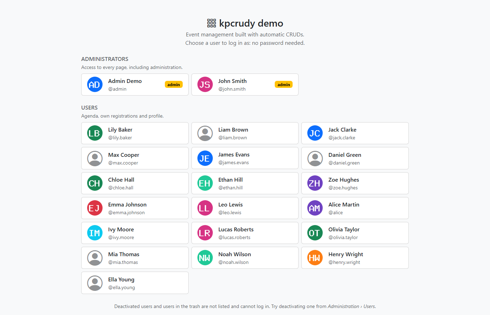

**Inici.** Estadístiques, propers esdeveniments i el mapa de la demo amb què ensenya cada pàgina.

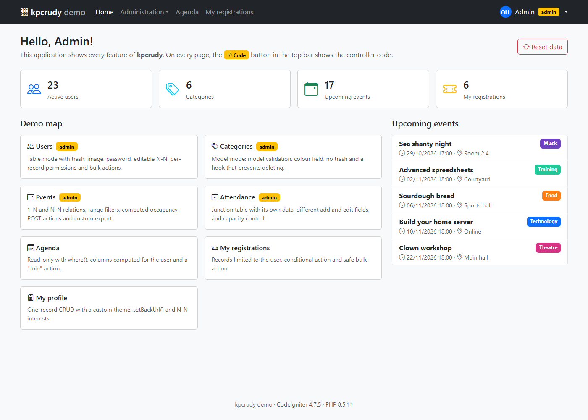

## Administració

**Usuaris.** Llistat amb foto, columnes calculades (nom complet, inscripcions), relació N-N (interessos), booleans, paperera, accions per fila, accions massives i exportació CSV.

**Esdeveniments amb filtres.** Filtres per llista (categoria, estat) i per rang (data, preu), combinables amb la cerca i l'ordenació. La columna d'ocupació es calcula per a cada fila.

**Fitxa de detall.** Relacions resoltes (categoria, creador), relació N-N d'assistents i accions pròpies: *Attendees*, *Duplicate*.

**Formulari.** Tipus de camp deduïts de la base de dades (text, desplegable de relació, data i hora, número, decimal, enum) i pujada d'imatge amb previsualització.

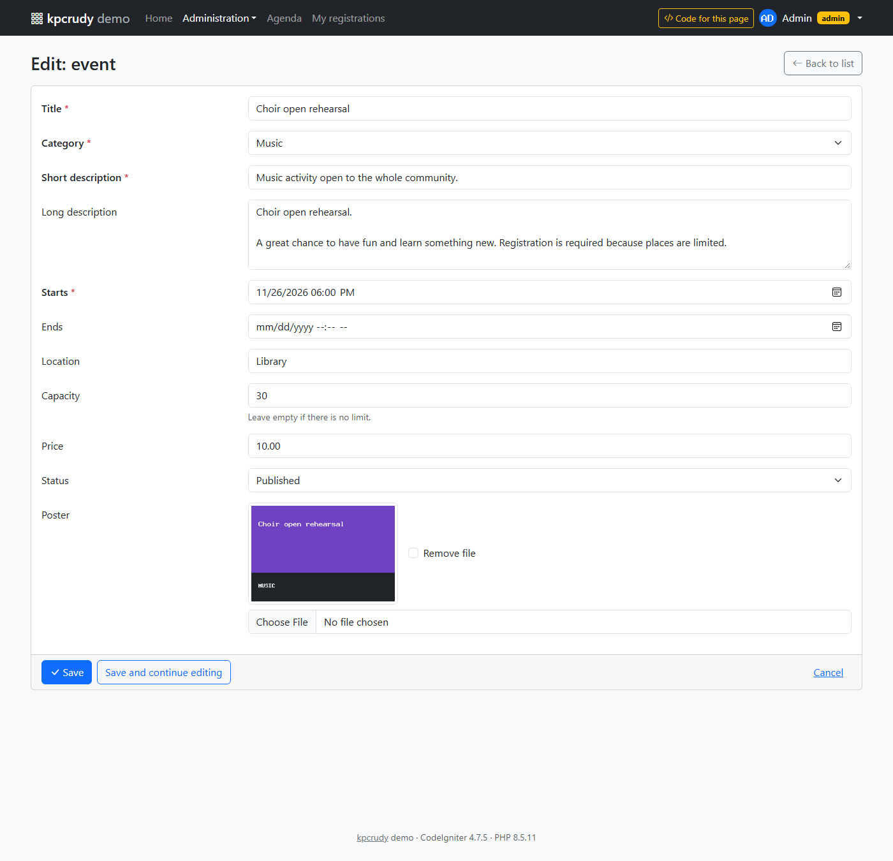

**Validació.** Regles de CodeIgniter (`is_unique` amb `{id}`, `min_length`...) i camps obligatoris deduïts de la taula. Els errors surten al costat de cada camp.

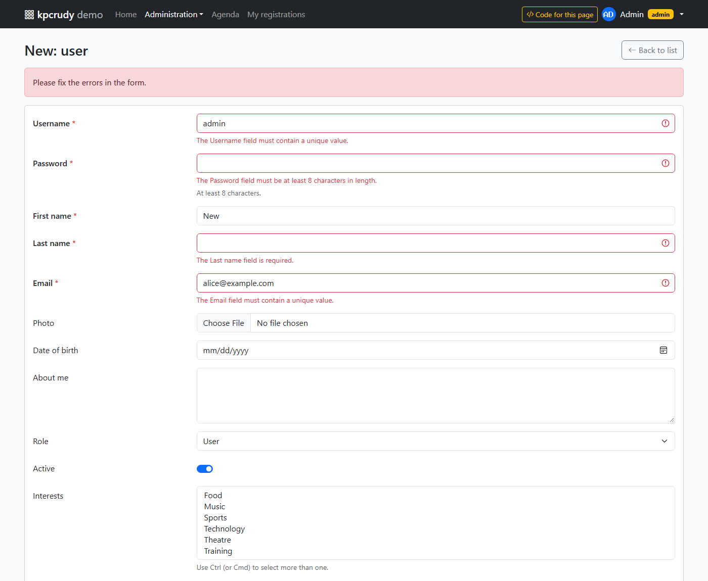

**Importació CSV: pujar el fitxer.** S'activa amb `enableImport()`. Es tria si cada fila s'afegeix sempre o actualitza el registre existent (aquí, pel nom d'usuari), i què passa amb les files amb errors. A la dreta hi ha les columnes que s'esperen i un botó per descarregar una plantilla.

**Importació CSV: previsualització.** Com s'han associat les columnes (`Notes` s'ignora), quantes files són noves, quantes s'actualitzaran i quines tenen errors, amb el motiu per línia. Les contrasenyes no es mostren.

**Importació CSV: resultat.** Resum i informe de les files saltades. L'última és un email repetit dins del mateix fitxer, que només es detecta en importar.

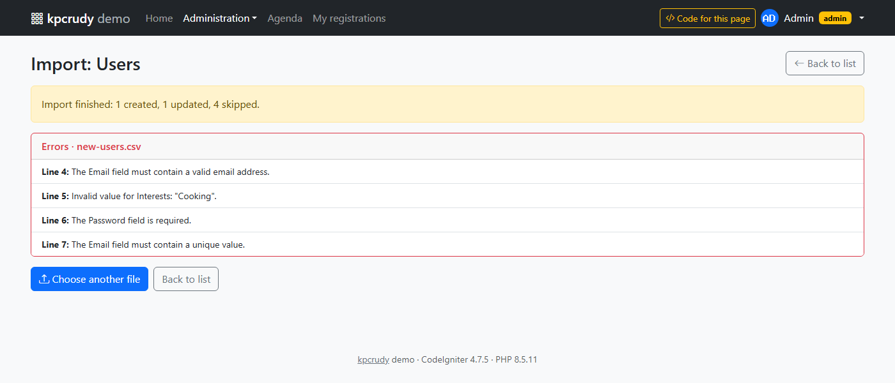

**Paperera.** Amb els *soft deletes* de CodeIgniter: restaurar, esborrar definitivament o buidar la paperera.

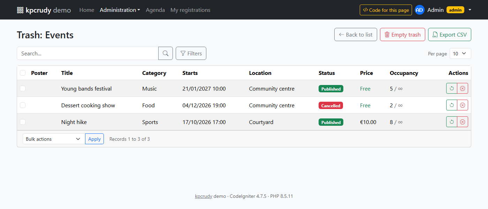

**Categories.** CRUD fet a partir d'un model de CodeIgniter, amb camp de color i sense paperera.

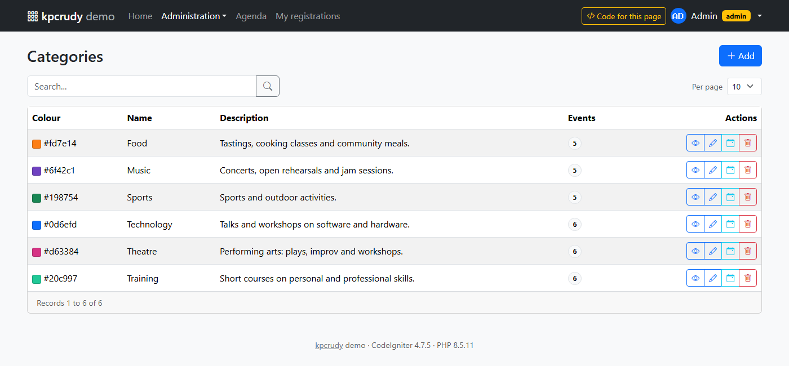

**Assistència.** CRUD sobre la taula de lligam entre usuaris i esdeveniments, obert ja filtrat per un esdeveniment des de la seva fitxa (`?f[event_id]=...`).

**Codi de cada pàgina.** El botó *Code for this page* mostra el mètode del controlador que genera el CRUD i, en una altra pestanya, les funcionalitats que s'hi veuen.

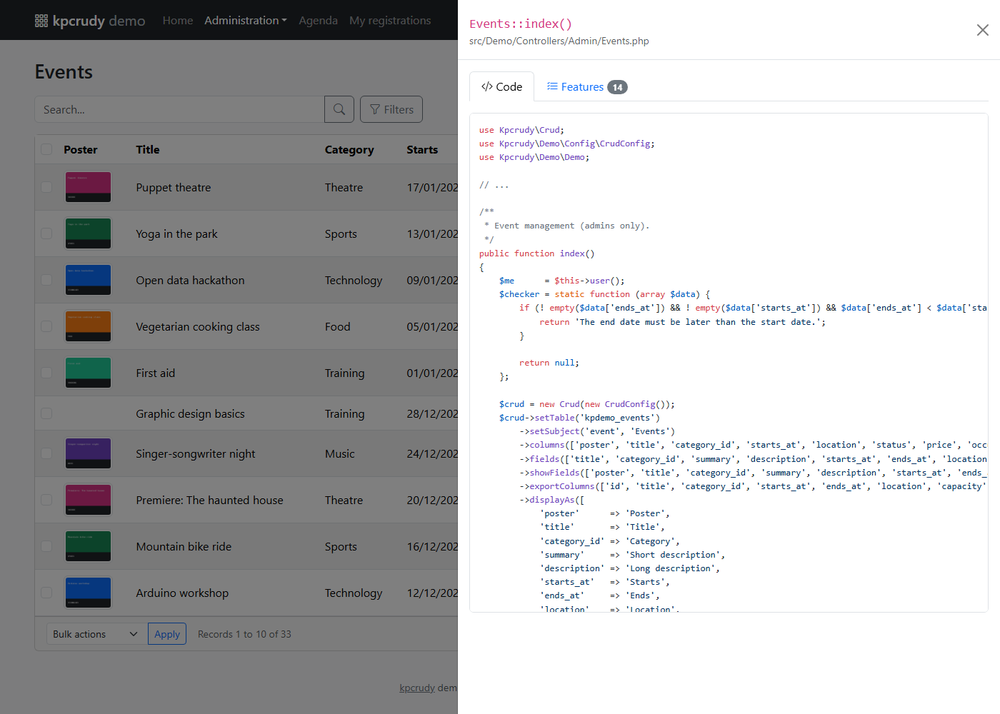

## Àrea d'usuari

**Agenda.** Només consulta i només esdeveniments publicats i futurs. El botó *Join* només surt si queden places i no hi estàs inscrit.

**Les meves inscripcions.** L'usuari només veu les seves. Les futures es poden anul·lar d'una en una o en bloc.

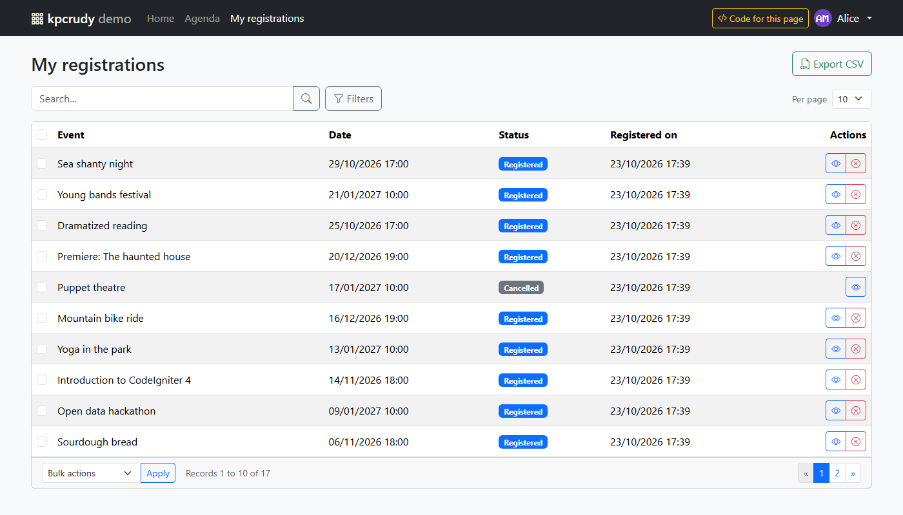

**El meu perfil.** CRUD d'un sol registre amb un tema propi per a la fitxa.

## Altres temes

El mateix CRUD amb els temes `w3css` i `tailwind` que inclou la llibreria (`$crud->setTheme('w3css')`). La guia [docs/new_theme_CA.md](../docs/new_theme_CA.md) explica com estan fets i com crear-ne un.

**W3.CSS.** Llistat amb els filtres oberts i formulari amb errors de validació.

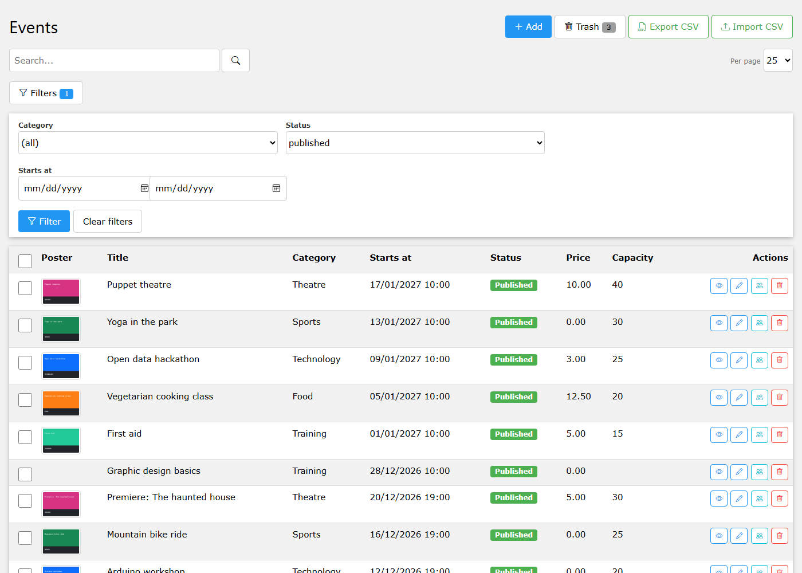

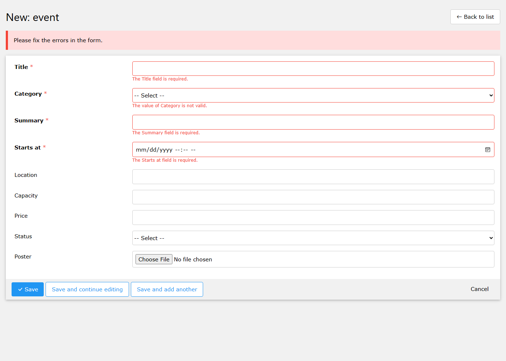

**Tailwind CSS.** Les mateixes pàgines.

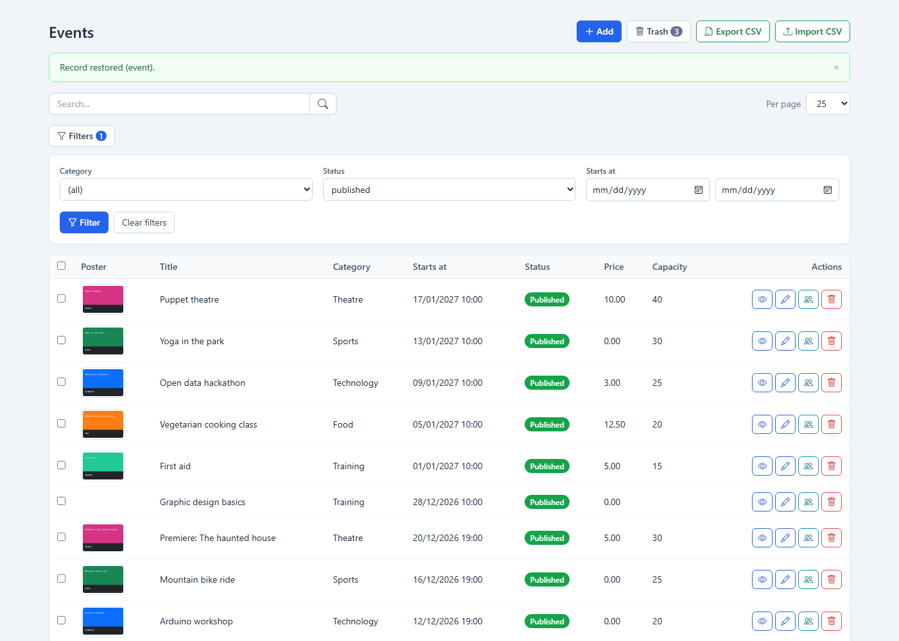

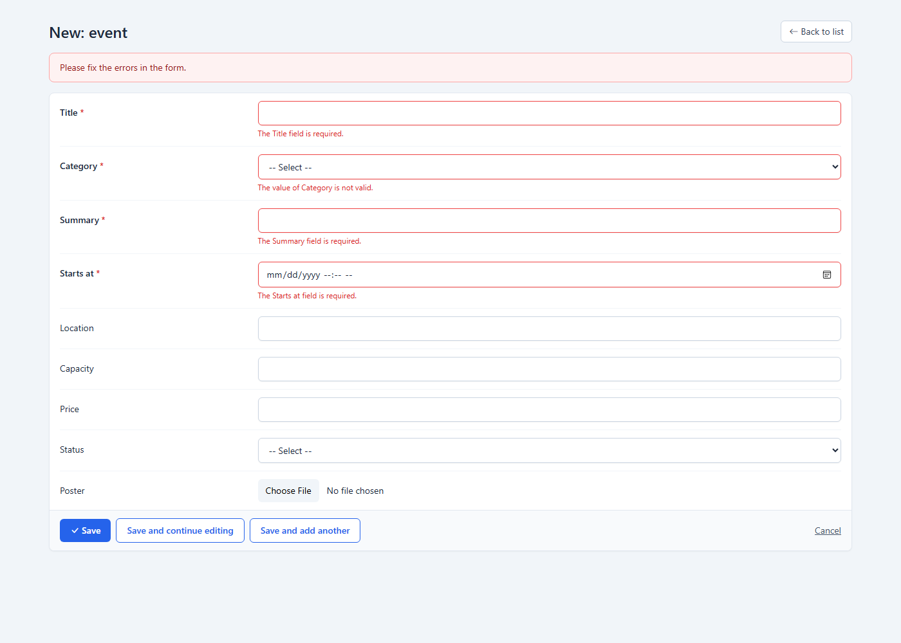
